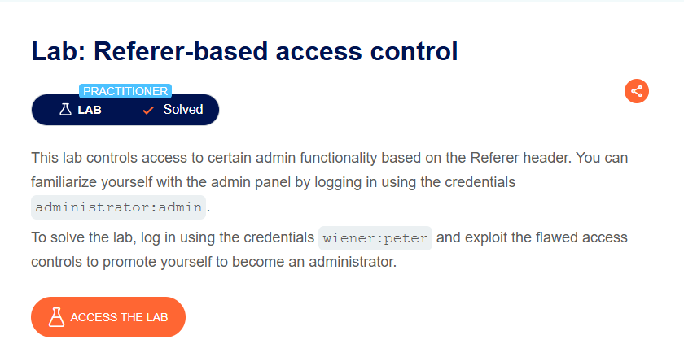
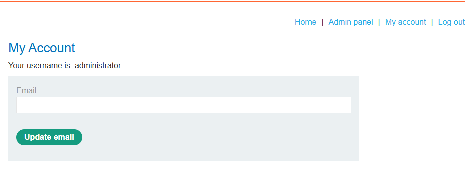
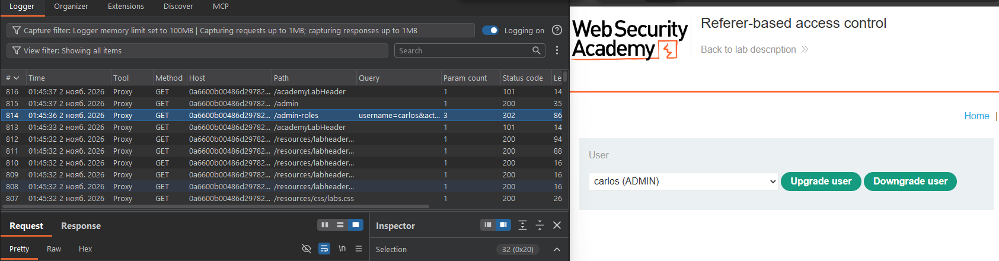
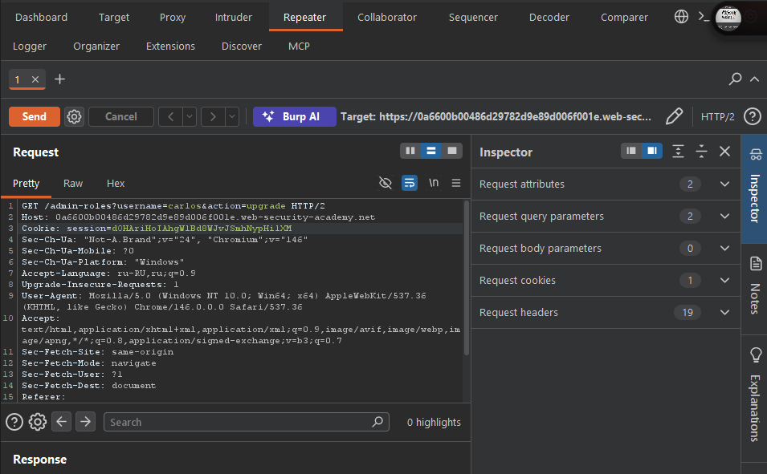
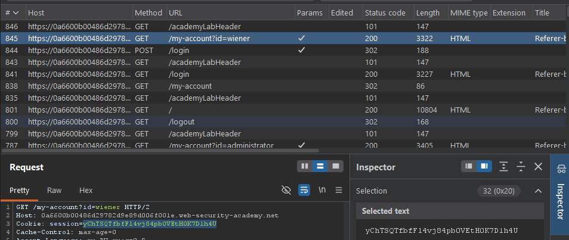
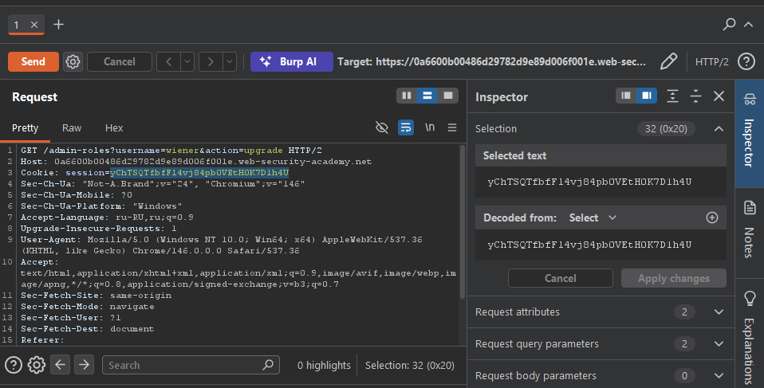
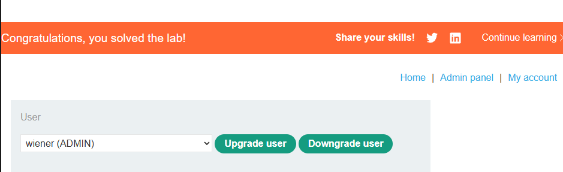

**Платформа:** PortSwigger Web Security Academy  
**Сложность:** Practitioner  
**Категория:** Access Control  
**Цель:** Войти как пользователь `wiener`, используя уязвимость контроля доступа на основе URL, и повысить свои права до администратора.

#### 1. Контекст и анализ поверхности

Приложение контролирует доступ к административным функциям на основе заголовка `Referer`. Задание предлагает сначала изучить админ-панель, войдя как `administrator:admin`, а затем, войдя как `wiener:peter`, повысить свои права.

**Шаг 1. Разведка админ-панели**

Входим в систему с учетными данными `administrator:admin`. Приложение перенаправляет на административную панель.

После входа приложение заходим на административную панель.

На панели видна функция повышения прав пользователя. Теперь необходимо понять, как эта функция обрабатывается на сервере, чтобы повторить запрос от имени обычного пользователя.

**Шаг 2. Анализ запроса на повышение прав**

Отправляем запрос. Сервер проверяет заголовок `Referer`, видит в нём `/admin` и считает, что запрос легитимен, приходящий от администратора. В результате запрос успешно выполняется, и пользователь `wiener` получает права администратора.

#### 2. Эксплуатация: Обход контроля доступа

**Шаг 1. Вход как обычный пользователь**

Выходим из системы и входим как `wiener:peter`. Сессионная cookie меняется на cookie обычного пользователя.

**Шаг 2. Попытка прямого доступа**

В Burp Repeater пытаемся отправить запрос на административный эндпоинт с cookie от `wiener`, но без корректного заголовка `Referer`. Сервер возвращает ошибку доступа (например, 401 Unauthorized или редирект), так как у пользователя нет прав.

**Шаг 3. Обход с помощью заголовка Referer**

Теперь в том же запросе вручную добавляем или изменяем заголовок `Referer` на URL административной панели, например `https://vulnerable-website.com/admin`. Это создаёт видимость того, что запрос инициирован со страницы администратора.

**Модифицированный запрос:**

Отправляем запрос. Сервер проверяет заголовок `Referer`, видит в нём `/admin` и считает запрос легитимным. Запрос успешно выполняется, и пользователь `wiener` получает права администратора.

#### 3. Impact

Уязвимость контроля доступа на основе заголовка `Referer` позволяет злоумышленнику обходить ограничения и выполнять действия с повышенными привилегиями. Это может привести к:

- **Повышению привилегий (Privilege Escalation):** Получение прав администратора или другой привилегированной роли.
- **Доступу к конфиденциальным функциям:** Использование функций, предназначенных только для администраторов (управление пользователями, настройка системы).
- **Нарушению целостности системы:** Изменение конфигураций, удаление данных и другие деструктивные действия.

#### 4. Recommendations

1. **Не полагайтесь на заголовок `Referer` для контроля доступа.** Заголовки HTTP, такие как `Referer`, легко подделываются и не являются надежным механизмом аутентификации или авторизации.
2. **Реализуйте серверную проверку сессии и ролей.** Контроль доступа должен основываться на проверке сессии пользователя и его роли на сервере. Каждый запрос к защищенному ресурсу должен проверять, имеет ли текущий пользователь необходимые права.
3. **Используйте токены CSRF.** Для защиты от межсайтовой подделки запросов (CSRF) используйте анти-CSRF токены в дополнение к проверке аутентификации.
4. **Принцип наименьших привилегий.** Пользователи должны иметь только те права, которые им действительно необходимы для выполнения их задач.